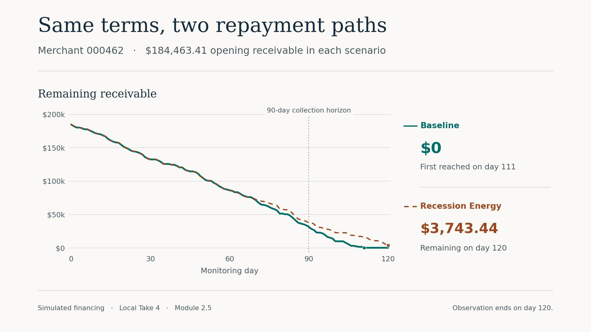

# When repayment follows sales

**How much working capital can a small business borrow against future sales, and what happens if those sales weaken?**

Andrew Goad’s Merchant Sales-Based Financing (MSBF) Strategy Simulator follows a financing request from sales and bank deposits through underwriting, counteroffers, funding and repayment. It evaluates the same synthetic applicants under Baseline and Recession Energy. The lender can change its offer under stress. Once an advance is funded, a share of each day’s eligible sales goes toward the contracted balance.

**[Explore the interactive studies](https://andrew-goad.github.io/merchant-sales-based-financing-strategy-simulator/)** · [Read the project guide](research-site/PROJECT_GUIDE.md) · [Design an experiment in the GUI](https://andrew-goad.github.io/merchant-sales-based-financing-strategy-simulator/#750b/experiment)

## One equipment repair, two repayment paths

In the **750 · Local GUI** study, merchant 000462 received **$146,600** for equipment repair in both scenarios. The agreement called for **$184,463.41** in total repayment from **9.7672%** of eligible daily sales. The first 60 collection days replayed the same sales. When the stress-affected dates entered the calculation on day 61, the balances began to diverge.

Baseline paid off on day 111. Under Recession Energy, **$3,743.44** remained at day 120. Of the 35 merchants funded in both scenarios, this merchant was the only one still owing money under stress. [Inspect the daily ledger](research-site/evidence/merchant_000462.csv)

## Compare five completed studies

Read each pair **Baseline → Recession Energy**. *Supportable* includes applications authorized for funding and those referred for review. *Open / funded* counts accounts with a positive ending balance among all accounts funded in that scenario. Each row follows its own synthetic population.

| Study | Supportable | Funded | Open / funded at day 120 | Daily monitoring records |
| --- | ---: | ---: | --- | ---: |
| [750 · Local DBeaver](https://andrew-goad.github.io/merchant-sales-based-financing-strategy-simulator/#750a/repayment) | 300 → 80 | 103 → 27 | 4/103 → 0/27 | 15,600 |
| [750 · Local GUI](https://andrew-goad.github.io/merchant-sales-based-financing-strategy-simulator/#750b/repayment) | 321 → 94 | 115 → 35 | 5/115 → 1/35 | 18,000 |
| [750 · AWS GUI](https://andrew-goad.github.io/merchant-sales-based-financing-strategy-simulator/#750c/repayment) | 318 → 72 | 110 → 26 | Not reported | 16,320 |
| [2,500 · AWS GUI](https://andrew-goad.github.io/merchant-sales-based-financing-strategy-simulator/#2500/repayment) | 1,055 → 269 | 329 → 100 | 22/329 → 7/100 | 51,480 |
| [25,000 · AWS GUI](https://andrew-goad.github.io/merchant-sales-based-financing-strategy-simulator/#25000/repayment) | 10,564 → 2,836 | 3,337 → 1,005 | 176/3,337 → 43/1,005 | 521,040 |

In the 25,000-merchant study, the share still open fell from **5.27% to 4.28%** across the two funded portfolios. Follow just the **1,005 merchants funded in both**, and the open count rises from **36 to 43**. The change in who qualified explains why those comparisons point in different directions. The Local DBeaver counts use certified ending balances. The other reported endpoints use outstanding contractual receivables. [Study sources, definitions and checks](research-site/evidence/STUDY_SOURCES.md)

The later 750-merchant runs provide a timing guide for the original DBeaver study. Computation took about **2 h on a local Windows desktop** (8 GB RAM, Core i5-2500K at 3.30 GHz) and **45 min on AWS EC2 Windows** (m7i-flex.4xlarge). The 2,500 study’s **2 h 24 min** combines two AWS module runs, with m7i.4xlarge as the reference configuration. The 25,000 study recorded **15 h 26 min** on AWS EC2 Windows (m7i-flex.4xlarge). [Timing records and measurement scope](research-site/evidence/execution_records.csv)

## Follow the work

| Reader’s question | Where to go |
| --- | --- |
| What does research on actual businesses tell us? | [Research and open questions](https://andrew-goad.github.io/merchant-sales-based-financing-strategy-simulator/#750b/sources) |
| How is the product designed, and which requirements govern it? | [Project guide](research-site/PROJECT_GUIDE.md) · [Module 2 business requirements and validation](docs/BRD_AND_VALIDATION_INDEX.md) |
| Where does the code turn sales into a payment? | [Numbered stage map](docs/README.md#stage-map) · [M2.5 daily monitoring](docs/guide/stages/M2_05.md) · [SQL that caps the payment at the remaining balance](Module_2/2.05_Daily_Remittance_Exposure_and_Portfolio_Monitoring/v0.2R5_ACCEPTED/src/current/03_166_generation.sql#L872) |
| How can I run a challenger or inspect a completed campaign? | [Windows setup and GUI walkthrough](https://andrew-goad.github.io/merchant-sales-based-financing-strategy-simulator/#750b/experiment) · [Reports by study](https://andrew-goad.github.io/merchant-sales-based-financing-strategy-simulator/#750b/reports) · [Andrew Goad’s Tableau Public collection](https://public.tableau.com/app/profile/andrew.goad/vizzes) |
| Can I reproduce the published figures? | [Evidence and reproduction commands](research-site/evidence/STUDY_SOURCES.md) · [Historical M2.5 stage acceptance](Module_2/2.05_Daily_Remittance_Exposure_and_Portfolio_Monitoring/v0.2R5_ACCEPTED/docs/VALIDATION_AND_ACCEPTANCE.md) · [Repository change log](CHANGELOG.md) |
