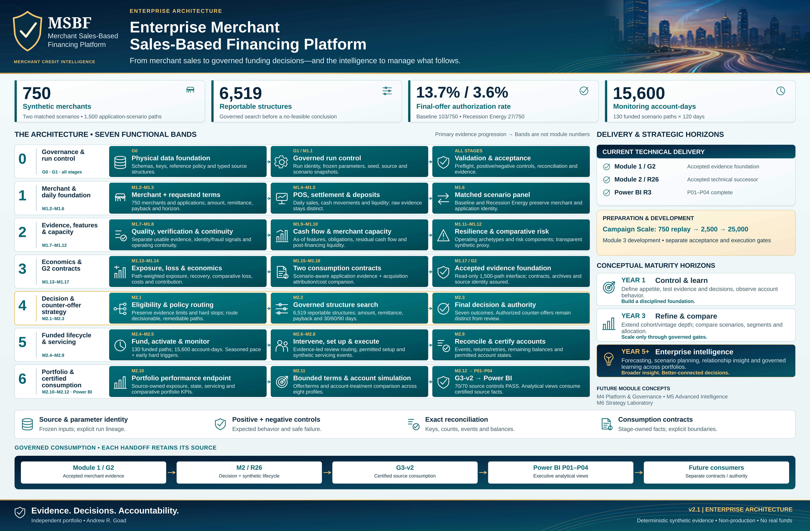
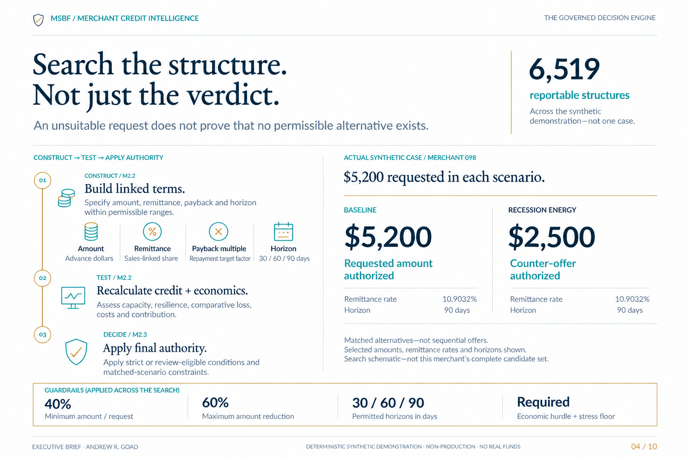
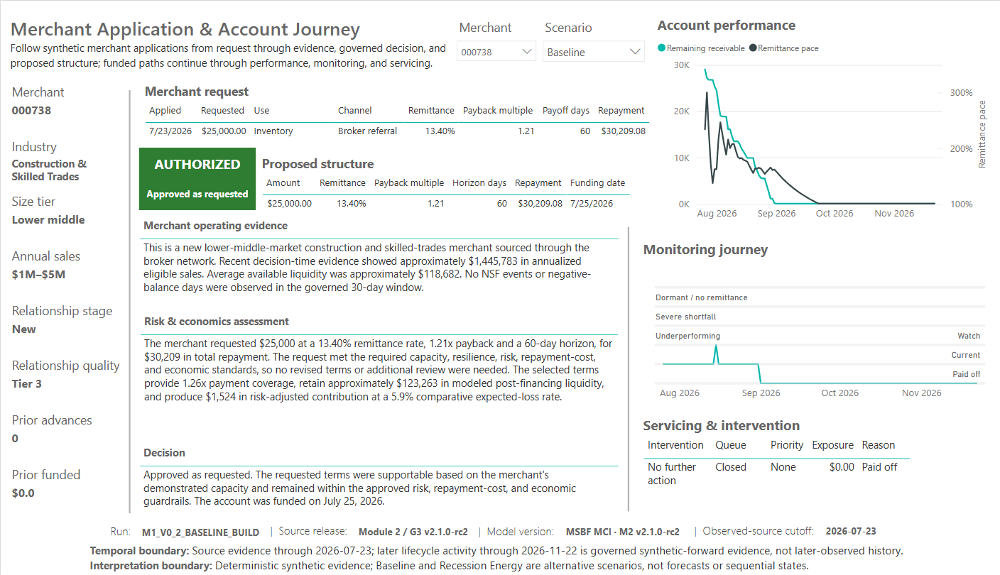
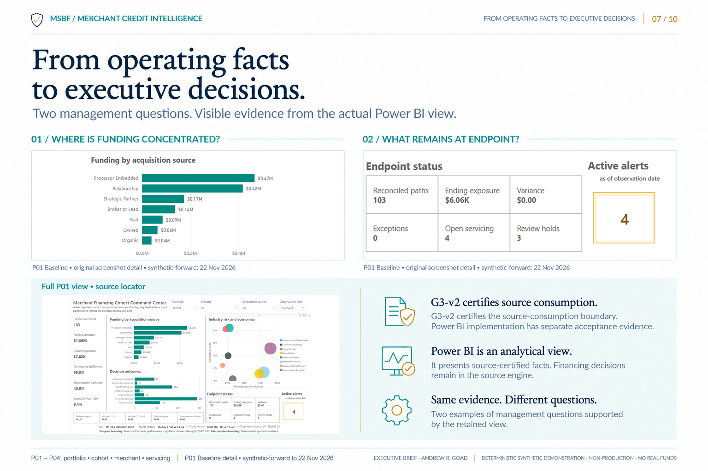
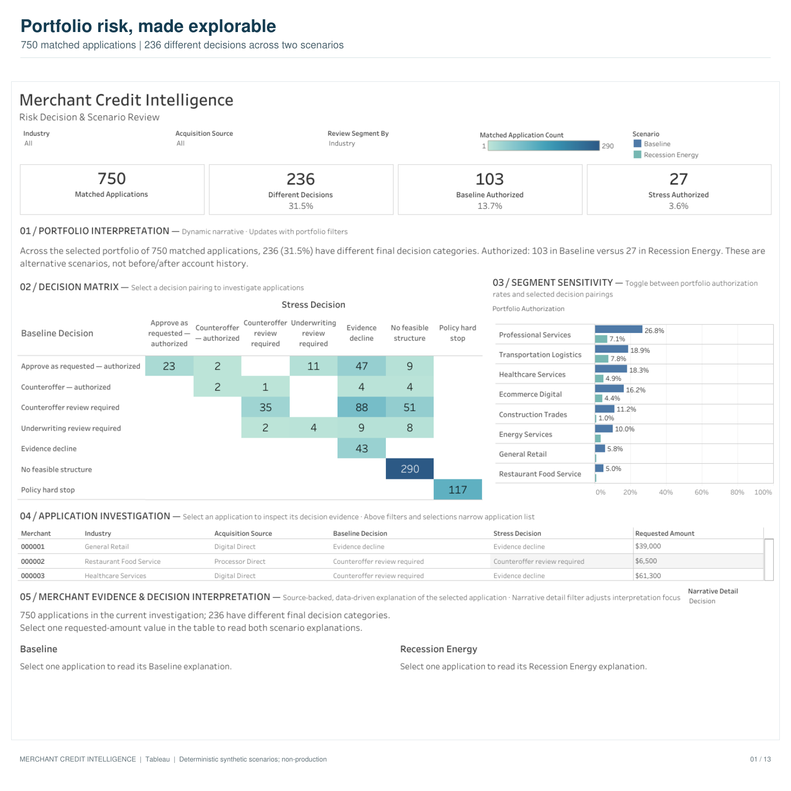
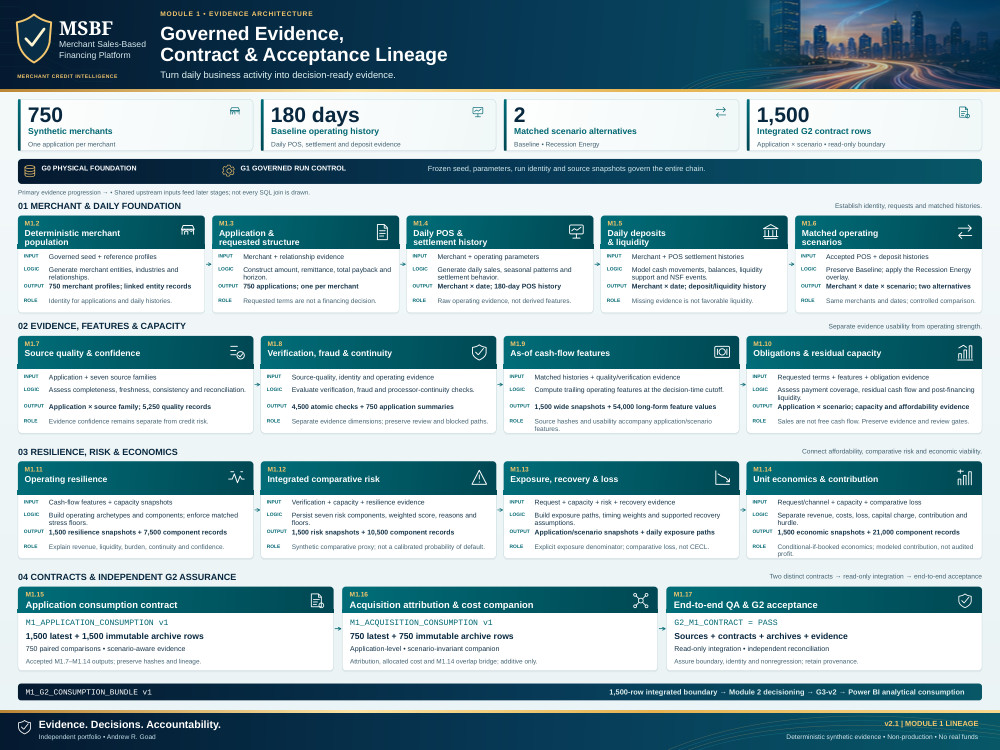
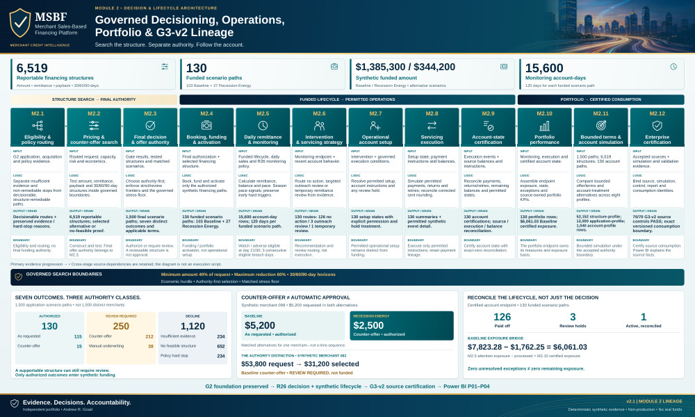

# MSBF · Merchant Credit Intelligence

### From merchant evidence to financing decisions—and the account that follows.

**An independent portfolio by Andrew R. Goad** · Merchant Sales-Based Financing Strategy Simulator

A merchant's sales can be strong while its requested financing is unsupportable. MSBF connects cash-flow evidence, permissible financing structures, explicit decision authority and account-level results—so a reviewer can understand not only the outcome, but the reasoning and records behind it.

**Start with the business story.** The frozen ten-page executive brief introduces financing for the merchant business—not credit for its shoppers.

[Read the ten-page executive brief](docs/portfolio_visuals/MSBF_VISUAL_PUBLIC_R1/assets/pitch/From_First_Advance_to_Intelligent_Portfolio.pdf) · [Explore the documentation](docs/README.md) · [What you can use now](docs/guide/CURRENT_USE.md) · [Explore Tableau](docs/tableau/README.md)

> **Scope:** deterministic synthetic demonstration · non-production · no real funds. Technical acceptance is documented at its recorded scope; [publication and supersession remain separate release actions](docs/release_integration/module_2_g3_v2_1/CURRENT_STATE.md).

## Three distinctions worth inspecting

**Sales are not capacity.** Existing commitments, usable evidence, operating-margin assumptions and liquidity change what a merchant can support. [Read the cash-flow calculation](docs/guide/stages/M1_10.md).

**A supportable structure is not funding permission.** The system can find a reviewable alternative without authorizing it. Construction and testing belong to M2.2; final authority belongs to M2.3. [Follow the structure-search explanation](docs/guide/stages/M2_02.md).

**A recommendation is not an executed action.** The funded-account chain separates intervention, setup permissions, permitted synthetic servicing and reconciliation. [Inspect the operating boundary](docs/guide/stages/M2_07.md).

## One connected system, explicit ownership

**Read the handoffs, not just the boxes.** Module 1 establishes evidence; Module 2 tests structures, resolves authority and follows funded paths. Power BI consumes the resulting facts; financing decisions remain in the source engine.

[Open the architecture at full resolution](docs/portfolio_visuals/MSBF_VISUAL_PUBLIC_R1/assets/architecture/png/Enterprise_Merchant_Sales_Based_Financing_Platform_v2_1.png) · [Read its vector/text PDF](docs/portfolio_visuals/MSBF_VISUAL_PUBLIC_R1/assets/architecture/pdf/Enterprise_Merchant_Sales_Based_Financing_Platform_v2_1.pdf) · [Browse all stages](docs/README.md#stage-map)

The demonstration has **750 synthetic merchants**, two alternative scenarios and **1,500 application-scenario paths**. Its funded lifecycle spans **130 scenario paths × 120 days = 15,600 monitoring rows**—not 130 distinct real customers or one live lending book. [Population and change evidence](docs/release_change_control/module_2_g3_v2_1/reports/02_DETAILED_CHANGE_LOG_AND_DATA_RECONCILIATION_REPORT.md).

## Search the structure—not just the verdict

**An unsuitable request does not rule out every alternative.** Construct terms together, reassess capacity and economics, then determine final authority separately.

Search respects a **40% minimum amount**, **60% maximum reduction**, **30/60/90-day horizons**, an economic hurdle and matched-scenario constraints. The **6,519 reportable structures** span the demonstration—not merchant 098 alone. Illustrated outcomes are scenario alternatives, not sequential offers or a before/after customer story. [Inspect the strategy change and guardrails](docs/release_change_control/module_2_g3_v2_1/reports/02_DETAILED_CHANGE_LOG_AND_DATA_RECONCILIATION_REPORT.md).

Synthetic merchant **082** provides the counterexample: its selected **$31,200** structure still requires review. [See why support does not confer authority](docs/portfolio_visuals/MSBF_VISUAL_PUBLIC_R1/assets/pitch/pages/05_Structure_and_Authority.png) · [Trace requirements, source and evidence](docs/guide/stages/M2_02.md).

## Explain the decision, not just the outcome

**Read the evidence and authority together.** The accepted P03 Application Journey connects both. [Open the original view at full resolution](docs/power_bi/m2_v2_1/assets/power_bi/core/p03_application_journey_738_baseline.png).

P03 translates source-owned merchant evidence, risk/economics, structure assessment and final authority into three business-facing layers: **Merchant operating evidence → Risk & economics assessment → Decision**. Technical rationale remains underneath; Power BI explains rather than makes the decision. Retained accepted narrative QA covers all **1,500 application-scenario paths**, not just the four curated cases.

**Terms cannot repair missing evidence. Terms can repair a structure problem.** Merchant **738** is authorized in Baseline but receives an evidence decline in Recession Energy, where the required 30-day POS window has only 28 usable days. Merchant **098** keeps access under that scenario through a governed **$2,500 counteroffer** on a $5,200 request. These are alternative deterministic synthetic assessments—not customer outcomes, forecasts or a claim of measured inclusion benefits.

[Explore the curated 738 / 098 / 082 / 749 decision cases](docs/guide/EXPLAINABILITY.md) · [Open the actual 738 evidence-decline view](docs/power_bi/m2_v2_1/assets/power_bi/core/p03_application_journey_738_recession_energy.png) · [Inspect the retained full-population narrative QA](docs/power_bi/m2_v2_1/docs/POWER_BI_VALIDATION_REPORT.md).

## Ask a portfolio question; follow the evidence

**Where is funding concentrated? What remains at the endpoint?** Read the retained Power BI evidence: zero reconciliation exceptions does not mean zero receivable.

This **P01 / Baseline** exhibit shows the synthetic-forward endpoint **22 November 2026**, with an observed-source cutoff of **23 July 2026**. Four visible experiences cover command center, cohort lifecycle, application journey and servicing/exceptions. G3-v2 source certification and Power BI implementation acceptance remain separate. [Report scope and source context](docs/power_bi/m2_v2_1/README.md).

[Open the original P01 screenshot](docs/portfolio_visuals/MSBF_VISUAL_PUBLIC_R1/assets/power_bi_reference/p01_command_center_baseline.png) · [View the accepted PBIX without changing it](docs/guide/CURRENT_USE.md#view-power-bi) · [Read the scenario comparison](docs/portfolio_visuals/MSBF_VISUAL_PUBLIC_R1/assets/pitch/pages/08_Scenario_Comparison.png)

The **53-page cohort report** traces decisions, segments, lifecycle results and merchant cases. **236 of 750 matched pairs (31.5%)** differ in final decision category between Baseline and Recession Energy—not a software-improvement rate or a count of lost approvals. [Cohort edition and calculation context](docs/portfolio_visuals/MSBF_VISUAL_PUBLIC_R1/assets/cohort/MSBF_Merchant_Credit_Intelligence_Initial_750_Cohort_Overview_R3_PATCH1_20260908_REVIEW.pdf).

## Investigate matched scenarios in Tableau

**[Merchant Credit Intelligence · Risk Decision & Scenario Review](docs/tableau/README.md)** adds an interactive Tableau review layer over the existing synthetic decision outputs. Compare **750 matched applications**, inspect the **236 category differences (31.5%)**, and follow a selected pairing into industry/channel concentration and merchant-level evidence.

**[Open the interactive Tableau Public dashboard](https://public.tableau.com/app/profile/andrew.goad/viz/MCI_Risk_Decision_Scenario_Review/RiskDecisionScenarioReview)**

**Identify → investigate → explain.** Portfolio filters update the indicators and interpretation. Matrix selections identify affected applications and their within-segment incidence. Merchant selections expose Decision, Evidence, Structure and Source rationale without reducing the portfolio indicators to a single application.

[Explore the Tableau companion](docs/tableau/README.md) · [Read the 13-page carousel](docs/tableau/docs/MCI_Risk_Decision_Scenario_Review_Carousel.pdf) · [Workbook and evidence notes](docs/tableau/docs/WORKBOOK_AND_EVIDENCE_NOTES.md)

This companion supplements Power BI rather than replacing it. The scenarios are alternatives, not sequential account outcomes; review is not authorization, and authorization does not establish funding. This is a documentation/portfolio addition, not a new simulator version or release.

## Choose your next level of detail

### Understand the evidence foundation

**Module 1:** merchant and request, daily evidence, quality, capacity, resilience, risk and economics. The application contract, acquisition-attribution companion and G2 acceptance are distinct finishing responsibilities.

[Explore Module 1](docs/guide/MODULE_1.md) · [Open full-size Module 1 lineage](docs/portfolio_visuals/MSBF_VISUAL_PUBLIC_R1/assets/architecture/png/Module_1_Governed_Evidence_Contract_and_Acceptance_Lineage_v2_1.png) · [Work through capacity](docs/guide/stages/M1_10.md)

### Follow decisioning into operations

**Module 2:** eligibility, structure search and final authority lead into funding, monitoring, intervention, setup, servicing, reconciliation, portfolio analysis and certification. Open the full-size lineage for detailed stage fields.

[Explore Module 2](docs/guide/MODULE_2.md) · [Open full-size Module 2 lineage](docs/portfolio_visuals/MSBF_VISUAL_PUBLIC_R1/assets/architecture/png/Module_2_Governed_Decisioning_Operations_and_G3v2_Lineage_v2_1.png) · [Follow setup into servicing](docs/guide/stages/M2_07.md)

### Learn, explain or challenge the result

The **23-page masterclass** opens calculations and binding reasons through four acts, worked merchant cases and visible exercise answers. Engineering, executive, analytical and teaching views serve different reading tasks—not copies of one layout.

[Masterclass and answer key](docs/portfolio_visuals/MSBF_VISUAL_PUBLIC_R1/assets/teaching/companion/LEARNING_GUIDE.md) · [How the decision engine works](docs/portfolio_visuals/MSBF_VISUAL_PUBLIC_R1/assets/posters/MSBF_MCI_How_the_Governed_Decision_Engine_Works_v2_1_COPYFIX_R1.png) · [What happens after the decision](docs/portfolio_visuals/MSBF_VISUAL_PUBLIC_R1/assets/posters/MSBF_MCI_What_Happens_After_the_Decision_v2_1_COPYFIX_R1.png) · [All five visual families](docs/portfolio_visuals/MSBF_VISUAL_PUBLIC_R1/GALLERY.md)

**Two end-to-end explainers.** [How the Governed Decision Engine Works](docs/guide/LEARNING.md#how-the-governed-decision-engine-works) connects merchant evidence, eligibility, search and final authority. [What Happens After the Decision](docs/guide/LEARNING.md#what-happens-after-the-decision) follows authorized paths through monitoring, permission, servicing and certification. Read each portrait separately at full resolution.

## What this portfolio makes inspectable

Built by Andrew R. Goad as an end-to-end demonstration of credit strategy, analytical engineering, risk governance, portfolio intelligence and executive decision support.

Inspect that synthesis through the [complete stage-reading map](docs/README.md#stage-map), [change-control reports](docs/release_change_control/module_2_g3_v2_1/README.md), analytical report and teaching material: cash-flow tests, authority boundaries and relational contracts that make the reasoning traceable.

**Development and assurance:** AI-assisted development and a documented project assurance workstream. [Read the provenance and history](docs/guide/SOURCE_VERSIONS.md#development-and-project-assurance).

## Current use and release boundary

Read the source and explanations, inspect retained analytical views, verify files, or consult the qualified **portable checkpoint restore plus isolated M2.11/M2.12/G3-v2 replay** procedure. Route B requires private retained checkpoints; Route D is unqualified, and no generalized fresh-campaign launcher is provided. [Choose a supported activity](docs/guide/CURRENT_USE.md).

This is a local editorial candidate, not a live release. [Current authority and remaining release gates](docs/release_integration/module_2_g3_v2_1/CURRENT_STATE.md).

Campaign Scale and Module 3 remain separately gated development. Arbitrary new campaigns, planned 2,500/25,000 progression and autonomous operation are not delivered capabilities. [Read the scoped roadmap](docs/README.md#future-work-and-release-records).