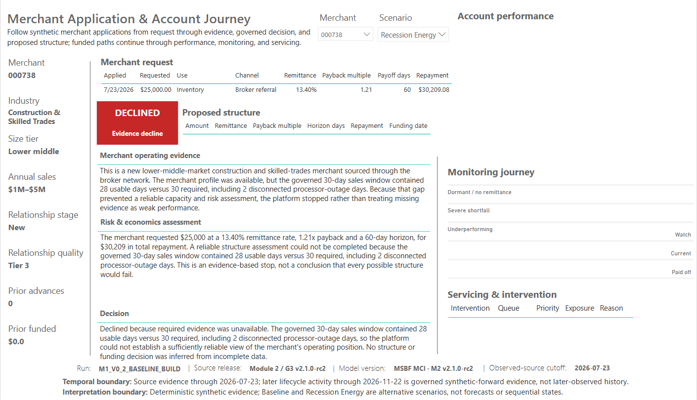
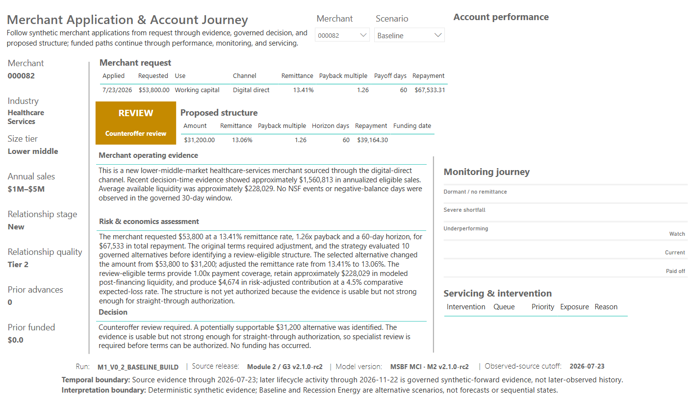
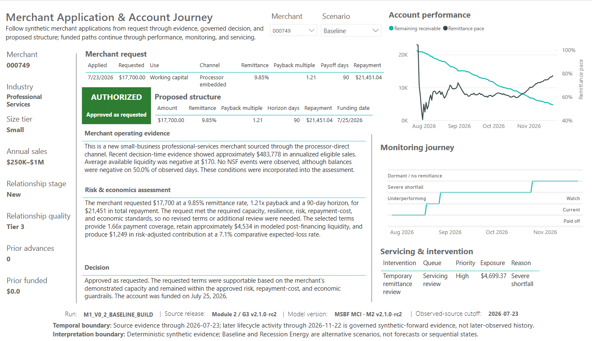

# Explain the decision, not just the outcome

[Portfolio home](../../README.md) · [Documentation portal](../README.md) · [Current use](CURRENT_USE.md)

P03 turns a source-owned decision into an explanation that a business reader can follow, while preserving the technical reasons a specialist needs to challenge it. Start with four deliberately chosen synthetic cases—not an exhaustive screenshot gallery.

## A business-facing explanation with retained technical rationale

P03 is the Application Journey: a selected merchant/application **under one scenario**, followed from its request and operating context through the governed decision and, where funding occurred, the account lifecycle. It does not merely repeat an approval label.

**Merchant operating evidence**

**Business-facing question:** What do we know about this business, and is the evidence usable? **Retained basis:** Merchant context, decision-time sales/liquidity, verification and evidence availability.

**Risk & economics assessment**

**Business-facing question:** What do the request and any selected terms imply? **Retained basis:** Requested/selected structure, capacity, modeled liquidity, risk/loss, economics and review conditions.

**Decision**

**Business-facing question:** Why is this outcome permitted, required for review or declined? **Retained basis:** Source-owned final outcome, binding gates/reasons and applicable funding context.

The retained strategy output includes `evidence_why_text`, `underwriting_why_text` and `decision_why_text`, alongside exact selected-term and binding-policy fields. The report's business narratives are presentation derivatives; the technical rationale is not replaced by polished prose. Labels and narrative tables explain source decisions rather than reconstructing feasibility, selection or final authority in Power BI.

[P03 business requirements](../power_bi/m2_v2_1/docs/POWER_BI_BUSINESS_REQUIREMENTS.md#113-p03---application-journey) · [Canonical report composition and source rules](../power_bi/m2_v2_1/docs/CANONICAL_SOURCE_OF_TRUTH.md) · [Exact strategy output carrier](../../successor_candidates/m2-g3-v2.1-r26-integration/source/inputs/PHASE2C_R4_STRATEGY.zip).

## 738 versus 098: evidence failure is not structure failure

### 738 · Terms cannot repair missing evidence

**Baseline:** `APPROVE_AS_REQUESTED_AUTHORIZED`; $25,000 is authorized and a funded lifecycle is present. The accepted screenshot includes the three narratives as well as account performance, monitoring and servicing context.

The three narrative layers remain readable alongside the request and account context. Values shown after the observed cutoff are synthetic-forward evidence. [Open the unchanged source at full resolution](../power_bi/m2_v2_1/assets/power_bi/core/p03_application_journey_738_baseline.png).

**Recession Energy:** `DECLINE_INSUFFICIENT_EVIDENCE`. The required 30-day eligible-sales window contains **28 usable POS days**; the other **two days are disconnected processor-outage days**. The evidence is insufficient for a reliable capacity/risk assessment; this is not the claim that every possible set of terms was tested and failed.

The absent funded-performance and servicing rows are the correct nonfunded boundary—not zero-valued results from an imaginary account. [Open the unchanged source at full resolution](../power_bi/m2_v2_1/assets/power_bi/core/p03_application_journey_738_recession_energy.png).

### 098 · Terms can repair a structure problem

Merchant 098 requests **$5,200** in each scenario. Baseline is `APPROVE_AS_REQUESTED_AUTHORIZED` at $5,200; Recession Energy is `COUNTEROFFER_AUTHORIZED` at **$2,500**, with the governed 90-day horizon and 10.9032% remittance shown in the frozen case exhibit.

The source retains an independently selected candidate and the governed result after matched-scenario non-improvement constraints. The final amount is therefore not an unconstrained sensitivity estimate. This is how structure search can preserve an authorized path without pretending missing evidence can be repaired by lending less.

There is no separately approved merchant-098 P03 screenshot in this public core set. This route uses the exact selected-decision records and accepted pitch/classroom case instead of inventing a capture or importing private QA imagery.

[Frozen executive 098 comparison](../portfolio_visuals/MSBF_VISUAL_PUBLIC_R1/assets/pitch/pages/04_Structure_Search.png) · [Matched-scenario classroom case](../portfolio_visuals/MSBF_VISUAL_PUBLIC_R1/assets/teaching/pages/15_Matched_Scenario_Case_098.png) · [Open the governed search mechanics](stages/M2_02.md).

## 082 · A reviewable alternative is not funding

**Baseline:** `COUNTEROFFER_REVIEW_REQUIRED` selects **$31,200** against the $53,800 request. The retained technical gates are `HUMAN_JUDGMENT` and `R1_CAPACITY_COMPOSITE`; the reason fields preserve medium-data-confidence and capacity-review conditions. P03 translates that into an understandable review-required explanation while leaving the proposed terms visible.

The selected structure is shown, but the blank funding/lifecycle fields do not falsely imply permission to fund. [Open the unchanged source at full resolution](../power_bi/m2_v2_1/assets/power_bi/core/p03_application_journey_082_baseline.png).

**Recession Energy:** the governed final outcome is `DECLINE_NO_FEASIBLE_STRUCTURE`. The source separately records an independent review result, then the matched Baseline term non-improvement floor with `BASELINE_TERM_NONIMPROVEMENT_NO_ELIGIBLE_CANDIDATE`. That governed/independent distinction matters: the final stress result is not accurately explained by saying only that risk “got worse.” No separate public 082 stress P03 capture is added here.

[Read the accepted 082 candidate-boundary lab](../portfolio_visuals/MSBF_VISUAL_PUBLIC_R1/assets/teaching/pages/12_Candidate_Lab_082.png) · [Follow final authority](stages/M2_03.md).

## 749 · Approval does not end the explanation

**Baseline:** `APPROVE_AS_REQUESTED_AUTHORIZED` at **$17,700**. The accepted narrative distinguishes observed negative average available liquidity from **modeled post-financing liquidity**; it does not rewrite historical evidence to make approval look simpler. The account then has monitored performance and a retained active-servicing/reconciliation path.

P03 keeps the unfavorable observed evidence visible while explaining the permitted terms and later account context. The screenshot is not a new servicing action. [Open the unchanged source at full resolution](../power_bi/m2_v2_1/assets/power_bi/core/p03_application_journey_749_baseline.png).

**Recession Energy:** `MANUAL_UNDERWRITING_REVIEW_REQUIRED`, with capacity and resilience review gates. A selected requested-structure record remains $17,700, but the review outcome is not funding authority. The source scenario is separate from the Baseline account's later chronology; do not narrate these as a single real borrower's progression.

[Read 749’s monitoring chronology](../portfolio_visuals/MSBF_VISUAL_PUBLIC_R1/assets/teaching/pages/19_Monitoring_Case_749.png) · [Read the retained payment/retry mechanics](stages/M2_08.md) · [Read account-state reconciliation](stages/M2_09.md).

## Full-population QA—not just attractive examples

The retained validation report records **VAL-P03-001:** the 738 scenario pair, two PASS rows; **VAL-P03-002:** zero narrative failures; and **VAL-P03-003:** 1,500 unique application-scenario paths, PASS only. The BRD requires all seven outcomes and material reason branches to remain scenario-isolated. Funded-path monitoring has its own 130-path / 15,600-row coverage.

Those are retained accepted QA results, not tests rerun during this documentation build. Four curated cases demonstrate concepts; they are not a replacement for full-population evidence. G3-v2's source-certification controls and the report's separate Power BI acceptance also remain distinct.

[Read the exact P03 validation section](../power_bi/m2_v2_1/docs/POWER_BI_VALIDATION_REPORT.md#13-p03-narrative-and-application-journey-validation) · [Open the report requirements/traceability/validation registers](../power_bi/m2_v2_1/registers).

## How to interpret every view on this page

The observed-source cutoff is **23 July 2026**. Later lifecycle evidence through **22 November 2026** is governed synthetic-forward evidence—not subsequently observed merchant history. Baseline and Recession Energy are alternative scenarios, not forecasts or sequential states. Screenshot rounding is presentation; exact source fields retain their precision. The original images and accepted PBIX remain unchanged.

[Return to portfolio and cohort reading](ANALYTICS.md) · [View the accepted report without assuming new-data refresh qualification](CURRENT_USE.md#view-power-bi).

*Deterministic synthetic demonstration · Non-production · No real funds. This current-reading page does not alter source-of-record evidence.*
