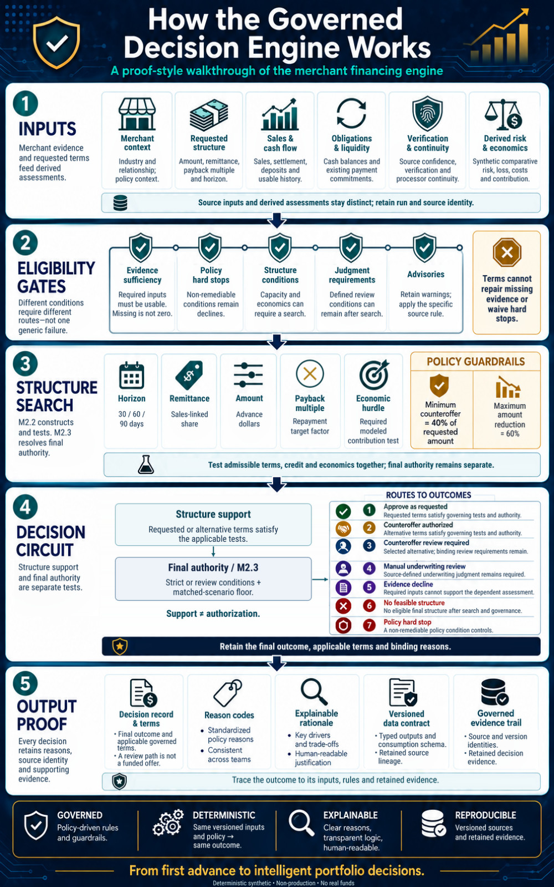
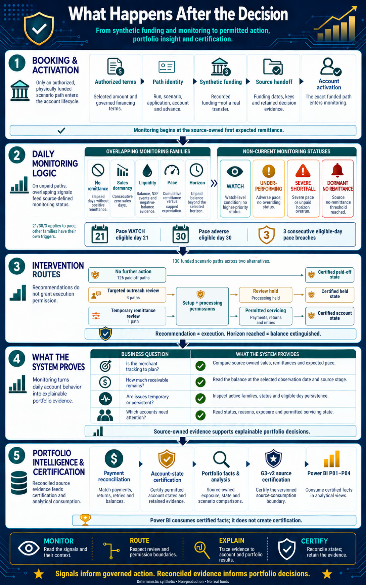

# Learn the mechanism · Orient, calculate, explain

[Portfolio home](../../README.md) · [Documentation portal](../README.md) · [Current use](CURRENT_USE.md)

The two corrected posters provide the short end-to-end explanations. The masterclass opens the underlying mechanics. They have different jobs and remain distinct visual families.

## How the Governed Decision Engine Works

**Question answered:** how do merchant evidence and requested terms pass through eligibility, structure search and final authority to a retained decision record?

The poster is a compact end-to-end orientation, not an exhaustive architecture or a new technical source. [Open the accepted full-resolution poster](../portfolio_visuals/MSBF_VISUAL_PUBLIC_R1/assets/posters/MSBF_MCI_How_the_Governed_Decision_Engine_Works_v2_1_COPYFIX_R1.png).

Read the four search dimensions as amount, remittance, payback multiple and horizon. Required economics and matched-scenario constraints remain. A supportable structure is not final authority, and terms do not repair missing critical evidence or waive policy hard stops.

## What Happens After the Decision

**Question answered:** how does an authorized funded path move through monitoring, recommendation, explicit permission, servicing and certified portfolio evidence?

The portrait explains alternate operating routes and their permissions, not an inevitable escalation staircase. [Open the accepted full-resolution poster](../portfolio_visuals/MSBF_VISUAL_PUBLIC_R1/assets/posters/MSBF_MCI_What_Happens_After_the_Decision_v2_1_COPYFIX_R1.png).

Keep raw monitoring conditions, five operational families and resolved status separate. Recommendation is not execution. An unpaid horizon does not erase a receivable. Reconciled source evidence and G3-v2 certification precede Power BI consumption.

## Open the mechanism in the masterclass

The frozen masterclass contains **23 pages: 22 lessons and a closing synthesis**. Its four acts move from the merchant, to the request, through search/decision, and into the funded account. Page count describes the teaching format, not an acceptance or capability total.

| Learning question | Exact accepted lesson |
|---|---|
| What cash remains after obligations and requested financing? | [04 Capacity Worked Case 098](../portfolio_visuals/MSBF_VISUAL_PUBLIC_R1/assets/teaching/pages/04_Capacity_Worked_Case_098.png) |
| Why can changing one term leave burden unchanged? | [08 Term Sensitivity Lab](../portfolio_visuals/MSBF_VISUAL_PUBLIC_R1/assets/teaching/pages/08_Term_Sensitivity_Lab.png) |
| Which candidate crosses feasibility but still needs review? | [12 Candidate Lab 082](../portfolio_visuals/MSBF_VISUAL_PUBLIC_R1/assets/teaching/pages/12_Candidate_Lab_082.png) |
| How do seven outcomes preserve meaningful distinctions? | [14 Seven Outcomes and Drivers](../portfolio_visuals/MSBF_VISUAL_PUBLIC_R1/assets/teaching/pages/14_Seven_Outcomes_and_Drivers.png) |
| When is a pace signal eligible and persistent? | [18 Pace and Persistence](../portfolio_visuals/MSBF_VISUAL_PUBLIC_R1/assets/teaching/pages/18_Pace_and_Persistence.png) |
| How do returns and retries reconcile? | [21 Return Retry Reconciliation](../portfolio_visuals/MSBF_VISUAL_PUBLIC_R1/assets/teaching/pages/21_Return_Retry_Reconciliation.png) |

[Read the masterclass PDF](../portfolio_visuals/MSBF_VISUAL_PUBLIC_R1/assets/teaching/MSBF_MCI_Merchant_POS_Lending_Masterclass_v2_1.pdf) · [Learner/instructor guide](../portfolio_visuals/MSBF_VISUAL_PUBLIC_R1/assets/teaching/companion/LEARNING_GUIDE.md) · [Visible exercise answers and explanations](../portfolio_visuals/MSBF_VISUAL_PUBLIC_R1/assets/teaching/companion/EXERCISE_ANSWER_KEY.md) · [Read-only code/evidence map](../portfolio_visuals/MSBF_VISUAL_PUBLIC_R1/assets/teaching/companion/READ_ONLY_CODE_MAP.md).

## A worked reading route

Begin with the two posters for the relationships. Use the masterclass to inspect the inputs and arithmetic. Then read the corresponding stage companion and exact source. The teaching material distinguishes illustrative arithmetic from actual exported synthetic cases; neither category should be relabeled a measured real-world result.

For the strongest contrast, use merchant 738's missing evidence and merchant 098's smaller permissible structure. Then compare 082's reviewable alternative and 749's active-account story. The [P03 explainability route](EXPLAINABILITY.md) keeps those cases source-bound and scenario-isolated.

[Choose another visual tradition](VISUALS.md) · [Study Module 1 mechanics](MODULE_1.md) · [Study Module 2 mechanics](MODULE_2.md).

*Deterministic synthetic demonstration · Non-production · No real funds. This current-reading page does not alter source-of-record evidence.*
