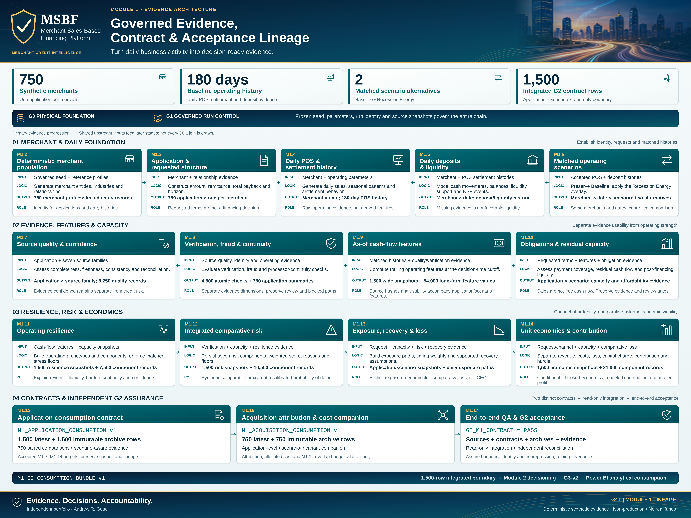

# Module 1 · Turn daily merchant activity into decision-ready evidence

[Portfolio home](../../README.md) · [Documentation portal](../README.md) · [Current use](CURRENT_USE.md)

Sales begin the question. Usable evidence, existing obligations, cash-flow capacity, resilience and economics determine what can be assessed. The 17 documentation entries below include the charter and 16 implemented stage entries; they are not a new execution recipe.

**Follow input → logic → output/grain → consumer.** The original engineering exhibit keeps the evidence transformations and final contracts visible. [Open the unchanged source at full resolution](../portfolio_visuals/MSBF_VISUAL_PUBLIC_R1/assets/architecture/png/Module_1_Governed_Evidence_Contract_and_Acceptance_Lineage_v2_1.png).

## Frame the design

The charter describes intent; it is not a generator.

[M1.1 · Charter, architecture and requirements](stages/M1_01.md)  

## Build merchant and request context

Identity, requested terms, daily POS/deposit histories and matched scenario overlays are separate responsibilities.

[M1.2 · Deterministic merchant population](stages/M1_02.md)  
[M1.3 · Application and requested structure](stages/M1_03.md)  
[M1.4 · Daily POS, settlement and merchant ecosystem](stages/M1_04.md)  
[M1.5 · Daily deposit and liquidity history](stages/M1_05.md)  
[M1.6 · Matched POS and deposit scenarios](stages/M1_06.md)  

## Assess evidence and capacity

Quality and verification govern usability; as-of features and obligations/liquidity establish what can actually be assessed.

[M1.7 · Source quality and data confidence](stages/M1_07.md)  
[M1.8 · Verification, fraud and continuity](stages/M1_08.md)  
[M1.9 · As-of cash-flow features](stages/M1_09.md)  
[M1.10 · Obligations, liquidity and capacity](stages/M1_10.md)  

## Translate resilience, risk and economics

Keep operating resilience, comparative risk, loss and contribution distinct; none is an approval by itself.

[M1.11 · Cash-flow archetypes and operating resilience](stages/M1_11.md)  
[M1.12 · Merchant risk components and integrated proxy](stages/M1_12.md)  
[M1.13 · Exposure, recovery and comparative expected loss](stages/M1_13.md)  
[M1.14 · Unit economics and risk-adjusted contribution](stages/M1_14.md)  

## Finish three different contracts

M1.15 supplies application consumption. M1.16 supplies attribution/acquisition cost. M1.17 certifies the integrated G2 boundary.

[M1.15 · Latest, archive, comparison and application contract](stages/M1_15.md)  
[M1.16 · Acquisition attribution and merchant acquisition cost](stages/M1_16.md)  
[M1.17 · End-to-end QA and G2 acceptance](stages/M1_17.md)  

## Read at the right grain

The foundational panel is merchant/date; later observations become application/scenario as of the request. M1.15 packages the accepted application evidence, while M1.16 preserves a distinct attribution/cost grain. An available historical balance is not the same thing as a modeled post-financing liquidity buffer. An integrated comparative risk proxy is not a probability-of-default estimate.

The R26 strategy successor preserves Module 1 technical bytes. Each companion therefore explains the accepted original version and its validation, while the later policy/lifecycle change belongs in Module 2. The original charter numbering and the unavailable exact M1.17 standalone v0.2R2 program caveat remain visible as provenance—not silently corrected originals.

[Open the original requirements/validation route](REQUIREMENTS_AND_VALIDATION.md) · [Continue to Module 2](MODULE_2.md).

*Deterministic synthetic demonstration · Non-production · No real funds. This current-reading page does not alter source-of-record evidence.*
