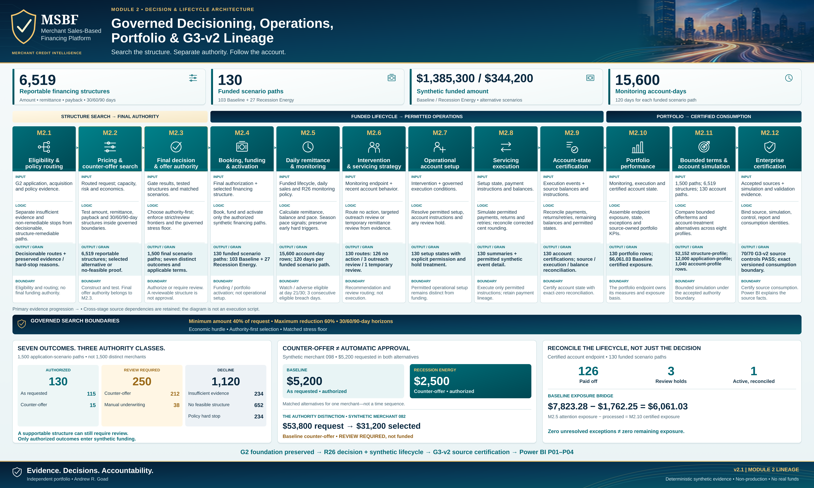

# Module 2 · Govern the decision and the account that follows

[Portfolio home](../../README.md) · [Documentation portal](../README.md) · [Current use](CURRENT_USE.md)

A requested structure may fail while a permissible alternative remains. Finding that alternative still does not grant authority. Once funding is authorized, the account needs its own monitored, permitted and reconciled lifecycle.

**Search the structure. Separate authority. Follow the account.** The engineering view preserves twelve stage responsibilities. [Open the unchanged source at full resolution](../portfolio_visuals/MSBF_VISUAL_PUBLIC_R1/assets/architecture/png/Module_2_Governed_Decisioning_Operations_and_G3v2_Lineage_v2_1.png).

## Route, construct, authorize

M2.1 separates evidence and policy routes. M2.2 constructs/tests permissible structures. M2.3 determines final authority.

[M2.1 · Separate an evidence problem from a structure problem](stages/M2_01.md)  
[M2.2 · Pricing, structure and counteroffer](stages/M2_02.md)  
[M2.3 · Authorize a decision—not merely a candidate](stages/M2_03.md)  

## Follow the funded account

Funding, monitoring, recommendations, permissions, execution, reconciliation and portfolio interpretation must remain distinct.

[M2.4 · Turn authorization into a traceable funded path](stages/M2_04.md)  
[M2.5 · Monitor repayment without inventing an early alarm](stages/M2_05.md)  
[M2.6 · Recommend a route before permitting action](stages/M2_06.md)  
[M2.7 · Operational setup and permissions](stages/M2_07.md)  
[M2.8 · Execute only the permitted synthetic servicing path](stages/M2_08.md)  
[M2.9 · Reconcile the account without erasing the balance](stages/M2_09.md)  
[M2.10 · Make a portfolio number traceable to account evidence](stages/M2_10.md)  

## Compare and certify

Bounded strategy/account-treatment comparisons lead to source certification, not autonomous deployment.

[M2.11 · Compare alternatives without claiming a causal optimizer](stages/M2_11.md)  
[M2.12 · Certify what downstream readers are consuming](stages/M2_12.md)  

## The current-versus-original bridge

The immutable original stage packages describe the v2.0.0 predecessor. Current strategy evidence contains 6,519 reportable structures across 1,500 application-scenario paths and seven final outcomes. The funded lifecycle has 103 Baseline plus 27 Recession Energy paths, not a combined real-merchant portfolio. Historical 557 structures and 59 funded paths remain valid for their original version.

R26 changes pace calibration while preserving actual remittance/exposure identities and downstream M2.6–M2.10 business outputs. The retained-final resume boundary is checkpoint dependent. The old `src/current` classes remain current within their own original packages, not a universal combined launcher.

[Read the detailed change and population reconciliation](../release_change_control/module_2_g3_v2_1/reports/02_DETAILED_CHANGE_LOG_AND_DATA_RECONCILIATION_REPORT.md) · [Read source-owned decisions through P03](EXPLAINABILITY.md) · [Inspect supported current-use choices](CURRENT_USE.md).

## Two end-to-end explanations

[Decision-engine poster: how evidence becomes a governed decision](LEARNING.md#how-the-governed-decision-engine-works) · [After-decision poster: how account evidence passes through operating permission and certification](LEARNING.md#what-happens-after-the-decision). Each portrait is shown separately at a useful reading size in the learning hub.

*Deterministic synthetic demonstration · Non-production · No real funds. This current-reading page does not alter source-of-record evidence.*
