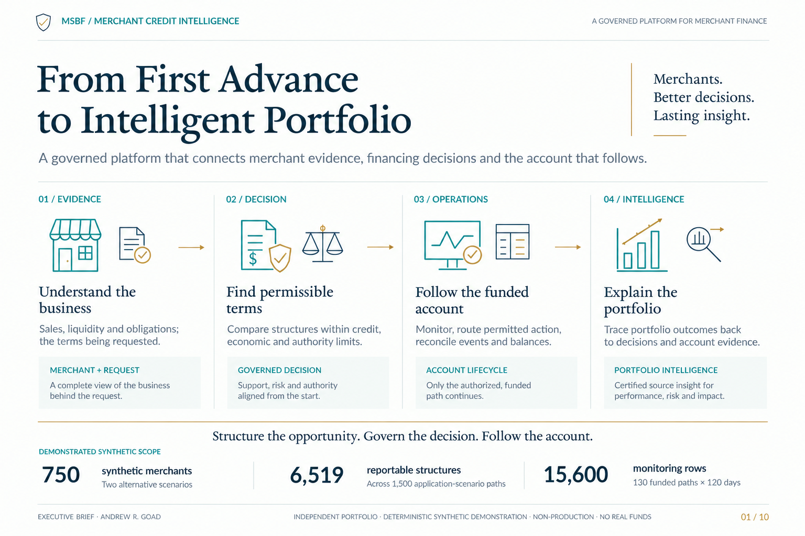

# Visual portfolio · Give each family a job

[Portfolio home](../../README.md) · [Documentation portal](../README.md) · [Current use](CURRENT_USE.md)

Architecture explains ownership; the pitch makes the proposition; the masterclass teaches the mechanics; the cohort interprets the evidence; the posters orient; genuine Power BI views show analytical use.

## Same system, different reading tasks

**Narrated demonstration**

**Its job:** Connect portfolio questions to individual decisions and the account that follows, with detailed tooltips and side-by-side Tableau comparison. **Strong entry point:** [Merchant Credit Intelligence · 3:48 video, chapters and transcript](../presentation/README.md)

**Executive pitch**

**Its job:** Explain the proposition and why the connected system matters. **Strong entry point:** [Ten-page frozen executive brief](../portfolio_visuals/MSBF_VISUAL_PUBLIC_R1/assets/pitch/From_First_Advance_to_Intelligent_Portfolio.pdf)

**Engineering trio**

**Its job:** Show source ownership, contracts, grains and consumer handoffs. **Strong entry point:** [Enterprise architecture](../portfolio_visuals/MSBF_VISUAL_PUBLIC_R1/assets/architecture/pdf/Enterprise_Merchant_Sales_Based_Financing_Platform_v2_1.pdf)

**Teaching**

**Its job:** Work through evidence, calculations, structure and account mechanics. **Strong entry point:** [Masterclass and answer routes](LEARNING.md)

**Analytical cohort**

**Its job:** Explain source-derived patterns and matched cases. **Strong entry point:** [Cohort and analytical reading](ANALYTICS.md)

**Illustrated explainers**

**Its job:** Orient the reader end to end without becoming miniature stage manuals. **Strong entry point:** [Both accepted proof posters](LEARNING.md#how-the-governed-decision-engine-works)

**Power BI evidence**

**Its job:** Show the actual analytical experience and source-owned decision narrative. **Strong entry point:** [P03 explainability and curated cases](EXPLAINABILITY.md)

The executive view leads with business relationships. The engineering and classroom views deliberately do not copy this layout. [Open the unchanged source at full resolution](../portfolio_visuals/MSBF_VISUAL_PUBLIC_R1/assets/pitch/pages/01_Cover.png).

## Technical lineage remains prominent

[Enterprise map · full-resolution PNG](../portfolio_visuals/MSBF_VISUAL_PUBLIC_R1/assets/architecture/png/Enterprise_Merchant_Sales_Based_Financing_Platform_v2_1.png) · [Module 1 lineage · full-resolution PNG](../portfolio_visuals/MSBF_VISUAL_PUBLIC_R1/assets/architecture/png/Module_1_Governed_Evidence_Contract_and_Acceptance_Lineage_v2_1.png) · [Module 2 lineage · full-resolution PNG](../portfolio_visuals/MSBF_VISUAL_PUBLIC_R1/assets/architecture/png/Module_2_Governed_Decisioning_Operations_and_G3v2_Lineage_v2_1.png).

Use full-resolution/vector access for dense engineering content. A navigation preview is not the only way to inspect the asset. No accepted image was regenerated, retouched, re-saved or used as evidence for a different scope.

## Capability-to-visual reading map

Each major capability has a deliberate visual entry. This is a navigation map, not a count of newly accepted capabilities.

**Business proposition** — Merchant → terms → account → portfolio. [Open the focused visual route](../portfolio_visuals/MSBF_VISUAL_PUBLIC_R1/assets/pitch/pages/01_Cover.png).

**Enterprise architecture** — Ownership, control plane and consumption. [Open the focused visual route](../portfolio_visuals/MSBF_VISUAL_PUBLIC_R1/assets/architecture/png/Enterprise_Merchant_Sales_Based_Financing_Platform_v2_1.png).

**Merchant evidence/capacity** — Sales, obligations, assessed burden and modeled buffer. [Open the focused visual route](../portfolio_visuals/MSBF_VISUAL_PUBLIC_R1/assets/teaching/pages/04_Capacity_Worked_Case_098.png).

**Structure search** — Linked terms and governed alternatives. [Open the focused visual route](../portfolio_visuals/MSBF_VISUAL_PUBLIC_R1/assets/pitch/pages/04_Structure_Search.png).

**Final authority** — Support does not confer funding permission. [Open the focused visual route](../portfolio_visuals/MSBF_VISUAL_PUBLIC_R1/assets/teaching/pages/13_Supportable_vs_Authorized.png).

**Explainability / P03** — Three source-owned narrative layers and four curated cases. [Open the focused visual route](EXPLAINABILITY.md).

**Portfolio intelligence** — Funding concentration and endpoint evidence. [Open the focused visual route](../power_bi/m2_v2_1/assets/power_bi/core/p01_command_center_baseline.png).

**Monitoring** — Raw flags, operational families and status. [Open the focused visual route](../portfolio_visuals/MSBF_VISUAL_PUBLIC_R1/assets/teaching/pages/17_Active_Monitoring_Drivers.png).

**Intervention / servicing** — Recommendation → permissions → permitted execution. [Open the focused visual route](../portfolio_visuals/MSBF_VISUAL_PUBLIC_R1/assets/teaching/pages/20_Intervention_Setup_Execution.png).

**End-to-end decision mechanism** — The corrected decision-engine poster. [Open the focused visual route](LEARNING.md#how-the-governed-decision-engine-works).

**Technical M1/M2 lineage** — Module 1 engineering map and linked Module 2 map. [Open the focused visual route](MODULE_1.md).

[The companion after-decision poster](LEARNING.md#what-happens-after-the-decision) explicitly completes the end-to-end account/servicing story. [The unchanged frozen-family gallery](../portfolio_visuals/MSBF_VISUAL_PUBLIC_R1/GALLERY.md) preserves original asset descriptions and formats; it is not the current execution guide.

## Format honesty

The frozen ten-page pitch is an image-based PDF with retained PNG pages, not a newly synchronized editable PowerPoint. The engineering trio provides its registered PNG/PDF formats. The masterclass provides its retained teaching files and companion material. The cohort remains the two registered PDF/PPTX files; no new public preview export was added.

The root stays curated. Detailed classrooms, portrait posters and specialist evidence are routed here and into the appropriate stage or learning guide, rather than accumulating as an exhaustive home-page gallery.

*Deterministic synthetic demonstration · Non-production · No real funds. This current-reading page does not alter source-of-record evidence.*
