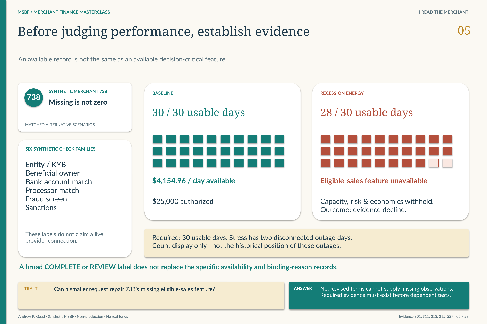

# M1.7 · Source quality and data confidence

**Is the evidence usable—or are we about to mistake absence for weakness?**

[Stage map](../../README.md#stage-map) · [Which source version?](../SOURCE_VERSIONS.md) · [Current use](../CURRENT_USE.md)

> **Source basis:** original `v0.2_ACCEPTED` in `Module_1/1.07_Source_Quality_and_Data_Confidence`. This is the retained foundation/Module 1 basis; no Module 1 technical payload is changed by the R26 successor. This is a reading companion, not a new technical acceptance or execution guide.

[](../../portfolio_visuals/MSBF_VISUAL_PUBLIC_R1/assets/teaching/pages/05_Evidence_Case_738.png)

Why missing required evidence is not simply a weak numerical assessment. [Open the unchanged source at full resolution](../../portfolio_visuals/MSBF_VISUAL_PUBLIC_R1/assets/teaching/pages/05_Evidence_Case_738.png).

M1.7 assesses the fitness of a source, not the creditworthiness of a merchant. That distinction is decisive when an application has missing sales, unavailable obligations or conflicting evidence: **unknown is not zero, and unavailable is not the same as a failed substantive test**.

## Seven sources per application

`msbf_m1.source_snapshot` has the grain **run × application × source**. The accepted population contains 5,250 rows: 750 applications across `POS_DAILY`, `DEPOSIT_DAILY`, `BUSINESS_CREDIT`, `OWNER_CREDIT`, `VERIFICATION`, `OBLIGATIONS` and `COLLATERAL_AVAILABILITY`.

Each row retains availability, depth, completeness, freshness, reconciliation, quality, confidence, fallback and lineage. M1.7 does not create the substantive credit, collateral, obligation or verification observations. It establishes whether later consumers can use those sources and what limitation must travel with them.

## Reconcile aligned evidence, not unrelated totals

When both POS and deposit sources are available, the source computes a symmetric bounded reconciliation score:

```text
Expected captured proceeds = aligned net proceeds × governed capture rate
Reconciliation = min(deposits / expected captured proceeds,
                     expected captured proceeds / deposits, 1)
```

The calculation uses aligned evidence. If either source is unavailable, reconciliation is null, not zero. A null comparison does not establish a contradiction between the two sources.

Effective thresholds apply the stricter global/contract requirement: maximum required history and completeness, minimum permitted freshness age, and maximum reconciliation pass threshold. This is why the contract is part of the source check rather than a decorative registry entry.

## Different absences require different responses

**POS unavailable**

**Retained fallback:** `FAIL_CLOSED_NO_POS`

**Verification unavailable**

**Retained fallback:** `FAIL_CLOSED_VERIFICATION`

**Deposits unavailable**

**Retained fallback:** `POS_ONLY`

**Obligations unavailable**

**Retained fallback:** `MANUAL_OBLIGATION_REVIEW`

**Collateral unavailable**

**Retained fallback:** `UNSECURED_PATH`

**Conflicting source evidence**

**Retained fallback:** `MANUAL_REVIEW_SOURCE_CONFLICT`


These are source-use paths, not final offer decisions. An unsecured fallback does not mean collateral failed, and a manual obligation review does not mean no commitments exist. Later policy can impose additional restrictions; M1.7 cannot grant authority by labeling a source available.

## From source quality to explainability

The non-persisted application-confidence diagnostic weights seven source families, but it remains a synthetic confidence index rather than a calibrated credit score. Its explanation should retain the actual missing or conflicting source—not merely summarize everything with a single number.

The downstream consequence is visible in P03's evidence-decline cases. A scenario with too little usable sales history cannot be repaired by offering a smaller amount. Follow the dedicated explanation guide for the actual accepted merchant 738 comparison; the source-quality rule and final authority remain different layers.

## Requirements interpretation

The following are editorial reading locators into the retained requirements/design/authority documents—not invented native requirement IDs. Native IDs and control lists remain in the linked originals.

**Design §5 · Paired-source logic.** Only compare sources that are available; null reconciliation is not zero reconciliation.

**Design §6 · Threshold precedence.** Honor the stricter effective global/contract threshold.

**Design §7 · Confidence and fallback.** Preserve source-specific stop, review and fallback reasons instead of favorable imputation.

## What the retained validation establishes

The v0.2 signoff records 55/55 positive controls, 5/5 negatives, 5,250 exact expected/actual snapshots and zero mismatches. It reports 4,889 available, 182 partial and 179 unavailable source rows. Those are source-row states across seven families, not three merchant populations. Generation does not rerun the accepted daily histories.

## Exact sources and original document families

[Original stage entry and package scope](../../../Module_1/1.07_Source_Quality_and_Data_Confidence/README.md). Original requirements, SQL, catalogs, validation and signoff remain unchanged. Links below identify source-of-record documents; an original `src/current` label is local to that historical package.

[M1 7 DESIGN AND GENERATION SPECIFICATION](../../../Module_1/1.07_Source_Quality_and_Data_Confidence/v0.2_ACCEPTED/docs/M1_7_DESIGN_AND_GENERATION_SPECIFICATION.md)  
[M1 7 VALIDATION MATRIX](../../../Module_1/1.07_Source_Quality_and_Data_Confidence/v0.2_ACCEPTED/docs/M1_7_VALIDATION_MATRIX.md)  
[M1 7 LIVE EXECUTION EVIDENCE REVIEW AND SIGNOFF](../../../Module_1/1.07_Source_Quality_and_Data_Confidence/v0.2_ACCEPTED/tests/M1_7_LIVE_EXECUTION_EVIDENCE_REVIEW_AND_SIGNOFF.md)  

**Implementation entry points (source study, not a run sequence):**

[46_msbf_m1_7_source_quality_data_confidence_generation_v0_2.sql](../../../Module_1/1.07_Source_Quality_and_Data_Confidence/v0.2_ACCEPTED/src/46_msbf_m1_7_source_quality_data_confidence_generation_v0_2.sql)  

**Contract/grain references:** [M1_7_FIELD_DICTIONARY.csv](../../../Module_1/1.07_Source_Quality_and_Data_Confidence/v0.2_ACCEPTED/docs/catalogs/M1_7_FIELD_DICTIONARY.csv).

**Full retained requirements/validation families:** [docs / v0.2_ACCEPTED](../../../Module_1/1.07_Source_Quality_and_Data_Confidence/v0.2_ACCEPTED/docs) · [tests / v0.2_ACCEPTED](../../../Module_1/1.07_Source_Quality_and_Data_Confidence/v0.2_ACCEPTED/tests). These grouped directories include earlier corrective and superseded records; they are not all new current acceptances.

## Read the neighboring boundary

[Previous reading: M1.6](M1_06.md) · [Next reading: M1.8](M1_08.md) · [All 31 entries](../../README.md#stage-map). **These are conceptual reading links, not an execution order.**

[Requirements and validation guide](../REQUIREMENTS_AND_VALIDATION.md) · [See the application decision explained](../EXPLAINABILITY.md).

*Deterministic synthetic demonstration · Non-production · No real funds. Current companions do not overwrite historical source records.*
