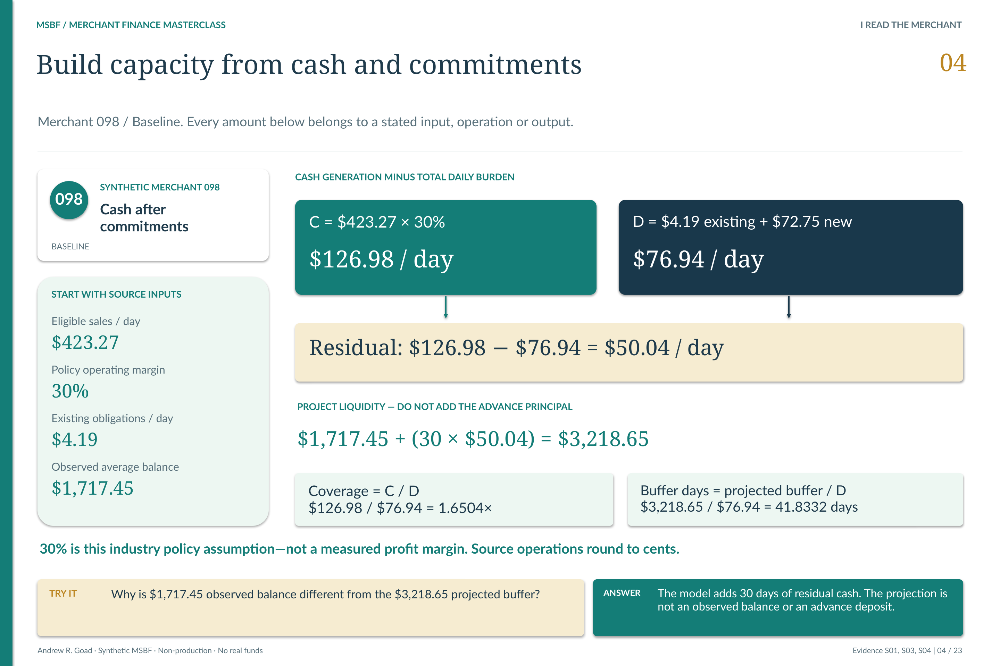

[MSBF](../../../README.md) / [Documentation](../../README.md) / Module 1

# M1.10 · Obligations, liquidity and residual cash flow

### What cash remains after the merchant's commitments and the requested financing?

Sales start the capacity question; they do not answer it. M1.10 separates cash already committed, the burden of the request, estimated operating cash and the liquidity left afterward. It also preserves the distinction between **no observed obligation** and **unavailable obligations evidence**.

**Reading companion, not a revised specification.** The source is accepted Module 1 `v0.2R2`; the signoff distinguishes `v0.2R1` generation from `v0.2R2` validation/reporting. Module 1 remains unchanged in the R26 successor. [Read the accepted signoff](../../../Module_1/1.10_Obligations_Liquidity_and_Capacity/v0.2R2_ACCEPTED/tests/M1_10_LIVE_EXECUTION_EVIDENCE_REVIEW_AND_SIGNOFF.md) · [Current-version bridge](../../release_change_control/module_2_g3_v2_1/reports/02_DETAILED_CHANGE_LOG_AND_DATA_RECONCILIATION_REPORT.md#4-module-1--g2-nonregression).

**Worked meaning · merchant 098 / Baseline.** The 30% margin is an industry policy assumption, not observed profitability. The projected buffer is not a bank balance or an advance deposit.

[Open the lesson full size](../../portfolio_visuals/MSBF_VISUAL_PUBLIC_R1/assets/teaching/pages/04_Capacity_Worked_Case_098.png) · [Read the exact lesson text](../../portfolio_visuals/MSBF_VISUAL_PUBLIC_R1/assets/teaching/companion/EXACT_SLIDE_COPY.md#page-4)

## The stage's job—and where it stops

M1.10 consumes physical cash-flow features from **M1.9**, obligation-source confidence from **M1.7**, verification/fraud disposition from **M1.8**, requested terms from **M1.3**, and relationship history from **M1.2**. It does not regenerate their daily histories.

It creates atomic obligation evidence and a scenario-aware capacity snapshot. It does **not** issue an approved offer, final counteroffer, decline, funding decision, expected-loss result or Module 1 latest/archive consumption contract. Its capacity/review flags are analytical evidence for later stages, not final lending authority. [Architecture and dependencies](../../../Module_1/1.10_Obligations_Liquidity_and_Capacity/v0.2R2_ACCEPTED/docs/M1_10_ARCHITECTURE.md).

## Inputs and physical grain

| Evidence | Why the calculation needs it |
| --- | --- |
| M1.9 eligible sales and average available balance | Sales support modeled cash generation; balance is the observed liquidity starting point. |
| M1.3 requested amount, rate, payback and horizon | Defines the additional daily burden being tested—not an approved structure. |
| Atomic obligations | Fixed payments and sales-linked commitments consume capacity differently. |
| Source availability, quality and verification | Determines whether capacity is complete, partial or blocked. |
| Governed policy | Supplies industry margins, projection horizons, ratio/tier thresholds and the stress floor. |

`msbf_m1.application_obligation_snapshot` is the atomic obligation evidence. Obligations are generated once per application, not invented again for the stress scenario. The scenario aggregation reprices sales-linked obligations using matched sales; fixed payment obligations retain their daily-payment basis.

`msbf_m1.application_liquidity_capacity_snapshot` has the primary key **`module1_run_id`, `scenario_id`, `merchant_application_id`**. The accepted population contains **906 obligation rows** and **1,500 capacity snapshots**, or **2,406 canonical entities**. Do not interpret that sum as a merchant count. [Schema and field definitions](../../../Module_1/1.10_Obligations_Liquidity_and_Capacity/v0.2R2_ACCEPTED/docs/catalogs/M1_10_FIELD_DICTIONARY.csv) · [Exact schema](../../../Module_1/1.10_Obligations_Liquidity_and_Capacity/v0.2R2_ACCEPTED/src/68_msbf_m1_10_schema_policy_extension_v0_2R2.sql).

## Follow the calculation

The operations below describe the accepted generation source. Money is in dollars; burden and cash flow are per day unless explicitly labeled monthly. The source rounds monetary operations to cents and protects denominator calculations.

**1. Reprice existing commitments.** Fixed daily payments are added to sales-linked payments based on the scenario's eligible-sales evidence. This avoids comparing unchanged nominal commitments with stressed revenue when the commitment itself is sales-linked.

**2. Test both legs of the request.** The rate-based leg is eligible daily sales × requested remittance rate. The horizon leg is requested total repayment ÷ `max(requested horizon days, 1)`. The assessed requested burden is the **greater** of those legs, under `MAX_RATE_OR_HORIZON`.

**3. Calculate residual cash.** Modeled daily operating cash = eligible daily sales × the policy industry margin. Total daily burden = existing daily payments + assessed requested burden. Residual daily cash = modeled operating cash − total daily burden. Coverage = modeled operating cash ÷ `max(total daily burden, 1)`.

**4. Project liquidity without adding the advance.** Projected buffer = average available balance + residual daily cash × the policy projection days. Buffer days = projected buffer ÷ `max(total daily burden, 1)`. This is a modeled capacity projection; it is not a simulated disbursement into the bank account.

[Inspect the exact generation expressions](../../../Module_1/1.10_Obligations_Liquidity_and_Capacity/v0.2R2_ACCEPTED/src/70_msbf_m1_10_obligations_liquidity_capacity_generation_v0_2R2.sql) · [Policy values and units](../../../Module_1/1.10_Obligations_Liquidity_and_Capacity/v0.2R2_ACCEPTED/docs/M1_10_PARAMETER_DICTIONARY.md).

### A concrete interpretation

The frozen lesson's merchant 098 has **$423.27/day** eligible sales and a **30%** policy margin, giving **$126.98/day** modeled operating cash. Existing payments of **$4.19** plus **$72.75** requested burden give **$76.94/day** total burden. Residual cash is **$50.04/day**.

The **$1,717.45** observed average balance becomes a **$3,218.65** projected buffer after adding **30 × $50.04**. The lesson's coverage is **1.6504×**. A reviewer should be able to distinguish each source input, policy assumption and derived output before debating the tier. [Source-grounded worked case](../../portfolio_visuals/MSBF_VISUAL_PUBLIC_R1/assets/teaching/companion/EXACT_SLIDE_COPY.md).

## Missing evidence cannot become favorable capacity

The source marks evidence **`BLOCKED`** when features are blocked, obligations are unavailable, or eligible sales are null. **`PARTIAL`** includes partial features, obligation quality `WARNING`/`FAIL`/`CONFLICT`, or verification not `CLEAR`; otherwise evidence is `COMPLETE`.

A subtle point matters: the numeric expression uses zero for a missing rate-based leg before taking the maximum with the horizon leg, and obligation aggregation can produce zero rows. **Those intermediate numbers do not certify affordability.** The independent evidence-status rule still blocks the assessment; operating cash and dependent ratios stay null where required. An unavailable obligations source routes to `MANUAL_OBLIGATION_REVIEW` rather than proving there are no commitments.

The tier rules consider coverage, burden-to-sales, residual cash, buffer days and, where applicable, stacking. The matched stress non-improvement floor prevents a more favorable interpreted capacity tier in the adverse alternative. [Evidence status and tier rules](../../../Module_1/1.10_Obligations_Liquidity_and_Capacity/v0.2R2_ACCEPTED/src/70_msbf_m1_10_obligations_liquidity_capacity_generation_v0_2R2.sql).

## Requirements and validation

The design is prose-based; the locators below are **editorial references to existing sections**, not invented official requirement IDs.

| Requirement locator | Implementation / evidence route |
| --- | --- |
| Design · Critical interpretation rules: missing is not none | Generation `evidence_status`; signoff's insufficient-evidence and stage-boundary results. |
| Design · Requested burden | `MAX_RATE_OR_HORIZON`; persisted requested/total burden identities in positive validation. |
| Architecture · Matched scenarios | Scenario-qualified snapshots and interpreted stress-tier floor. |
| Design · Deterministic reconciliation | Target-typed expected rows, persisted-field hash reconstruction and fail-before-commit mismatch checks. |

[Read the design specification](../../../Module_1/1.10_Obligations_Liquidity_and_Capacity/v0.2R2_ACCEPTED/docs/M1_10_DESIGN_AND_GENERATION_SPECIFICATION.md) · [Read the validation matrix](../../../Module_1/1.10_Obligations_Liquidity_and_Capacity/v0.2R2_ACCEPTED/docs/M1_10_VALIDATION_MATRIX.md) · [Inspect positive validation SQL](../../../Module_1/1.10_Obligations_Liquidity_and_Capacity/v0.2R2_ACCEPTED/src/71_msbf_m1_10_obligations_liquidity_capacity_validation_v0_2R2.sql).

The **retained acceptance**, not a new execution for this guide, records **70/70 positive controls**, **6/6 negative controls**, **zero deterministic mismatches** and **zero stress-tier improvements**. Negative tests cover disabled policy, invalid methodology, invalid burden basis, unapproved stress scenario, prerequisite drift and a post-generation rerun. [Validation scope](../../../Module_1/1.10_Obligations_Liquidity_and_Capacity/v0.2R2_ACCEPTED/docs/M1_10_VALIDATION_MATRIX.md) · [Negative-control SQL](../../../Module_1/1.10_Obligations_Liquidity_and_Capacity/v0.2R2_ACCEPTED/src/72_msbf_m1_10_negative_control_tests_v0_2R2.sql).

The evidence also preserves **598 insufficient-evidence rows** and **1,483 of 1,500 rows with manual-review recommendations**. That high recommendation incidence is a disclosed synthetic routing/calibration consideration—not 1,483 final review decisions and not a structural acceptance failure. Corrections to validation/reporting did not alter the accepted generation's business rows or hashes. [Read the complete signoff and correction history](../../../Module_1/1.10_Obligations_Liquidity_and_Capacity/v0.2R2_ACCEPTED/tests/M1_10_LIVE_EXECUTION_EVIDENCE_REVIEW_AND_SIGNOFF.md).

## Continue the evidence chain

**The takeaway:** capacity is a traceable relationship among cash, commitments, request terms and evidence quality—not a disguised approval score. These are synthetic analytical calculations, not calibrated production underwriting.

**Reading order; execution prerequisites are separate.**

[Previous companion: M1.9](M1_09.md) · [Next companion: M1.11](M1_11.md) · [All 31 entries](../../README.md#stage-map).

Source and related reading: [M1.9 source](../../../Module_1/1.09_As_Of_Cash_Flow_Features/README.md) · [M1.10 original package](../../../Module_1/1.10_Obligations_Liquidity_and_Capacity/README.md) · [M1.11 source](../../../Module_1/1.11_Cash_Flow_Archetypes_and_Resilience/README.md) · [Later consumption contract: M1.15](../../../Module_1/1.15_Latest_Archive_Comparison_and_Contract/README.md).

[Requirements and validation guide](../REQUIREMENTS_AND_VALIDATION.md) · [See the application decision explained](../EXPLAINABILITY.md) · [Current-use prerequisites](../CURRENT_USE.md).

*Deterministic synthetic demonstration · Non-production · No real funds. Current companions do not overwrite historical source records.*
