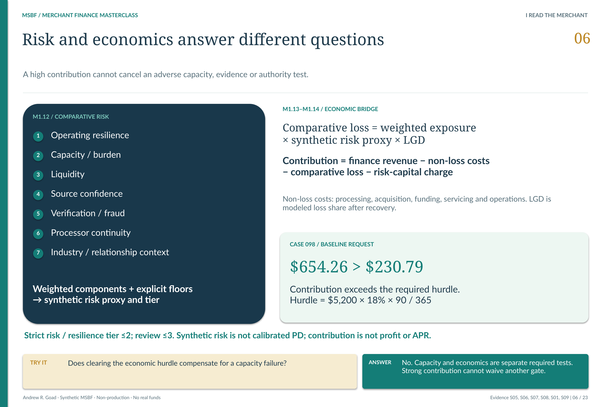

# M1.14 · Unit economics and risk-adjusted contribution

**Does the request cover its modeled costs, comparative loss and economic hurdle?**

[Stage map](../../README.md#stage-map) · [Which source version?](../SOURCE_VERSIONS.md) · [Current use](../CURRENT_USE.md)

> **Source basis:** original `v0.2R4_ACCEPTED` in `Module_1/1.14_Unit_Economics_and_Contribution`. This is the retained foundation/Module 1 basis; no Module 1 technical payload is changed by the R26 successor. This is a reading companion, not a new technical acceptance or execution guide.

[](../../portfolio_visuals/MSBF_VISUAL_PUBLIC_R1/assets/teaching/pages/06_Risk_and_Economics.png)

Risk, repayment and contribution answer different questions; this is modeled economics, not realized profit. [Open the unchanged source at full resolution](../../portfolio_visuals/MSBF_VISUAL_PUBLIC_R1/assets/teaching/pages/06_Risk_and_Economics.png).

M1.14 explains the economics of requested financing before a final price or decision is issued. It exposes why finance revenue, contribution before loss, contribution after comparative loss and risk-adjusted contribution are different quantities.

## From request revenue to contribution

The wide grain is **run × scenario × application**. The long form adds component code/version. The source consumes accepted request terms, capacity, path-weighted EAD, comparative loss and partner-channel cost evidence.

```text
Gross finance revenue = requested finance charge
Non-loss cost = processor + partner + funding + servicing + operating cost
Pre-loss contribution = gross finance revenue − non-loss cost
After-loss contribution = pre-loss contribution − schedule-adjusted comparative loss
Risk-adjusted contribution = after-loss contribution − synthetic risk capital charge
```

Processor cost scales with total repayment; partner cost uses requested funding and the governed acquisition rate. Funding cost uses path-weighted EAD × annual funding rate × horizon/365. Servicing and operating costs each retain fixed/time-based and variable terms as defined in the specification.

## Return and hurdle have an explicit horizon basis

```text
Risk capital charge = EAD × allocation rate × annual capital cost × horizon/365
Annualized risk-adjusted return = risk-adjusted contribution / funding × 365/horizon
Hurdle = funding × annual hurdle rate × horizon/365
Economic surplus = risk-adjusted contribution − hurdle
```

Those are governed synthetic assumptions. Annualizing a demonstration return does not make it realized profitability, a production pricing quote or an accounting performance measure.

## Preserve incomplete economics

If comparative-loss evidence is blocked, the after-loss contribution, risk-adjusted return, surplus and favorable hurdle conclusion remain null. Known pre-loss components may remain visible. The appropriate explanation is that the required economics cannot be established—not that loss was zero.

Partial evidence can retain a default channel cost or partial comparative loss. The adverse scenario caps final contribution and annualized return at matched Baseline and prevents a more favorable economic tier. The final interpreted result therefore retains both computation and governance context.

## Keep acquisition overlap out of double counting

M1.14 already includes a partner acquisition-cost proxy. Later M1.16 adds source/campaign attribution and a detailed acquisition-cost bridge **without rewriting this accepted economics**. A current reader must not add both cost totals unconditionally; the later bridge identifies supported overlap, unmapped proxy and incremental cost.

## Handoff to contract and decisioning

M1.15 packages these fields in the application contract. Module 2 later evaluates alternative structures against its required economic hurdle and final authority. Positive economics here cannot cure missing evidence, waive a hard stop or create funding permission.

## Requirements interpretation

The following are editorial reading locators into the retained requirements/design/authority documents—not invented native requirement IDs. Native IDs and control lists remain in the linked originals.

**Design §4 · Economic formulas.** Keep five non-loss costs, comparative loss, capital charge and hurdle as reconcilable components.

**Design §6 · Evidence states.** Do not turn unavailable loss/economics into a favorable zero-cost conclusion.

**Signoff · Accepted versions and corrections.** Preserve the distinction between atomic contract/generation and later physical-hash validation fixes.

## What the retained validation establishes

The accepted v0.2R4 package separates initial policy v0.2, atomic contract/generation v0.2R3 and validation/reporting v0.2R4. It records 1,500 snapshots, 21,000 components, 82/82 positives, 7/7 negatives and zero hash, contribution, blocked-contract or stress-floor violations. Earlier failed acceptance and constraint/hash corrections remain part of the record.

## Exact sources and original document families

[Original stage entry and package scope](../../../Module_1/1.14_Unit_Economics_and_Contribution/README.md). Original requirements, SQL, catalogs, validation and signoff remain unchanged. Links below identify source-of-record documents; an original `src/current` label is local to that historical package.

[M1 14 DESIGN AND GENERATION SPECIFICATION](../../../Module_1/1.14_Unit_Economics_and_Contribution/v0.2R4_ACCEPTED/docs/M1_14_DESIGN_AND_GENERATION_SPECIFICATION.md)  
[M1 14 VALIDATION MATRIX](../../../Module_1/1.14_Unit_Economics_and_Contribution/v0.2R4_ACCEPTED/docs/M1_14_VALIDATION_MATRIX.md)  
[M1 14 LIVE EXECUTION EVIDENCE REVIEW AND SIGNOFF](../../../Module_1/1.14_Unit_Economics_and_Contribution/v0.2R4_ACCEPTED/tests/M1_14_LIVE_EXECUTION_EVIDENCE_REVIEW_AND_SIGNOFF.md)  

**Implementation entry points (source study, not a run sequence):**

[100_msbf_m1_14_schema_policy_extension_v0_2R3.sql](../../../Module_1/1.14_Unit_Economics_and_Contribution/v0.2R4_ACCEPTED/src/100_msbf_m1_14_schema_policy_extension_v0_2R3.sql)  
[102_msbf_m1_14_unit_economics_generation_v0_2R3.sql](../../../Module_1/1.14_Unit_Economics_and_Contribution/v0.2R4_ACCEPTED/src/102_msbf_m1_14_unit_economics_generation_v0_2R3.sql)  

**Contract/grain references:** [M1_14_v0_2R3_LOGIC_AND_CONTRACT_REVIEW.md](../../../Module_1/1.14_Unit_Economics_and_Contribution/v0.2R4_ACCEPTED/docs/M1_14_v0_2R3_LOGIC_AND_CONTRACT_REVIEW.md) · [M1_14_FIELD_DICTIONARY.csv](../../../Module_1/1.14_Unit_Economics_and_Contribution/v0.2R4_ACCEPTED/docs/catalogs/M1_14_FIELD_DICTIONARY.csv).

**Full retained requirements/validation families:** [docs / v0.2R4_ACCEPTED](../../../Module_1/1.14_Unit_Economics_and_Contribution/v0.2R4_ACCEPTED/docs) · [tests / v0.2R4_ACCEPTED](../../../Module_1/1.14_Unit_Economics_and_Contribution/v0.2R4_ACCEPTED/tests). These grouped directories include earlier corrective and superseded records; they are not all new current acceptances.

## Read the neighboring boundary

[Previous reading: M1.13](M1_13.md) · [Next reading: M1.15](M1_15.md) · [All 31 entries](../../README.md#stage-map). **These are conceptual reading links, not an execution order.**

[Requirements and validation guide](../REQUIREMENTS_AND_VALIDATION.md) · [See the application decision explained](../EXPLAINABILITY.md).

*Deterministic synthetic demonstration · Non-production · No real funds. Current companions do not overwrite historical source records.*
