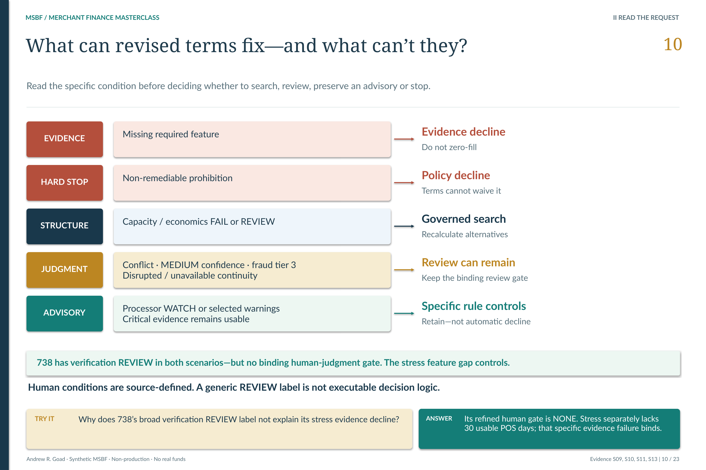

# M2.1 · Separate an evidence problem from a structure problem

**What kind of decision can the available merchant evidence support?**

[Stage map](../../README.md#stage-map) · [Which source version?](../SOURCE_VERSIONS.md) · [Current use](../CURRENT_USE.md)

> **Source basis:** original `v0.2R7_ACCEPTED` in `Module_2/2.01_Eligibility_Policy_Gates_and_Decision_Routing`. The original package is preserved historical Module 2 evidence. Current strategy/lifecycle interpretation is version-separated in the R26 integration and change-control sources, not inferred from the old directory label. This is a reading companion, not a new technical acceptance or execution guide.

The routing question is whether evidence is usable and the failed condition is structure-remediable. [Open the unchanged source at full resolution](../../portfolio_visuals/MSBF_VISUAL_PUBLIC_R1/assets/teaching/pages/10_Eligibility_and_Remediability.png).

## Why routing comes before an offer

A failed request can mean very different things. Required source evidence may be missing; a non-remediable policy condition may apply; or the requested terms may be unsuitable even though a different permissible structure deserves assessment. Treating all three as the same decline discards both useful opportunity and the reason for stopping.

M2.1 consumes the accepted G2 application evidence and forms the eligibility/policy-routing boundary. It does not generate final offer terms, book an account or decide that a candidate found later is authorized. Its output must preserve the evidence and rule context that M2.2 and M2.3 need.

## Current policy versus the historical route

The original v0.2R7 package documents the precedence `DECLINE_POLICY` → `INSUFFICIENT_EVIDENCE` → `MANUAL_REVIEW` → `ELIGIBLE_FOR_OFFER_DESIGN`. Those are historical routing states, not the successor's seven final outcomes.

The current strategy correction expands search entry to decisionable, structure-remediable FAIL or REVIEW paths. In particular, a failed requested structure cannot become a final **no-feasible-structure** conclusion without the required search and completeness evidence. Missing critical evidence and policy hard stops retain their own boundaries; changing price or principal is not a cure for absent underwriting evidence.

This distinction appears in the accepted P03 cases: merchant 738 has insufficient usable POS evidence under Recession Energy; merchant 098 has a smaller governed structure under that scenario. Both differ from a simple “original request passed/failed” story.

## Input, logic and handoff

The unit is an application under a specified scenario and governed run—not a merchant detached from scenario. The G2 contract supplies upstream quality, verification, cash-flow/capacity, resilience, comparative risk/loss and economics context. Routing must keep that source identity intact rather than joining unrelated Baseline and Recession Energy rows.

The reader should follow three separate questions:

1. **Is the required evidence decisionable?** Unavailable evidence is not an adverse numeric value and must not become a fabricated zero.
2. **Is the failed condition remediable by structure?** A policy hard stop is not an invitation to search around the rule.
3. **What must the next stage assess?** A search-eligible route conveys work to M2.2; final permission still belongs to M2.3.

The successor retains decision-gate evidence, search-required/attempted/completed context and binding reasons. The current change report records 84,228 decision-gate rows and 652 explicit no-feasible proof rows across the strategy population. These are evidence rows, not 84,228 separate approvals or additional merchants.

## Inspect rather than reconstruct

Read the original architecture/specification for the policy-control pattern, then the current change report and retained strategy output for the successor route. The retained `PHASE2C_R4_STRATEGY.zip` provides exact policy and decision/candidate evidence. Its originating R4 generator is not packaged; do not convert the original program 138 into an asserted exact reproduction of the entire successor search.

The business requirement is accountable routing: the next stage should know both what it is permitted to assess and what it must not infer. An apparently complete table or an attractive candidate is not permission to bypass this boundary.

## Requirements interpretation

The following are editorial reading locators into the retained requirements/design/authority documents—not invented native requirement IDs. Native IDs and control lists remain in the linked originals.

**BRD · Governing inputs and control requirements.** Consume the accepted G2 identity and fail closed on unresolved source or acceptance findings.

**Current change report §5.1–5.3.** Distinguish critical evidence, hard stops and structure-remediable routing; search before a no-feasible conclusion.

**Design specification · Routing precedence.** Preserve the original routing vocabulary as historical, not the current final-outcome taxonomy.

## What the retained validation establishes

The original stage acceptance and control families remain historical evidence. The R26/R20 integrated acceptance preserves the corrected routing/search result through the version-separated successor sources. This page reads those records; it does not rerun either policy generation or a gate suite.

## Exact sources and original document families

[Original stage entry and package scope](../../../Module_2/2.01_Eligibility_Policy_Gates_and_Decision_Routing/README.md). Original requirements, SQL, catalogs, validation and signoff remain unchanged. Links below identify source-of-record documents; an original `src/current` label is local to that historical package.

[ARCHITECTURE](../../../Module_2/2.01_Eligibility_Policy_Gates_and_Decision_Routing/v0.2R7_ACCEPTED/docs/ARCHITECTURE.md)  
[BRD](../../../Module_2/2.01_Eligibility_Policy_Gates_and_Decision_Routing/v0.2R7_ACCEPTED/docs/BRD.md)  
[SOURCE PROVENANCE](../../../Module_2/2.01_Eligibility_Policy_Gates_and_Decision_Routing/v0.2R7_ACCEPTED/docs/SOURCE_PROVENANCE.md)  
[VALIDATION AND ACCEPTANCE](../../../Module_2/2.01_Eligibility_Policy_Gates_and_Decision_Routing/v0.2R7_ACCEPTED/docs/VALIDATION_AND_ACCEPTANCE.md)  
[M2 1 DESIGN AND GENERATION SPECIFICATION](../../../Module_2/2.01_Eligibility_Policy_Gates_and_Decision_Routing/v0.2R7_ACCEPTED/docs/source_documents/M2_1_DESIGN_AND_GENERATION_SPECIFICATION.md)  

**Implementation entry points (source study, not a run sequence):**

[01_132_schema_policy_v0_2.sql](../../../Module_2/2.01_Eligibility_Policy_Gates_and_Decision_Routing/v0.2R7_ACCEPTED/src/current/01_132_schema_policy_v0_2.sql)  
[04_134_generation_R1.sql](../../../Module_2/2.01_Eligibility_Policy_Gates_and_Decision_Routing/v0.2R7_ACCEPTED/src/current/04_134_generation_R1.sql)  
[132_msbf_m2_1_schema_policy_extension_v0_2R7.sql](../../../Module_2/2.01_Eligibility_Policy_Gates_and_Decision_Routing/v0.2R7_ACCEPTED/src/current/132_msbf_m2_1_schema_policy_extension_v0_2R7.sql)  
[134_msbf_m2_1_eligibility_policy_routing_generation_v0_2R7.sql](../../../Module_2/2.01_Eligibility_Policy_Gates_and_Decision_Routing/v0.2R7_ACCEPTED/src/current/134_msbf_m2_1_eligibility_policy_routing_generation_v0_2R7.sql)  

**Contract/grain references:** [01_MSBF_M2_1_Eligibility_Policy_Gates_Decision_Routing_Foundations_Detail_Report_v0_2R7_Run_Contract_Lifecycle_And_Acceptance_Gate_20260730.csv](../../../Module_2/2.01_Eligibility_Policy_Gates_and_Decision_Routing/v0.2R7_ACCEPTED/catalogs/source_catalogs/01_MSBF_M2_1_Eligibility_Policy_Gates_Decision_Routing_Foundations_Detail_Report_v0_2R7_Run_Contract_Lifecycle_And_Acceptance_Gate_20260730.csv).

**Full retained requirements/validation families:** [docs / v0.2R7_ACCEPTED](../../../Module_2/2.01_Eligibility_Policy_Gates_and_Decision_Routing/v0.2R7_ACCEPTED/docs) · [source_documents / docs](../../../Module_2/2.01_Eligibility_Policy_Gates_and_Decision_Routing/v0.2R7_ACCEPTED/docs/source_documents) · [tests / v0.2R7_ACCEPTED](../../../Module_2/2.01_Eligibility_Policy_Gates_and_Decision_Routing/v0.2R7_ACCEPTED/tests). These grouped directories include earlier corrective and superseded records; they are not all new current acceptances.

## Current successor bridge

[Detailed version change, policy and population reconciliation](../../release_change_control/module_2_g3_v2_1/reports/02_DETAILED_CHANGE_LOG_AND_DATA_RECONCILIATION_REPORT.md) · [R26 source/runtime projection](../../../successor_candidates/m2-g3-v2.1-r26-integration/README.md) · [Retained strategy output and resolved-policy carrier](../../../successor_candidates/m2-g3-v2.1-r26-integration/source/inputs/PHASE2C_R4_STRATEGY.zip) · [Later R20 acceptance and current release status](../../release_integration/module_2_g3_v2_1/CURRENT_STATE.md).

## Read the neighboring boundary

[Previous reading: M1.17](M1_17.md) · [Next reading: M2.2](M2_02.md) · [All 31 entries](../../README.md#stage-map). **These are conceptual reading links, not an execution order.**

[Requirements and validation guide](../REQUIREMENTS_AND_VALIDATION.md) · [See the application decision explained](../EXPLAINABILITY.md).

*Deterministic synthetic demonstration · Non-production · No real funds. Current companions do not overwrite historical source records.*
