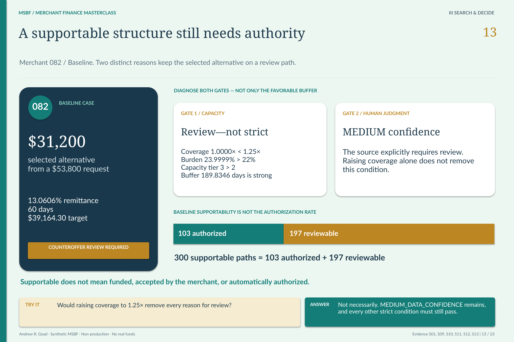

# M2.3 · Authorize a decision—not merely a candidate

**After a structure is supportable, what outcome is actually permitted?**

[Stage map](../../README.md#stage-map) · [Which source version?](../SOURCE_VERSIONS.md) · [Current use](../CURRENT_USE.md)

> **Source basis:** original `v0.2R2_ACCEPTED` in `Module_2/2.03_Final_Offer_and_Decision_Authorization`. The original package is preserved historical Module 2 evidence. Current strategy/lifecycle interpretation is version-separated in the R26 integration and change-control sources, not inferred from the old directory label. This is a reading companion, not a new technical acceptance or execution guide.

A reviewable structure is not hidden authorization volume. [Open the unchanged source at full resolution](../../portfolio_visuals/MSBF_VISUAL_PUBLIC_R1/assets/teaching/pages/13_Supportable_vs_Authorized.png).

## The independent authority boundary

M2.2 constructs and tests structures. M2.3 decides whether the selected structure can be authorized, requires review, or must end in a particular decline class. A supportable candidate and an authorized offer are different products of the system.

The current decision population contains 1,500 application-scenario paths: the same 750 applications assessed under Baseline and Recession Energy. A path must retain its run/application/scenario key, requested and selected terms, binding rule evidence and governed final outcome. Combining two scenario decisions into one merchant-level “answer” would erase the contrast the demonstration is designed to explain.

## Seven outcomes, three authority classes

**Authorized**

**Exact current outcome code:** `APPROVE_AS_REQUESTED_AUTHORIZED` **Meaning:** Requested terms satisfy the applicable final conditions.

**Authorized**

**Exact current outcome code:** `COUNTEROFFER_AUTHORIZED` **Meaning:** A permissible alternative reaches the final authorization boundary.

**Review**

**Exact current outcome code:** `COUNTEROFFER_REVIEW_REQUIRED` **Meaning:** A selected alternative remains subject to specified review conditions.

**Review**

**Exact current outcome code:** `MANUAL_UNDERWRITING_REVIEW_REQUIRED` **Meaning:** The source-defined underwriting review path remains required.

**Decline**

**Exact current outcome code:** `DECLINE_INSUFFICIENT_EVIDENCE` **Meaning:** Required evidence does not support a reliable assessment.

**Decline**

**Exact current outcome code:** `DECLINE_NO_FEASIBLE_STRUCTURE` **Meaning:** The required search establishes no permissible structure.

**Decline**

**Exact current outcome code:** `DECLINE_POLICY_HARD_STOP` **Meaning:** A non-remediable policy restriction governs the result.

These codes are taken from the current retained strategy output. They do not introduce defer, withdraw or incomplete categories. Older source records contain a four-outcome model; those records are retained unchanged and must not be silently relabeled as this seven-outcome authority.

## A concrete authority test

Merchant 082 requests $53,800. In Baseline the selected $31,200 alternative is **COUNTEROFFER_REVIEW_REQUIRED**, with composite capacity and human-judgment review still binding. Selection is not funding. Under Recession Energy the outcome is **DECLINE_NO_FEASIBLE_STRUCTURE**.

Merchant 098 requests $5,200 in each scenario. Baseline permits the request; Recession Energy permits a $2,500 counteroffer. Both selected terms must still satisfy their scenario's final conditions. These are alternative synthetic assessments, not sequential renegotiations with a real business.

The distinction is visible at portfolio level too: Baseline has 300 supportable paths, but only 103 authorized and 197 requiring review. “Supportable” therefore cannot serve as a funding flag.

## Source-owned reasoning and downstream permission

The current policy keeps authority-first selection across strict and review frontiers, required economics, 40% minimum principal, 60% maximum reduction and the exact 30/60/90-day horizons. A matched-scenario stress floor prevents a stress result from becoming an ungoverned improvement merely because a standalone assessment changes.

P03 turns these source-owned reasons into business-facing evidence, risk/economics and decision narratives. It does not select the outcome, waive a failed condition or run a second decision model. Technical rationale remains available underneath the presentation.

M2.4 is the next boundary: only the authorized subset can enter the synthetic funded-account lifecycle. Review and decline records remain important decision evidence without becoming accounts.

## Requirements interpretation

The following are editorial reading locators into the retained requirements/design/authority documents—not invented native requirement IDs. Native IDs and control lists remain in the linked originals.

**Original BRD · Final offer and decision authorization.** Preserve a final permission boundary separate from candidate construction.

**Current change report §6.** Read the current seven-outcome taxonomy and authority-first selection, not the predecessor four-outcome distribution.

**Retained strategy final-decision output.** Bind each outcome, selected structure and reason to the exact application-scenario identity.

## What the retained validation establishes

The original v0.2R2 final-offer acceptance is retained, while the current seven-outcome result is supported by the version-separated strategy records and later R26/R20 authority. A fresh editorial comparison is not a new decision-engine acceptance.

## Exact sources and original document families

[Original stage entry and package scope](../../../Module_2/2.03_Final_Offer_and_Decision_Authorization/README.md). Original requirements, SQL, catalogs, validation and signoff remain unchanged. Links below identify source-of-record documents; an original `src/current` label is local to that historical package.

[ARCHITECTURE](../../../Module_2/2.03_Final_Offer_and_Decision_Authorization/v0.2R2_ACCEPTED/docs/ARCHITECTURE.md)  
[BRD](../../../Module_2/2.03_Final_Offer_and_Decision_Authorization/v0.2R2_ACCEPTED/docs/BRD.md)  
[SOURCE PROVENANCE](../../../Module_2/2.03_Final_Offer_and_Decision_Authorization/v0.2R2_ACCEPTED/docs/SOURCE_PROVENANCE.md)  
[VALIDATION AND ACCEPTANCE](../../../Module_2/2.03_Final_Offer_and_Decision_Authorization/v0.2R2_ACCEPTED/docs/VALIDATION_AND_ACCEPTANCE.md)  
[M2 3 DESIGN AND GENERATION SPECIFICATION](../../../Module_2/2.03_Final_Offer_and_Decision_Authorization/v0.2R2_ACCEPTED/docs/source_documents/M2_3_DESIGN_AND_GENERATION_SPECIFICATION.md)  
[SOURCE PROVENANCE](../../../Module_2/2.03_Final_Offer_and_Decision_Authorization/v0.2R2_ACCEPTED/docs/source_documents/SOURCE_PROVENANCE.md)  

**Implementation entry points (source study, not a run sequence):**

[01_148_schema_policy_R1.sql](../../../Module_2/2.03_Final_Offer_and_Decision_Authorization/v0.2R2_ACCEPTED/src/current/01_148_schema_policy_R1.sql)  
[04_150_generation_R1.sql](../../../Module_2/2.03_Final_Offer_and_Decision_Authorization/v0.2R2_ACCEPTED/src/current/04_150_generation_R1.sql)  
[148_msbf_m2_3_schema_policy_decision_contract_extension_v0_2R2.sql](../../../Module_2/2.03_Final_Offer_and_Decision_Authorization/v0.2R2_ACCEPTED/src/current/148_msbf_m2_3_schema_policy_decision_contract_extension_v0_2R2.sql)  
[150_msbf_m2_3_final_offer_decision_generation_v0_2R2.sql](../../../Module_2/2.03_Final_Offer_and_Decision_Authorization/v0.2R2_ACCEPTED/src/current/150_msbf_m2_3_final_offer_decision_generation_v0_2R2.sql)  

**Contract/grain references:** [MSBF_M2_3_Final_Offer_&_Decision_Authorization_Detail_Report_v0_2R2_Contract_Registry_And_Hash_Summary_20260801.csv](../../../Module_2/2.03_Final_Offer_and_Decision_Authorization/v0.2R2_ACCEPTED/catalogs/source_catalogs/MSBF_M2_3_Final_Offer_&_Decision_Authorization_Detail_Report_v0_2R2_Contract_Registry_And_Hash_Summary_20260801.csv) · [MSBF_M2_3_Final_Offer_&_Decision_Authorization_Detail_Report_v0_2R2_Run_Contract_Lifecycle_And_Acceptance_Gate_20260801.csv](../../../Module_2/2.03_Final_Offer_and_Decision_Authorization/v0.2R2_ACCEPTED/catalogs/source_catalogs/MSBF_M2_3_Final_Offer_&_Decision_Authorization_Detail_Report_v0_2R2_Run_Contract_Lifecycle_And_Acceptance_Gate_20260801.csv).

**Full retained requirements/validation families:** [docs / v0.2R2_ACCEPTED](../../../Module_2/2.03_Final_Offer_and_Decision_Authorization/v0.2R2_ACCEPTED/docs) · [source_documents / docs](../../../Module_2/2.03_Final_Offer_and_Decision_Authorization/v0.2R2_ACCEPTED/docs/source_documents) · [tests / v0.2R2_ACCEPTED](../../../Module_2/2.03_Final_Offer_and_Decision_Authorization/v0.2R2_ACCEPTED/tests). These grouped directories include earlier corrective and superseded records; they are not all new current acceptances.

## Current successor bridge

[Detailed version change, policy and population reconciliation](../../release_change_control/module_2_g3_v2_1/reports/02_DETAILED_CHANGE_LOG_AND_DATA_RECONCILIATION_REPORT.md) · [R26 source/runtime projection](../../../successor_candidates/m2-g3-v2.1-r26-integration/README.md) · [Retained strategy output and resolved-policy carrier](../../../successor_candidates/m2-g3-v2.1-r26-integration/source/inputs/PHASE2C_R4_STRATEGY.zip) · [Later R20 acceptance and current release status](../../release_integration/module_2_g3_v2_1/CURRENT_STATE.md).

## Read the neighboring boundary

[Previous reading: M2.2](M2_02.md) · [Next reading: M2.4](M2_04.md) · [All 31 entries](../../README.md#stage-map). **These are conceptual reading links, not an execution order.**

[Requirements and validation guide](../REQUIREMENTS_AND_VALIDATION.md) · [See the application decision explained](../EXPLAINABILITY.md).

*Deterministic synthetic demonstration · Non-production · No real funds. Current companions do not overwrite historical source records.*
