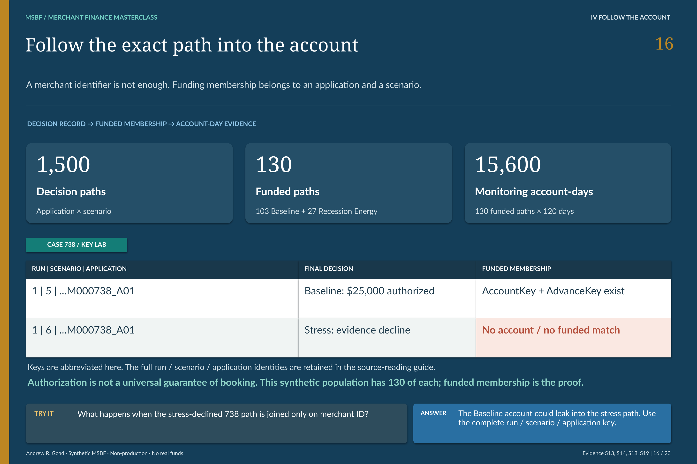

# M2.4 · Turn authorization into a traceable funded path

**Which decisions become synthetic accounts—and how is their identity carried forward?**

[Stage map](../../README.md#stage-map) · [Which source version?](../SOURCE_VERSIONS.md) · [Current use](../CURRENT_USE.md)

> **Source basis:** original `v0.2_ACCEPTED` in `Module_2/2.04_Booking_Funding_and_Portfolio_Activation`. The original package is preserved historical Module 2 evidence. Current strategy/lifecycle interpretation is version-separated in the R26 integration and change-control sources, not inferred from the old directory label. This is a reading companion, not a new technical acceptance or execution guide.

The funded path keeps application, scenario and synthetic account identities connected. [Open the unchanged source at full resolution](../../portfolio_visuals/MSBF_VISUAL_PUBLIC_R1/assets/teaching/pages/16_Funded_Account_Keys.png).

## Funding is a subset, not a synonym for decision

Every application-scenario path needs a decision record. Only an authorized path belongs in the funded lifecycle. M2.4 consumes the final authority and applicable terms from M2.3, establishes the synthetic booking/funding and account/advance records, and prepares the downstream monitoring boundary.

A review-required candidate must not appear funded simply because M2.2 found an amount. Likewise, a declined path's absence from monitoring is meaningful: it did not become a funded account in that scenario.

## Keep the two populations visible

The original v0.2 acceptance describes 59 funded paths: 44 Baseline and 15 Recession Energy, totaling $667,600 in synthetic principal. The corrected strategy feeds **130 paths: 103 Baseline and 27 Recession Energy**. Their amounts are **$1,385,300** and **$344,200**, respectively.

The combined 130 count describes funded scenario paths, not 130 distinct real merchants. The two scenario amounts are alternative results and should not be presented as one live lending book. The unchanged 750-application base makes the old/new strategy comparison possible; it is not evidence of customer acquisition growth.

## Identity, dates and contract meaning

The physical design carries the governed run, application and scenario into deterministic synthetic account/advance identifiers. Booking, funding, monitoring and first-remittance dates have defined relationships in the original specification. Those original scheduling rules are source evidence, not a promise that arbitrary new inputs have been tested through a current full build.

The activation record must reconcile to the authorized final amount, rate, payback and horizon. Downstream consumers need both the original decision identity and the lifecycle identity; joining only on merchant loses scenario and may attach servicing to the wrong decision.

The monitoring contract passes the funded path and selected terms to M2.5. It is not an executed legal lending agreement, proof of actual disbursement or evidence that funds moved outside the deterministic demonstration.

## What the accounting bridge tells the reader

The current funded population begins with $2,076,147.40 of total-repayment receivable across the two alternative scenario sets. The principal amount is not the same as that receivable: the payback multiple determines the repayment target. Neither target is realized profit.

After 120 monitoring days per funded path, M2.5 supplies remittance and residual-exposure evidence. Later operational servicing can affect the final certified balance, but M2.4 does not retrospectively rewrite final authority to make those results more attractive.

## A useful evidence test

Trace merchant 738 from its Baseline authorized decision to its funded date and monitoring records. Contrast the Recession Energy evidence decline, where funding and lifecycle sections correctly have no account activity. Then inspect merchant 098, whose smaller stress counteroffer still enters the permitted funded lifecycle. These cases teach both the inclusion rule and the meaning of absence.

The public original source files remain separated into normal, reporting and contingency recovery classes. Reading the folders in numeric order is not itself a qualified execution procedure.

## Requirements interpretation

The following are editorial reading locators into the retained requirements/design/authority documents—not invented native requirement IDs. Native IDs and control lists remain in the linked originals.

**BRD · Required outputs.** Produce synthetic booking/funding, account/advance and portfolio-activation records only from accepted authority.

**Design specification · Source-to-activation mapping.** Preserve deterministic identity and the no-activation treatment of unauthorized decisions.

**Current change report §9.** Keep the 59-to-130 version comparison separate from Baseline-versus-Recession scenario comparison.

## What the retained validation establishes

The original acceptance supports its 59-path historical cohort. The successor activation population and amount split are reconciled in the current change-control report and retained strategy inputs, preserved by R26/R20. No booking, funding or database activity was performed for this guide.

## Exact sources and original document families

[Original stage entry and package scope](../../../Module_2/2.04_Booking_Funding_and_Portfolio_Activation/README.md). Original requirements, SQL, catalogs, validation and signoff remain unchanged. Links below identify source-of-record documents; an original `src/current` label is local to that historical package.

[ARCHITECTURE](../../../Module_2/2.04_Booking_Funding_and_Portfolio_Activation/v0.2_ACCEPTED/docs/ARCHITECTURE.md)  
[BRD](../../../Module_2/2.04_Booking_Funding_and_Portfolio_Activation/v0.2_ACCEPTED/docs/BRD.md)  
[SOURCE PROVENANCE](../../../Module_2/2.04_Booking_Funding_and_Portfolio_Activation/v0.2_ACCEPTED/docs/SOURCE_PROVENANCE.md)  
[VALIDATION AND ACCEPTANCE](../../../Module_2/2.04_Booking_Funding_and_Portfolio_Activation/v0.2_ACCEPTED/docs/VALIDATION_AND_ACCEPTANCE.md)  
[M2 4 DESIGN AND GENERATION SPECIFICATION](../../../Module_2/2.04_Booking_Funding_and_Portfolio_Activation/v0.2_ACCEPTED/docs/source_documents/M2_4_DESIGN_AND_GENERATION_SPECIFICATION.md)  
[SOURCE PROVENANCE](../../../Module_2/2.04_Booking_Funding_and_Portfolio_Activation/v0.2_ACCEPTED/docs/source_documents/SOURCE_PROVENANCE.md)  

**Implementation entry points (source study, not a run sequence):**

[01_156_schema_policy.sql](../../../Module_2/2.04_Booking_Funding_and_Portfolio_Activation/v0.2_ACCEPTED/src/current/01_156_schema_policy.sql)  
[03_158_generation.sql](../../../Module_2/2.04_Booking_Funding_and_Portfolio_Activation/v0.2_ACCEPTED/src/current/03_158_generation.sql)  

**Contract/grain references:** [01_run_contract_lifecycle_and_acceptance_gate.csv](../../../Module_2/2.04_Booking_Funding_and_Portfolio_Activation/v0.2_ACCEPTED/catalogs/source_catalogs/01_run_contract_lifecycle_and_acceptance_gate.csv) · [156_msbf_m2_4_schema_policy_activation_contract_extension_v0_2_results_20260801.csv](../../../Module_2/2.04_Booking_Funding_and_Portfolio_Activation/v0.2_ACCEPTED/catalogs/source_catalogs/156_msbf_m2_4_schema_policy_activation_contract_extension_v0_2_results_20260801.csv) · [21_contract_registry_and_hash_summary.csv](../../../Module_2/2.04_Booking_Funding_and_Portfolio_Activation/v0.2_ACCEPTED/catalogs/source_catalogs/21_contract_registry_and_hash_summary.csv).

**Full retained requirements/validation families:** [docs / v0.2_ACCEPTED](../../../Module_2/2.04_Booking_Funding_and_Portfolio_Activation/v0.2_ACCEPTED/docs) · [source_documents / docs](../../../Module_2/2.04_Booking_Funding_and_Portfolio_Activation/v0.2_ACCEPTED/docs/source_documents) · [tests / v0.2_ACCEPTED](../../../Module_2/2.04_Booking_Funding_and_Portfolio_Activation/v0.2_ACCEPTED/tests). These grouped directories include earlier corrective and superseded records; they are not all new current acceptances.

## Current successor bridge

[Detailed version change, policy and population reconciliation](../../release_change_control/module_2_g3_v2_1/reports/02_DETAILED_CHANGE_LOG_AND_DATA_RECONCILIATION_REPORT.md) · [R26 source/runtime projection](../../../successor_candidates/m2-g3-v2.1-r26-integration/README.md) · [Retained strategy output and resolved-policy carrier](../../../successor_candidates/m2-g3-v2.1-r26-integration/source/inputs/PHASE2C_R4_STRATEGY.zip) · [Later R20 acceptance and current release status](../../release_integration/module_2_g3_v2_1/CURRENT_STATE.md).

## Read the neighboring boundary

[Previous reading: M2.3](M2_03.md) · [Next reading: M2.5](M2_05.md) · [All 31 entries](../../README.md#stage-map). **These are conceptual reading links, not an execution order.**

[Requirements and validation guide](../REQUIREMENTS_AND_VALIDATION.md) · [See the application decision explained](../EXPLAINABILITY.md).

*Deterministic synthetic demonstration · Non-production · No real funds. Current companions do not overwrite historical source records.*
