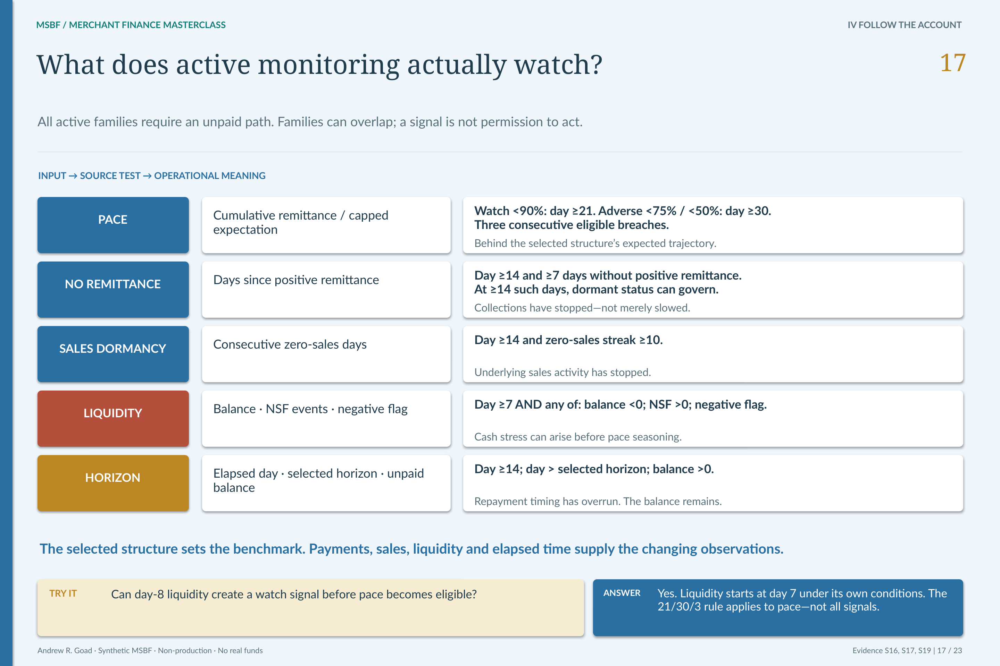

# M2.5 · Monitor repayment without inventing an early alarm

**Is a funded path behaving as expected—and which condition actually requires attention?**

[Stage map](../../README.md#stage-map) · [Which source version?](../SOURCE_VERSIONS.md) · [Current use](../CURRENT_USE.md)

> **Source basis:** original `v0.2R5_ACCEPTED` in `Module_2/2.05_Daily_Remittance_Exposure_and_Portfolio_Monitoring`. The original package is preserved historical Module 2 evidence. Current strategy/lifecycle interpretation is version-separated in the R26 integration and change-control sources, not inferred from the old directory label. This is a reading companion, not a new technical acceptance or execution guide.

Five monitoring families have different drivers; a status is not the same object as a raw alert flag. [Open the unchanged source at full resolution](../../portfolio_visuals/MSBF_VISUAL_PUBLIC_R1/assets/teaching/pages/17_Active_Monitoring_Drivers.png).

## A daily evidence system

M2.5 owns daily remittance, exposure and monitoring observations for funded synthetic paths. The current grain is one run/application/scenario/monitoring date, with 120 rows for each of 130 funded paths: **15,600 account-days**. The original 59-path package's 7,080 daily rows remain historical, not a current population count.

This stage observes modeled account behavior and resolves monitoring state. It does not recommend every intervention, grant operational permission or execute a payment. Those responsibilities remain M2.6, M2.7 and M2.8.

## Why the R26 calibration matters

The original monitoring rule could assess pace too early. R26 anchors pace to the first expected remittance and uses **selected total repayment ÷ selected horizon** as the expected daily benchmark. It preserves the 90% / 75% / 50% pace thresholds while changing when persistent pace evidence becomes eligible to drive status.

PACE WATCH eligibility starts at day 21; adverse pace eligibility starts at day 30. Both require three consecutive qualifying days, so the earliest corresponding persistent pace observations are days 23 and 32. This is a pace-specific rule, not permission to suppress every early signal until day 21.

Early no-remittance, zero-sales, liquidity and horizon conditions retain their own rules. The five operational families are **PACE, NO_REMITTANCE, SALES_DORMANCY, LIQUIDITY and HORIZON**. Raw flags, family labels and final monitoring status are distinct layers.

## The denominator is part of the meaning

Cumulative pace compares remittance with the applicable expected collection basis. A paid-off path cannot become adverse simply because a later expected-collection denominator keeps growing; terminal and matched-scenario handling remain controlled. Horizon overrun concerns an unpaid balance beyond the selected horizon—not merely the passage of time.

The historical 21/30/3 description should therefore never be placed on a poster as a universal delay for all alert families. Likewise, improved pace does not necessarily resolve a still-binding horizon condition.

## What changed—and what did not

The retained R17-to-R26 comparison records 9,249 changed cumulative-pace values and 3,300 changed monitoring-status rows. It also records **zero changes across all 15,600 rows** to actual remittance, cumulative remittance, receivable balance, principal-exposure proxy, source sales, dates/keys and the specified hard-trigger flags.

The endpoint remains 99 paid-off Baseline paths plus four severe-shortfall paths, and all 27 Recession Energy paths paid off. Baseline monitoring-end exposure is $7,823.28; Recession Energy is $0. These are alternative synthetic endpoints, not evidence of actual collections performance.

## From monitoring to action

M2.6 consumes the resolved evidence to recommend a route. A watch signal is not automatically a servicing event. M2.7 must establish permission before M2.8 processes any permitted synthetic servicing action.

For reproduction, the accepted R26 retained-final method restores an existing qualified checkpoint. It does not rerun M2.5–M2.10 through a newly advertised arbitrary-campaign launcher. The policy contract, source inputs and read-only reconciliation reports are the appropriate current reading route.

## Requirements interpretation

The following are editorial reading locators into the retained requirements/design/authority documents—not invented native requirement IDs. Native IDs and control lists remain in the linked originals.

**R26 approved policy record.** Change the pace anchor, eligibility and persistence without suppressing the separately governed hard triggers.

**Current change report §8.2.** Reconcile changed status/pace fields and unchanged cash/exposure/identity fields separately.

**Original BRD · Daily monitoring outputs.** Produce daily account evidence, not authorization or actual servicing.

## What the retained validation establishes

R26 retains 16/16 static policy checks, the submitted physical checkpoints, downstream nonregression and the later technical acceptance. The original M2.5 validation remains attached to its own version. Reading these results is not a fresh monitoring replay or proof of real-world alert effectiveness.

## Exact sources and original document families

[Original stage entry and package scope](../../../Module_2/2.05_Daily_Remittance_Exposure_and_Portfolio_Monitoring/README.md). Original requirements, SQL, catalogs, validation and signoff remain unchanged. Links below identify source-of-record documents; an original `src/current` label is local to that historical package.

[ARCHITECTURE](../../../Module_2/2.05_Daily_Remittance_Exposure_and_Portfolio_Monitoring/v0.2R5_ACCEPTED/docs/ARCHITECTURE.md)  
[BRD](../../../Module_2/2.05_Daily_Remittance_Exposure_and_Portfolio_Monitoring/v0.2R5_ACCEPTED/docs/BRD.md)  
[SOURCE PROVENANCE](../../../Module_2/2.05_Daily_Remittance_Exposure_and_Portfolio_Monitoring/v0.2R5_ACCEPTED/docs/SOURCE_PROVENANCE.md)  
[VALIDATION AND ACCEPTANCE](../../../Module_2/2.05_Daily_Remittance_Exposure_and_Portfolio_Monitoring/v0.2R5_ACCEPTED/docs/VALIDATION_AND_ACCEPTANCE.md)  
[M2 5 DESIGN AND GENERATION SPECIFICATION](../../../Module_2/2.05_Daily_Remittance_Exposure_and_Portfolio_Monitoring/v0.2R5_ACCEPTED/docs/source_documents/M2_5_DESIGN_AND_GENERATION_SPECIFICATION.md)  

**Implementation entry points (source study, not a run sequence):**

[01_164_schema_policy.sql](../../../Module_2/2.05_Daily_Remittance_Exposure_and_Portfolio_Monitoring/v0.2R5_ACCEPTED/src/current/01_164_schema_policy.sql)  
[03_166_generation.sql](../../../Module_2/2.05_Daily_Remittance_Exposure_and_Portfolio_Monitoring/v0.2R5_ACCEPTED/src/current/03_166_generation.sql)  

**Contract/grain references:** [164_msbf_m2_5_schema_policy_monitoring_contract_extension_v0_2_results_20260801.csv](../../../Module_2/2.05_Daily_Remittance_Exposure_and_Portfolio_Monitoring/v0.2R5_ACCEPTED/catalogs/source_catalogs/164_msbf_m2_5_schema_policy_monitoring_contract_extension_v0_2_results_20260801.csv) · [MSBF_M2_5_Daily_Remittance_Exposure_&_Portfolio_Monitoring_Detail_Report_v0_2R5_Contract_Registry_And_Hash_Summary_20260801.csv](../../../Module_2/2.05_Daily_Remittance_Exposure_and_Portfolio_Monitoring/v0.2R5_ACCEPTED/catalogs/source_catalogs/MSBF_M2_5_Daily_Remittance_Exposure_&_Portfolio_Monitoring_Detail_Report_v0_2R5_Contract_Registry_And_Hash_Summary_20260801.csv) · [MSBF_M2_5_Daily_Remittance_Exposure_&_Portfolio_Monitoring_Detail_Report_v0_2R5_Run_Contract_Lifecycle_And_Acceptance_Gate_20260801.csv](../../../Module_2/2.05_Daily_Remittance_Exposure_and_Portfolio_Monitoring/v0.2R5_ACCEPTED/catalogs/source_catalogs/MSBF_M2_5_Daily_Remittance_Exposure_&_Portfolio_Monitoring_Detail_Report_v0_2R5_Run_Contract_Lifecycle_And_Acceptance_Gate_20260801.csv).

**Full retained requirements/validation families:** [docs / v0.2R5_ACCEPTED](../../../Module_2/2.05_Daily_Remittance_Exposure_and_Portfolio_Monitoring/v0.2R5_ACCEPTED/docs) · [source_documents / docs](../../../Module_2/2.05_Daily_Remittance_Exposure_and_Portfolio_Monitoring/v0.2R5_ACCEPTED/docs/source_documents) · [tests / v0.2R5_ACCEPTED](../../../Module_2/2.05_Daily_Remittance_Exposure_and_Portfolio_Monitoring/v0.2R5_ACCEPTED/tests). These grouped directories include earlier corrective and superseded records; they are not all new current acceptances.

## Current successor bridge

[Detailed version change, policy and population reconciliation](../../release_change_control/module_2_g3_v2_1/reports/02_DETAILED_CHANGE_LOG_AND_DATA_RECONCILIATION_REPORT.md) · [R26 source/runtime projection](../../../successor_candidates/m2-g3-v2.1-r26-integration/README.md) · [Retained strategy output and resolved-policy carrier](../../../successor_candidates/m2-g3-v2.1-r26-integration/source/inputs/PHASE2C_R4_STRATEGY.zip) · [Later R20 acceptance and current release status](../../release_integration/module_2_g3_v2_1/CURRENT_STATE.md).

[Exact accepted source used by the successor rebase](../../../successor_candidates/m2-g3-v2.1-r26-integration/source/accepted_sources/M2_5_GEN__03_166_generation.sql); this source preserves method lineage and is not a standalone current launch instruction.

[R26_POLICY_CONTRACT.json](../../../successor_candidates/m2-g3-v2.1-r26-integration/source/config/R26_POLICY_CONTRACT.json)  
[R26_RUNTIME_CONTRACT.json](../../../successor_candidates/m2-g3-v2.1-r26-integration/source/config/R26_RUNTIME_CONTRACT.json)  
[R19_STRATEGY_PROFILE_CONTRACT.json](../../../successor_candidates/m2-g3-v2.1-r26-integration/source/config/R19_STRATEGY_PROFILE_CONTRACT.json)  

## Read the neighboring boundary

[Previous reading: M2.4](M2_04.md) · [Next reading: M2.6](M2_06.md) · [All 31 entries](../../README.md#stage-map). **These are conceptual reading links, not an execution order.**

[Requirements and validation guide](../REQUIREMENTS_AND_VALIDATION.md) · [See the application decision explained](../EXPLAINABILITY.md).

*Deterministic synthetic demonstration · Non-production · No real funds. Current companions do not overwrite historical source records.*
