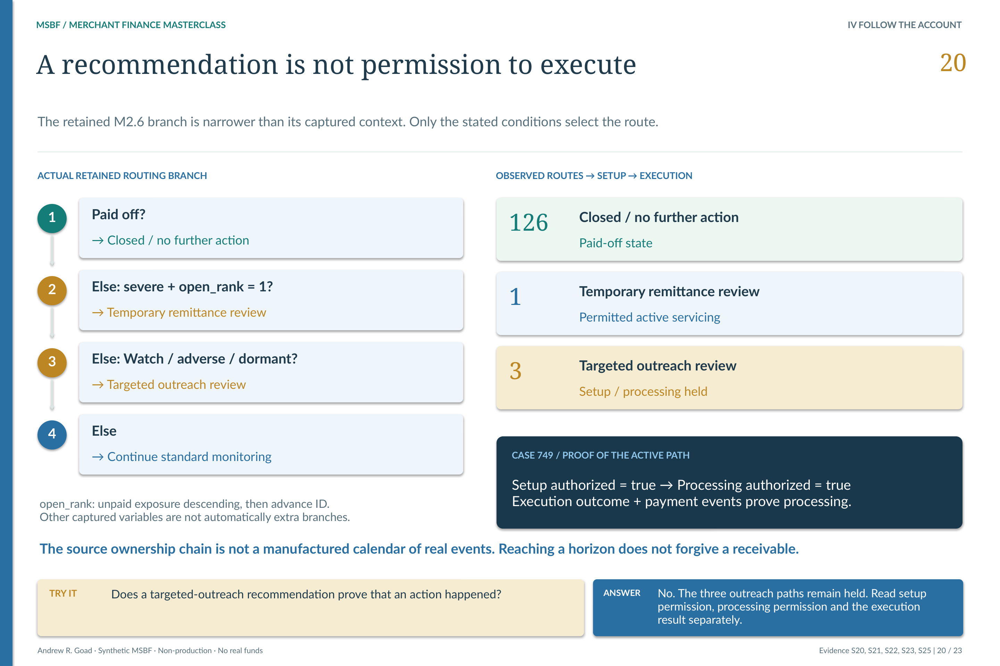

[MSBF](../../../README.md) / [Documentation](../../README.md) / Module 2

# M2.7 · Operational activation and account setup

### What may be configured after an intervention is recommended—and what remains held?

A monitoring signal is not an instruction to change payments. M2.6 recommends an intervention; M2.7 resolves the operational setup and blueprint; M2.8 owns permitted servicing simulation and its execution evidence. A reviewed account can therefore have a clear recommendation while **setup or processing remains held**.

**Reading companion, not a new acceptance.** The original M2.7 `v0.2R1` package records the v2.0.0 59-path population. The current accepted successor uses 130 funded scenario paths. The source-version bridge below keeps those observations separate. M2.7 is account setup—not final financing-structure selection.

**Read across three kinds of evidence:** recommendation, permission and execution result. The observed 126/1/3 routes do not imply that every available policy route occurred, or that an outreach recommendation became real merchant contact.

[Open the lesson at full resolution](../../portfolio_visuals/MSBF_VISUAL_PUBLIC_R1/assets/teaching/pages/20_Intervention_Setup_Execution.png) · [Read the lifecycle explainer](../../portfolio_visuals/MSBF_VISUAL_PUBLIC_R1/assets/posters/MSBF_MCI_What_Happens_After_the_Decision_v2_1_COPYFIX_R1.png)

## From a source outcome to a governed setup

The accepted M2.6 latest contract is materialized once. M2.7 maps source **outcome/action pairs**, rather than treating any word appearing in a JSON payload as an instruction. The preserved generation source's Section 4 makes the mapping explicit:

| M2.6 outcome / action | M2.7 result |
| --- | --- |
| Closed / no-action-closed | No operational setup required |
| Temporary remittance adjustment review / temporary remittance review | Temporary payment adjustment setup ready |
| Targeted merchant outreach review / outreach review queue | Operational setup review required |
| Continue standard monitoring / same action | Standard servicing setup ready |

The exact source values include `CLOSED_NO_FURTHER_ACTION`, `TEMPORARY_REMITTANCE_ADJUSTMENT_REVIEW` and `TARGETED_MERCHANT_OUTREACH_REVIEW`; the corresponding setup outcomes are `NO_OPERATIONAL_SETUP_REQUIRED`, `TEMPORARY_PAYMENT_ADJUSTMENT_SETUP_READY` and `OPERATIONAL_SETUP_REVIEW_REQUIRED`.

The source also contains restructure/recovery branches and a default review outcome. **Defined routes are not observed counts or evidence of real servicing capability.** Read the actual conditions before assigning a route. [Inspect the preserved mapping input](../../../successor_candidates/m2-g3-v2.1-r26-integration/source/accepted_sources/M2_7_GEN__03_182_generation_v0_2R1.sql).

## The permission boundary is a data contract

`setup_authorized_flag` is true for designated setup-ready outcomes; it is not true merely because an upstream recommendation exists. The source retains `blueprint_created_flag`, `setup_review_required_flag` and `no_setup_required_flag` separately.

A setup-authorized record receives **`SIMULATED_BLUEPRINT_READY`**; a review record **`OPERATIONAL_REVIEW_REQUIRED`**; an account with no setup need **`NOT_REQUIRED`**. Plan identity, activation/reassessment dates and temporary-parameter fields are derived under the setup logic. The output does not silently create a real core account or transmit a payment.

The account-context fields retain **`module1_run_id`, `scenario_id`, `merchant_application_id`, `synthetic_account_id` and `synthetic_advance_id`**. Latest/archive and contract-registry hashes preserve lineage from the M2.6 source through activation and account setup. The named downstream interface is **`M2_OPERATIONAL_ACTIVATION_ACCOUNT_SETUP_CONSUMPTION v1`**. [Account setup schema and blueprint rules](../../../successor_candidates/m2-g3-v2.1-r26-integration/source/accepted_sources/M2_7_GEN__03_182_generation_v0_2R1.sql) · [Original contract/control catalog](../../../Module_2/2.07_Operational_Activation_and_Account_Setup/v0.2R1_ACCEPTED/catalogs/source_catalogs/M2_7_POSITIVE_CONTROL_CATALOG.csv).

**Processing and actual events are a later question.** A setup-ready blueprint must be followed into M2.8's processing permission and execution result. The frozen lesson's synthetic merchant 749 shows both setup and processing authorized, with payment-event evidence. Its three outreach counterparts remain held. No actual contact, ACH transmission or production account action is implied. [Follow the three-stage boundary](../../portfolio_visuals/MSBF_VISUAL_PUBLIC_R1/assets/teaching/companion/EXACT_SLIDE_COPY.md) · [Open the M2.8 source package](../../../Module_2/2.08_Servicing_Execution_Payment_and_Lifecycle_Control/README.md).

## A source-version bridge—not a blended population

| Versioned evidence | What the retained record says |
| --- | --- |
| Original v2.0.0 M2.7 · `v0.2R1` | 59 source, activation, setup and latest/archive rows; 57 no-setup, one temporary-adjustment blueprint, one operational governance review. |
| Corrected Wave A / R17 lifecycle | Reconstructed from the 130 funded-path successor using versioned source transforms and identity rebinding. |
| R26 downstream nonregression | M2.7 comparison: **130 rows on each side, 18 shared columns, zero different cells**. M2.6–M2.10 business outputs are preserved relative to R17. |
| Current teaching / observed routes | 126 closed/no-further-action paths, one permitted active-servicing path and three review holds across alternative scenarios. |

[Original accepted population](../../../Module_2/2.07_Operational_Activation_and_Account_Setup/v0.2R1_ACCEPTED/docs/source_documents/M2_7_LIVE_EXECUTION_EVIDENCE_REVIEW_AND_SIGNOFF.md) · [R17-to-R26 direct comparison record](../../release_change_control/module_2_g3_v2_1/registers/06_R17_TO_R26_DOWNSTREAM_OUTPUT_NONREGRESSION.csv).

The R26 runtime's `accepted_sources/` files are preserved inputs and identity evidence. Their historical population constants are not today's observed counts. The [transformation register](../../../successor_candidates/m2-g3-v2.1-r26-integration/source/manifests/13_TRANSFORMATION_RULE_REGISTER.csv) and [validation-rebase register](../../../successor_candidates/m2-g3-v2.1-r26-integration/source/manifests/11_POSITIVE_VALIDATION_REBASE_M2_5_M2_10.csv) explain the source rebasing. The delivered retained-final runtime **does not rerun M2.5–M2.10**; those stages are verified predecessor facts for its M2.11–M2.12 resume. [Exact integration boundary](../../../successor_candidates/m2-g3-v2.1-r26-integration/README.md).

## Requirements and validation

The original BRD's section/control numbers are retained below as locators. The `M2_7_POS_*` names are actual **historical** validation IDs, not new acceptance requirements for this reading companion.

**1. BRD · Governing inputs.** M2.6 contract and source hash before setup. The historical literal hash remains tied to its original population.

Historical evidence ID: `M2_7_POS_004_SOURCE_IDENTITY`.

**2. BRD · Operational readiness.** Method, consumption contract and schema identity, rather than an unversioned setup payload.

Historical evidence ID: `M2_7_POS_003_METHOD_CONTRACT`.

**3. BRD · Control requirement 1.** Exact historical 59-path registry counts; later rebasing has separate evidence.

Historical evidence ID: `M2_7_POS_012_REGISTRY_COUNTS`.

**4. BRD · Control requirement 6.** Zero real-execution flags in the definitions; setup remains synthetic.

Historical evidence ID: `M2_7_POS_018_DEFINITION_BOUNDARY`.

[Read the original BRD](../../../Module_2/2.07_Operational_Activation_and_Account_Setup/v0.2R1_ACCEPTED/docs/BRD.md) · [Inspect the validation catalog](../../../Module_2/2.07_Operational_Activation_and_Account_Setup/v0.2R1_ACCEPTED/catalogs/source_catalogs/M2_7_POSITIVE_CONTROL_CATALOG.csv) · [See original current/reporting/recovery classes](../../../Module_2/2.07_Operational_Activation_and_Account_Setup/v0.2R1_ACCEPTED/src/README.md).

The original signoff records **120/120 positive**, **20/20 negative** controls; **24/24 detail-result sets**; and zero latest/archive mismatches, stress improvements, real-execution boundary rows or premature M2.8 objects. It separately records **3,237 evidence assertions**—not 3,237 newly rerun tests for this guide. The failure/recovery history remains part of the record, not a normal execution instruction. [Original validation and acceptance](../../../Module_2/2.07_Operational_Activation_and_Account_Setup/v0.2R1_ACCEPTED/docs/source_documents/M2_7_LIVE_EXECUTION_EVIDENCE_REVIEW_AND_SIGNOFF.md).

Current population support comes from the accepted Wave A reconstruction, the exact R17/R26 comparison and the later integrated authority—not by substituting 130 into the old 59-path report. This guide performs no database or servicing execution.

## Follow the account, not an assumed timeline

**The takeaway:** recommendation, setup permission, processing permission and execution evidence answer different questions. A reconciled account can still have a receivable, and reaching a horizon does not forgive it.

**Reading order; execution prerequisites are separate.**

[Previous companion: M2.6](M2_06.md) · [Next companion: M2.8](M2_08.md) · [All 31 entries](../../README.md#stage-map).

Source and related reading: [M2.6 source](../../../Module_2/2.06_Early_Warning_Intervention_and_Servicing_Strategy/README.md) · [M2.7 original package](../../../Module_2/2.07_Operational_Activation_and_Account_Setup/README.md) · [M2.8 source](../../../Module_2/2.08_Servicing_Execution_Payment_and_Lifecycle_Control/README.md) · [Then M2.9 reconciliation](../../../Module_2/2.09_Payment_Reconciliation_and_Account_State_Certification/README.md).

[Requirements and validation guide](../REQUIREMENTS_AND_VALIDATION.md) · [See the application decision explained](../EXPLAINABILITY.md) · [Current-use prerequisites](../CURRENT_USE.md).

*Deterministic synthetic demonstration · Non-production · No real funds. Current companions do not overwrite historical source records.*
