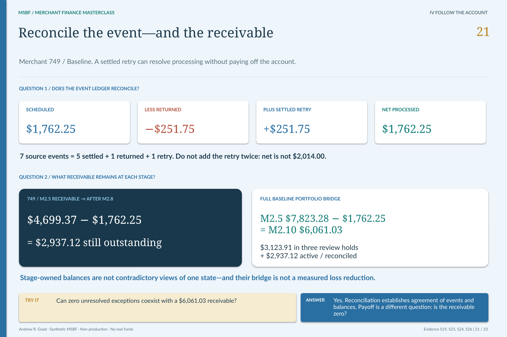

# M2.8 · Execute only the permitted synthetic servicing path

**What was actually processed after setup and processing permission?**

[Stage map](../../README.md#stage-map) · [Which source version?](../SOURCE_VERSIONS.md) · [Current use](../CURRENT_USE.md)

> **Source basis:** original `v0.2_ACCEPTED` in `Module_2/2.08_Servicing_Execution_Payment_and_Lifecycle_Control`. The original package is preserved historical Module 2 evidence. Current strategy/lifecycle interpretation is version-separated in the R26 integration and change-control sources, not inferred from the old directory label. This is a reading companion, not a new technical acceptance or execution guide.

[](../../portfolio_visuals/MSBF_VISUAL_PUBLIC_R1/assets/teaching/pages/21_Return_Retry_Reconciliation.png)

Scheduled amount, return, retry and residual balance belong to distinct ledger relationships. [Open the unchanged source at full resolution](../../portfolio_visuals/MSBF_VISUAL_PUBLIC_R1/assets/teaching/pages/21_Return_Retry_Reconciliation.png).

## Execution evidence is not a recommendation

M2.8 consumes M2.7's operational setup and processing permissions. It records synthetic payment/event execution and the resulting lifecycle state. M2.6's recommendation alone is insufficient, and a setup-ready record must not be confused with the absence of a processing hold.

The current stage retains 130 account-scenario paths: closed paths, review-held paths and the permitted active-servicing path remain represented. A held branch has no implied payment or outreach execution. These are modeled records, not banking transactions.

## Read the event ledger

The design preserves scheduled/processed payments, a returned payment and the governed retry with source account and permission lineage. The reader must distinguish a gross scheduled amount, a returned amount, retry recovery and the net amount actually reflected in the synthetic execution result.

For merchant 749's Baseline active path, the change report describes a corrected **$503.50 processed amount on the retry event** and a **$1,762.25 total processed amount**. The classroom ledger separately shows **$251.75 of retry recovery**. These are different fields, not competing totals.

The retained event definitions distinguish `processed_payment_amount` on the retry event from `retry_payment_amount`. With the source's 2× catch-up multiplier, that event processes the normal $251.75 installment plus $251.75 of recovery: $503.50. The whole-ledger identity remains **$1,762.25 scheduled − $251.75 returned + $251.75 retry recovery = $1,762.25 processed**. Adding the full $503.50 again as recovery would double count the regular installment. This is a field-level reading of the retained source and classroom ledger, not a new payment replay.

[Inspect the event fields](../../../successor_candidates/m2-g3-v2.1-r26-integration/source/accepted_sources/M2_8_GEN__03_190_generation.sql) · [Catch-up multiplier in the retained policy](../../../successor_candidates/m2-g3-v2.1-r26-integration/source/accepted_sources/M2_8_SCHEMA__01_188_schema_policy.sql) · [Exact rounding correction](../../../successor_candidates/m2-g3-v2.1-r26-integration/source/config/R13_M2_8_RETRY_ROUNDING_CORRECTION.json) · [Classroom ledger and source pointers](../../portfolio_visuals/MSBF_VISUAL_PUBLIC_R1/assets/teaching/companion/READ_ONLY_CODE_MAP.md#9-reconcile-events-before-reading-the-portfolio).

The original 59-path example contains smaller historical amounts and must not be substituted for this current 130-path evidence.

## The one-cent correction has a real control lesson

A retry multiplier applied before the scheduled amount was finalized to cents produced a one-cent reconciliation discrepancy. The retained correction changes the rounding order:

```text
Prior: round(round(exposure / duration, 2) × payment_factor × retry_multiplier, 2)
Current: round(round(round(exposure / duration, 2) × payment_factor, 2) × retry_multiplier, 2)
```

The scheduled cent amount is established first; the retry multiplier then acts on that cent amount. M2.9's exact-zero reconciliation and exposure controls were not weakened to accommodate the difference.

This is an illustration of why implementation details belong underneath a business-facing result. “Paid correctly” is not sufficiently precise when two plausible arithmetic orderings produce different ledger evidence.

## Source and version separation

The immutable original `src/current` generation and schema are source-of-record for v0.2. The version-separated R26 accepted sources and change report explain the rebuilt successor population and retained rounding correction. They do not authorize mixing arbitrary original and successor SQL into a filename-sorted run.

The R17-to-R26 downstream comparison records 130 rows, 23 shared columns and zero changed cells for M2.8. Monitoring calibration preserved this execution output.

## Reconciliation is still downstream

M2.9 independently reconciles the source monitoring exposure and M2.8 execution ledger into a certified account state. An execution snapshot is not its own independent reconciliation. M2.10 later summarizes that certified result; Power BI displays it rather than creating a new payment ledger.

Recovery scripts are retained contingency evidence with their own prerequisites. They are not automatically invoked by the current-use guide and are not ordinary next steps after every run.

## Requirements interpretation

The following are editorial reading locators into the retained requirements/design/authority documents—not invented native requirement IDs. Native IDs and control lists remain in the linked originals.

**Original BRD · Servicing execution outputs.** Keep permitted execution distinct from operational recommendation and setup.

**Current change report §7.3.** Apply retry multiplication to the established scheduled cent amount; preserve exact-zero reconciliation.

**Current downstream nonregression register · M2.8.** Retain the 130-row, 23-column R17/R26 business-output equality without claiming a new replay.

## What the retained validation establishes

The current change-control report records the corrected retry, processed total and zero reconciliation/exposure variance. Original v0.2 acceptance remains visible as historical source evidence. No payment simulation, engine replay or real collection was executed for this companion.

## Exact sources and original document families

[Original stage entry and package scope](../../../Module_2/2.08_Servicing_Execution_Payment_and_Lifecycle_Control/README.md). Original requirements, SQL, catalogs, validation and signoff remain unchanged. Links below identify source-of-record documents; an original `src/current` label is local to that historical package.

[ARCHITECTURE](../../../Module_2/2.08_Servicing_Execution_Payment_and_Lifecycle_Control/v0.2_ACCEPTED/docs/ARCHITECTURE.md)  
[BRD](../../../Module_2/2.08_Servicing_Execution_Payment_and_Lifecycle_Control/v0.2_ACCEPTED/docs/BRD.md)  
[SOURCE PROVENANCE](../../../Module_2/2.08_Servicing_Execution_Payment_and_Lifecycle_Control/v0.2_ACCEPTED/docs/SOURCE_PROVENANCE.md)  
[VALIDATION AND ACCEPTANCE](../../../Module_2/2.08_Servicing_Execution_Payment_and_Lifecycle_Control/v0.2_ACCEPTED/docs/VALIDATION_AND_ACCEPTANCE.md)  
[M2 8 DESIGN AND GENERATION SPECIFICATION](../../../Module_2/2.08_Servicing_Execution_Payment_and_Lifecycle_Control/v0.2_ACCEPTED/docs/source_documents/M2_8_DESIGN_AND_GENERATION_SPECIFICATION.md)  

**Implementation entry points (source study, not a run sequence):**

[01_188_schema_policy.sql](../../../Module_2/2.08_Servicing_Execution_Payment_and_Lifecycle_Control/v0.2_ACCEPTED/src/current/01_188_schema_policy.sql)  
[03_190_generation.sql](../../../Module_2/2.08_Servicing_Execution_Payment_and_Lifecycle_Control/v0.2_ACCEPTED/src/current/03_190_generation.sql)  

**Contract/grain references:** [195_21_contract_registry_and_canonical_hash.csv](../../../Module_2/2.08_Servicing_Execution_Payment_and_Lifecycle_Control/v0.2_ACCEPTED/catalogs/source_catalogs/195_21_contract_registry_and_canonical_hash.csv).

**Full retained requirements/validation families:** [docs / v0.2_ACCEPTED](../../../Module_2/2.08_Servicing_Execution_Payment_and_Lifecycle_Control/v0.2_ACCEPTED/docs) · [source_documents / docs](../../../Module_2/2.08_Servicing_Execution_Payment_and_Lifecycle_Control/v0.2_ACCEPTED/docs/source_documents) · [tests / v0.2_ACCEPTED](../../../Module_2/2.08_Servicing_Execution_Payment_and_Lifecycle_Control/v0.2_ACCEPTED/tests). These grouped directories include earlier corrective and superseded records; they are not all new current acceptances.

## Current successor bridge

[Detailed version change, policy and population reconciliation](../../release_change_control/module_2_g3_v2_1/reports/02_DETAILED_CHANGE_LOG_AND_DATA_RECONCILIATION_REPORT.md) · [R26 source/runtime projection](../../../successor_candidates/m2-g3-v2.1-r26-integration/README.md) · [Retained strategy output and resolved-policy carrier](../../../successor_candidates/m2-g3-v2.1-r26-integration/source/inputs/PHASE2C_R4_STRATEGY.zip) · [Later R20 acceptance and current release status](../../release_integration/module_2_g3_v2_1/CURRENT_STATE.md).

[Exact accepted source used by the successor rebase](../../../successor_candidates/m2-g3-v2.1-r26-integration/source/accepted_sources/M2_8_GEN__03_190_generation.sql); this source preserves method lineage and is not a standalone current launch instruction.


## Read the neighboring boundary

[Previous reading: M2.7](M2_07.md) · [Next reading: M2.9](M2_09.md) · [All 31 entries](../../README.md#stage-map). **These are conceptual reading links, not an execution order.**

[Requirements and validation guide](../REQUIREMENTS_AND_VALIDATION.md) · [See the application decision explained](../EXPLAINABILITY.md).

*Deterministic synthetic demonstration · Non-production · No real funds. Current companions do not overwrite historical source records.*
