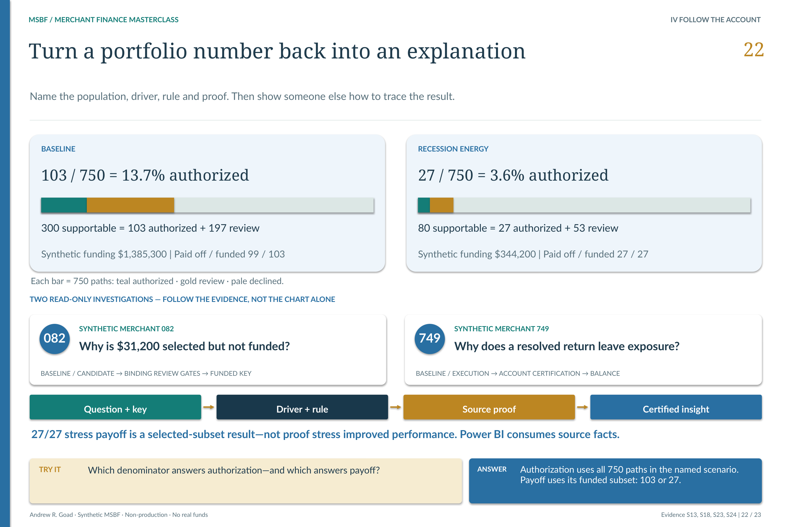

# M2.12 · Certify what downstream readers are consuming

**Can the complete source boundary be traced, reconciled and consumed without changing its meaning?**

[Stage map](../../README.md#stage-map) · [Which source version?](../SOURCE_VERSIONS.md) · [Current use](../CURRENT_USE.md)

> **Source basis:** original `v1_ACCEPTED` in `Module_2/2.12_Enterprise_Portfolio_Certification_and_G3_Contract`. The original package is preserved historical Module 2 evidence. Current strategy/lifecycle interpretation is version-separated in the R26 integration and change-control sources, not inferred from the old directory label. This is a reading companion, not a new technical acceptance or execution guide.

Reconciled source evidence and certification precede Power BI consumption. [Open the unchanged source at full resolution](../../portfolio_visuals/MSBF_VISUAL_PUBLIC_R1/assets/teaching/pages/22_Portfolio_Intelligence_and_Proof.png).

## Certification joins evidence—not responsibilities

M2.12 is the Module 2 enterprise-consumption boundary. It checks the accepted stages, component contracts, source edges, evidence families and canonical identities and exposes the resulting bundle to downstream consumers.

It does not create a new financing decision, reprice a candidate, execute servicing or approve a Power BI visual merely by certifying its source. The source pipeline and the analytical presentation require different evidence.

## Original G3 and current G3-v2

The original `v1_ACCEPTED` package specifies **M2_G3_CONSUMPTION_BUNDLE v1** and **G3_M2_CONTRACT — PASS**. Its physical boundary contains 12 stage nodes, 13 component contracts, 72 evidence cells and 19 source edges, with 134 canonical entities across nine families.

The current R26-integrated successor adds a distinct **70/70 G3-v2 source-certification** result, tied to the retained strategy/simulation population and current output identities. Do not add 70 to the older positive/negative control counts and market a fabricated program-wide total; these are different suites and scopes.

The v1 source and its failed/proposed/corrected history remain accessible unchanged. Current metadata supplies the later authority rather than rewriting the old contract to pretend a successor existed at its original acceptance date.

## What the consumer needs to trust

A source-certified view must preserve the run, scenario, application/account keys and the exact selected source roots. Latest/archive/registry agreement matters because a current row without the matching retained archive could obscure how the published result was obtained.

Capability labels also need a boundary. A complete set of source contracts can establish that the synthetic demonstration is internally consumable; it cannot establish legal certification, production deployment, empirical profitability or authority to operate Campaign Scale or Module 3.

## Power BI is a separate accepted implementation

The accepted client-facing PBIX presents P01–P04 and retains the hidden P02-DIAG page. P05/P06 are excluded from the current visible scope. Its source bindings, observation-date behavior, narrative QA and persistence received separate Power BI acceptance under IA-D-R17-PBI-001.

G3-v2's 70/70 does not substitute for that report review. Conversely, a polished screenshot does not certify the upstream engine. The intended relationship is **reconciled source evidence → source certification → analytical consumption**.

P03's business-facing narratives retain the source rationale; P04 reads permitted execution and certified account state. Neither page is a new operational authority.

## Release status remains a separate event

R20 accepts the exact integrated pre-history R3, preserving R26, Power BI, cohort and visual determinations. The later local history and editorial derivatives are not technical release upgrades. Stable publication remains a separately controlled action after actual release-asset verification, owner Git/base/tag checks and final commit binding.

A future hosted-verification receipt must describe genuine downloads and Windows-native extraction after publication. No local validator can prove those events happened before they occur.

## Requirements interpretation

The following are editorial reading locators into the retained requirements/design/authority documents—not invented native requirement IDs. Native IDs and control lists remain in the linked originals.

**BRD · Twelve-stage/thirteen-component certification.** Bind stage lineage, contracts and evidence into the enterprise-consumption bundle.

**Original validation · Stage nodes, component contracts and source edges.** Interpret structural coverage at its original boundary; retain its exact acceptance evidence.

**R26 G3-v2 and R20 authority.** Preserve current source certification separately from Power BI implementation and later publication.

## What the retained validation establishes

The original v1 acceptance records 128/128 positives, 20/20 negatives and 48/48 acceptance requirements. R26/G3-v2 source certification and R17 Power BI acceptance remain separate later determinations, preserved by R20. This guide does not independently reaccept any technical system.

## Exact sources and original document families

[Original stage entry and package scope](../../../Module_2/2.12_Enterprise_Portfolio_Certification_and_G3_Contract/README.md). Original requirements, SQL, catalogs, validation and signoff remain unchanged. Links below identify source-of-record documents; an original `src/current` label is local to that historical package.

[ARCHITECTURE](../../../Module_2/2.12_Enterprise_Portfolio_Certification_and_G3_Contract/v1_ACCEPTED/docs/ARCHITECTURE.md)  
[BRD](../../../Module_2/2.12_Enterprise_Portfolio_Certification_and_G3_Contract/v1_ACCEPTED/docs/BRD.md)  
[SOURCE PROVENANCE](../../../Module_2/2.12_Enterprise_Portfolio_Certification_and_G3_Contract/v1_ACCEPTED/docs/SOURCE_PROVENANCE.md)  
[VALIDATION AND ACCEPTANCE](../../../Module_2/2.12_Enterprise_Portfolio_Certification_and_G3_Contract/v1_ACCEPTED/docs/VALIDATION_AND_ACCEPTANCE.md)  

**Implementation entry points (source study, not a run sequence):**

[220_msbf_m2_12_schema_policy_certification_structures_g3_bundle_triggers_views_v1_HF4.sql](../../../Module_2/2.12_Enterprise_Portfolio_Certification_and_G3_Contract/v1_ACCEPTED/src/current/220_msbf_m2_12_schema_policy_certification_structures_g3_bundle_triggers_views_v1_HF4.sql)  
[222_msbf_m2_12_end_to_end_certification_generation_physical_reconciliation_v1_HF9.sql](../../../Module_2/2.12_Enterprise_Portfolio_Certification_and_G3_Contract/v1_ACCEPTED/src/current/222_msbf_m2_12_end_to_end_certification_generation_physical_reconciliation_v1_HF9.sql)  

**Contract/grain references:** [M2_12_ACCEPTED_SOURCE_AND_CONTRACT_INVENTORY.csv](../../../Module_2/2.12_Enterprise_Portfolio_Certification_and_G3_Contract/v1_ACCEPTED/catalogs/source_catalogs/M2_12_ACCEPTED_SOURCE_AND_CONTRACT_INVENTORY.csv).

**Full retained requirements/validation families:** [docs / v1_ACCEPTED](../../../Module_2/2.12_Enterprise_Portfolio_Certification_and_G3_Contract/v1_ACCEPTED/docs) · [source_documents / docs](../../../Module_2/2.12_Enterprise_Portfolio_Certification_and_G3_Contract/v1_ACCEPTED/docs/source_documents) · [tests / v1_ACCEPTED](../../../Module_2/2.12_Enterprise_Portfolio_Certification_and_G3_Contract/v1_ACCEPTED/tests). These grouped directories include earlier corrective and superseded records; they are not all new current acceptances.

## Current successor bridge

[Detailed version change, policy and population reconciliation](../../release_change_control/module_2_g3_v2_1/reports/02_DETAILED_CHANGE_LOG_AND_DATA_RECONCILIATION_REPORT.md) · [R26 source/runtime projection](../../../successor_candidates/m2-g3-v2.1-r26-integration/README.md) · [Retained strategy output and resolved-policy carrier](../../../successor_candidates/m2-g3-v2.1-r26-integration/source/inputs/PHASE2C_R4_STRATEGY.zip) · [Later R20 acceptance and current release status](../../release_integration/module_2_g3_v2_1/CURRENT_STATE.md).

[R26_POLICY_CONTRACT.json](../../../successor_candidates/m2-g3-v2.1-r26-integration/source/config/R26_POLICY_CONTRACT.json)  
[R26_RUNTIME_CONTRACT.json](../../../successor_candidates/m2-g3-v2.1-r26-integration/source/config/R26_RUNTIME_CONTRACT.json)  
[R19_STRATEGY_PROFILE_CONTRACT.json](../../../successor_candidates/m2-g3-v2.1-r26-integration/source/config/R19_STRATEGY_PROFILE_CONTRACT.json)  

## Read the neighboring boundary

[Previous reading: M2.11](M2_11.md) · [All 31 entries](../../README.md#stage-map). **These are conceptual reading links, not an execution order.**

[Requirements and validation guide](../REQUIREMENTS_AND_VALIDATION.md) · [See the application decision explained](../EXPLAINABILITY.md).

*Deterministic synthetic demonstration · Non-production · No real funds. Current companions do not overwrite historical source records.*
