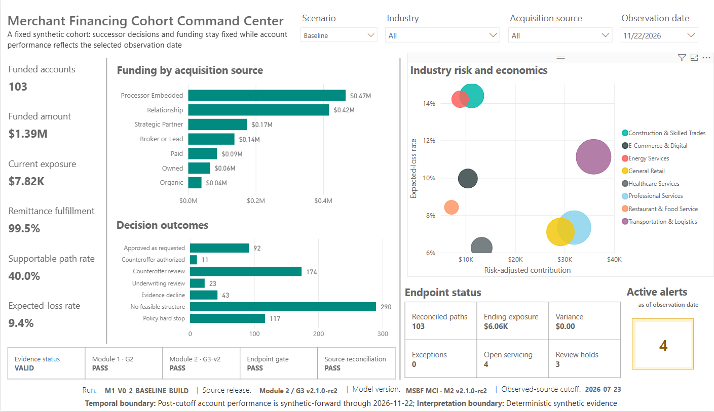
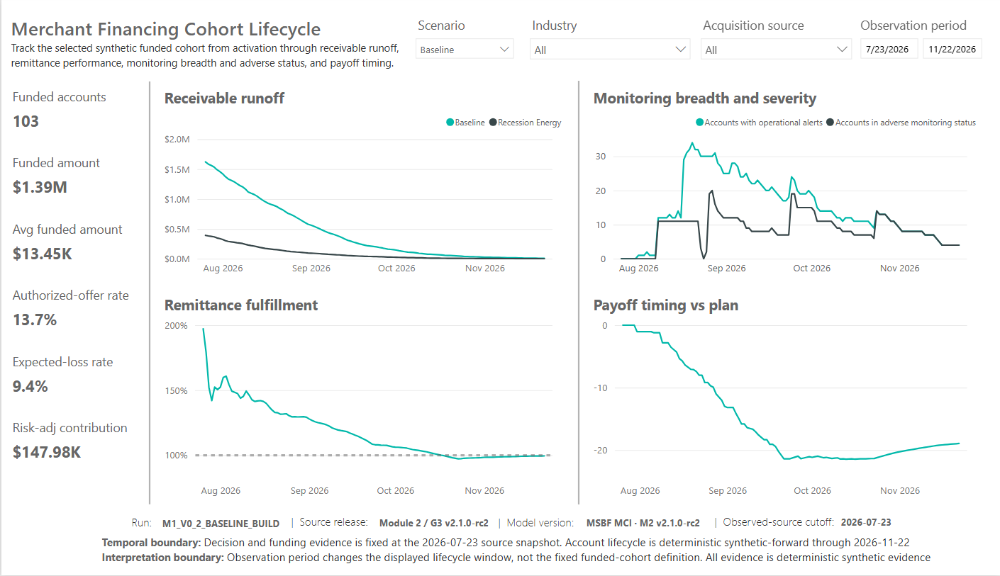
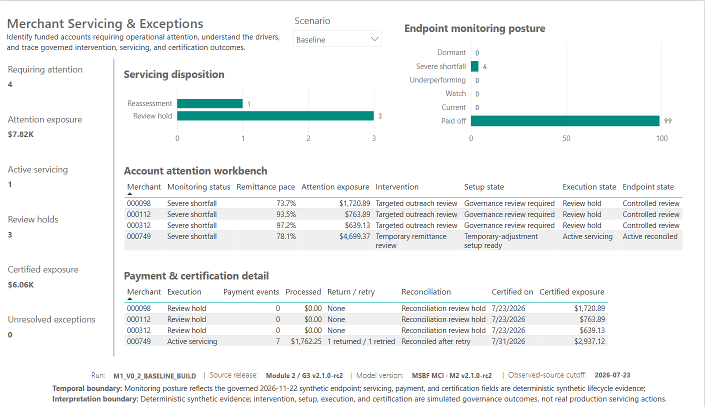

# MSBF Merchant Credit Intelligence - Canonical Power BI Source of Truth

**Document ID:** MSBF-MCI-PBI-CST-R7  
**Register version:** R7  
**As of:** 2026-09-04  
**Product release candidate:** Module 2 v2.1.0-rc2  
**Status:** Corrected final publication candidate; R16 localized P04 audit finding closed by bounded correction; expedited focused re-audit pending

## 1. Purpose

This document is the controlling human-readable source of truth for the current **MSBF Merchant Credit Intelligence** Power BI release candidate. It consolidates the accepted technical authority, physical artifact identity, report composition, semantic-source rules, current page state, data populations, validation outcomes, owner-confirmed corrections, evidence policy, final persistence closure, and the remaining controlled publication action.

It is intended for GitHub publication support, technical maintenance, audit traceability, and future continuation. It does not itself execute GitHub publication or public supersession.

## 2. Controlling identity

| Attribute | Current value |
| --- | --- |
| Product | **MSBF Merchant Credit Intelligence** |
| Short name | **MSBF MCI** |
| Subtitle | **Decisioning, Portfolio & Servicing Intelligence** |
| Module scope | **Module 2** |
| Release candidate | **v2.1.0-rc2** |
| Client-facing PBIX | `MSBF_Merchant_Credit_Intelligence_M2_v2.1.0-rc2.pbix` |
| PBIX bytes | `27,635,305` |
| PBIX SHA-256 | `ca46e8551860836a0cf4ff9239c42fcf8df02f1705596b9f8ca1bd047b5294e4` |
| Embedded DataModel bytes | `27,485,797` |
| Embedded DataModel SHA-256 | `24396d02c0fbcb782cc9918e842886711146b8ff9455c8822d2aeaf009b96061` |
| Observed-source cutoff | **2026-07-23** |
| Synthetic-forward lifecycle endpoint | **2026-11-22** |
| Technical authority | **R26 M2.5-M2.12 / G3-v2 accepted technical successor baseline** |
| Power BI authority | **Version-separated integration authorized** |
| Public release state | **Not executed; corrected candidate is ready for expedited focused re-audit and, if accepted, separate controlled release action** |

## 3. Authority and source hierarchy

When records conflict, use this precedence:

1. Accepted R26 audit authority and source carrier.
2. The current client-facing PBIX and physically installed DAX.
3. Final owner-approved Power BI presentation captures.
4. QA, accessibility, interaction, and package-integrity evidence.
5. Derived publication documents and registers.

The report is a deterministic synthetic analytical product. It is not a production underwriting platform, payment system, servicing system, CECL estimate, audited profitability statement, causal experiment, or representation of actual merchant outcomes.

## 4. Release boundary

### Included in the current client-facing release candidate

- P01 - Cohort Command Center
- P02 - Cohort Lifecycle
- P03 - Application Journey
- P04 - Servicing & Exceptions
- P02-DIAG - Attention States, retained as a hidden diagnostic page

### Excluded from the current client-facing release candidate

- P05 - Economics & Value Creation
- P06 - Strategy & Decision Effectiveness

P05 and P06 remain internal candidate pages. Their later completion must use the accepted R26 M2.11/M2.12 populations and undergo a separate page-level validation cycle.

## 5. Physical report composition

| Order | Page | Visibility | Visuals | Disposition | Page definition SHA-256 |
| --- | --- | --- | --- | --- | --- |
| 1 | P01 - Cohort Command Center | Visible | 24 | PUBLIC_VISIBLE | 599b0329bbb650d3... |
| 2 | P02 - Cohort Lifecycle | Visible | 21 | PUBLIC_VISIBLE | a5ab6a5739beffb9... |
| 3 | P02-DIAG - Attention States | HiddenInViewMode | 9 | INTERNAL_HIDDEN_DIAGNOSTIC | 3ef471d0a5ae4a37... |
| 4 | P03 - Application Journey | Visible | 25 | PUBLIC_VISIBLE | 5f94ceaea062943d... |
| 5 | P04 - Servicing & Exceptions | Visible | 17 | PUBLIC_VISIBLE | 6a7f28593cf56efe... |

The current PBIX contains **5 pages, 4 visible pages, 1 hidden diagnostic page, 96 visual containers, and 221 query bindings**. PBIX CRC validation passed, and no unsafe paths, duplicate paths, or case-fold collisions were identified.

## 6. Semantic authority rules

1. Substantive report data must come from accepted R1 successor facts.
2. Current shared dimensions may be used for labels, categories, sorting, and metadata where they are the governing dimension for an R1 fact.
3. No predecessor fact is permitted anywhere in the physical P01-P04 or P02-DIAG visual JSON, including query bindings, `filterConfig`, and active filter predicates.
4. `ApplicationScenarioKey` is the exact cross-stage identity.
5. Decision, candidate, no-feasible, and strategy logic remain source-owned; DAX must not reconstruct them.
6. Physical funding comes from `R1FactFundedLifecycle`, not authorization inference or operational activation.
7. Monitoring and expected-to-date metrics use current R1 monitoring semantics, not predecessor `FactAccountDaily`.
8. Page-specific measures are presentation adapters. They may format, filter, alias, and narrate accepted source facts, but may not create new policy or servicing methods.
9. Scenario isolation is mandatory. Baseline and Recession Energy are alternative governed scenarios, not forecasts, chronological states, or actual outcomes.
10. Nonfunded paths must not display downstream funded lifecycle, monitoring, servicing, or certification evidence.

## 7. Model inventory

The last exact base inventory established **55 tables, 1,804 columns, 316 measures, and 55 relationships**. Current readable DAX-query overlays and owner-confirmed additions indicate approximately **349 measures and 1,807 columns**.

These current measure and column totals remain explicitly qualified estimates. The owner has closed the portfolio persistence/nonregression gate based on the final post-reopen report state; exact post-finalization DMV counts were not separately recaptured and are retained as a nonblocking documentation qualification rather than a publication gate.

## 8. Current source populations

| Source object | Rows | Columns | Grain | Key contract | Source boundary | SHA-256 |
| --- | --- | --- | --- | --- | --- | --- |
| R1DimApplicationScenario | 1,500 | 90 | application_scenario | ApplicationScenarioKey | R4 | e70678aa92c30439... |
| R1FactFeatureAvailability | 1,500 | 40 | ApplicationScenarioKey × feature_code | ApplicationScenarioKey\|feature_code | R4 | 091df5a7c55f31eb... |
| R1FactDecisionGate | 84,228 | 41 | ApplicationScenarioKey × candidate_id × gate_code | ApplicationScenarioKey\|candidate_id\|gate_code | R4 | 53aa8084cf254cb1... |
| R1FactOfferCandidate | 6,519 | 115 | ApplicationScenarioKey × candidate_id | CandidateKey | R4 | 57bc87d7d3659f20... |
| R1FactFinalDecision | 1,500 | 132 | ApplicationScenarioKey | ApplicationScenarioKey | R4 | 469a2b0fec970bde... |
| R1FactNoFeasibleProof | 652 | 37 | ApplicationScenarioKey | ApplicationScenarioKey | R4 | 9e2169c5e5302bfd... |
| R1FactDailyMonitoring | 15,600 | 47 | ApplicationScenarioKey × monitoring_day_index | ApplicationScenarioKey\|monitoring_day_index | R26_RESUME_PASS | 900dec0ad182b696... |
| R1FactIntervention | 130 | 28 | ApplicationScenarioKey | ApplicationScenarioKey | R17 | 93aa252818eb4d01... |
| R1FactOperationalSetup | 130 | 33 | ApplicationScenarioKey | ApplicationScenarioKey | R17 | ed024644c2dd4a36... |
| R1FactServicingExecution | 130 | 38 | ApplicationScenarioKey | ApplicationScenarioKey | R17 | 4ce67bc3e3c62978... |
| R1FactAccountCertification | 130 | 37 | ApplicationScenarioKey | ApplicationScenarioKey | R17 | a4f5e7e863bd914c... |
| R1FactPortfolioPerformance | 130 | 33 | ApplicationScenarioKey | ApplicationScenarioKey | R17 | f2fba90bc712877d... |
| R1DimStrategyProfile | 8 | 19 | strategy_profile_code | StrategyProfileKey | R26_RESUME_PASS | 369d2b952ef47ed0... |
| R1FactCandidateEvaluation | 52,152 | 50 | ApplicationScenarioKey × candidate_id × strategy_profile_code | CandidateProfileKey | R26_RESUME_PASS | 69425100ed4420aa... |
| R1FactApplicationStrategySimulation | 12,000 | 43 | ApplicationScenarioKey × strategy_profile_code | ApplicationScenarioProfileKey | R26_RESUME_PASS | 0a99982ff80cff47... |
| R1FactAccountStrategySimulation | 1,040 | 35 | ApplicationScenarioKey × strategy_profile_code | AccountProfileKey | R26_RESUME_PASS | 0ed4d596b5e567b4... |
| R1FactPortfolioStrategyAnalysis | 24 | 37 | reporting_scope_code × strategy_profile_code | ScopeProfileKey | R26_RESUME_PASS | 2d0e3de04958a701... |
| R1FactG3v2Certification | 70 | 11 | control_id | control_id | R26_RESUME_PASS | de497e11a1614a82... |
| R1DimReportingScope | 3 | 6 | reporting_scope_code | reporting_scope_code | R19_DERIVED | 7b73eac8be0b3d5f... |
| R1AuthorityStatus | 1 | 15 | one row | authority_record_id | R19_AUTHORITY | c28792f1dcf48d45... |
| R1FactFundedLifecycle | 130 | 23 | ApplicationScenarioKey | ApplicationScenarioKey | R1_M2_4_R6 | 5b7631f5e36149af... |

## 9. Page implementation state

### P01 - Cohort Command Center

**Status:** PASS / page frozen

P01 is the executive portfolio entry point. It provides:

- scenario, industry, acquisition-source, and observation-date controls;
- funded-account, funded-amount, exposure, remittance, supportability, and comparative-loss KPIs;
- funding by acquisition source;
- seven-outcome decision distribution;
- industry risk and economics;
- endpoint reconciliation and operational-attention status;
- visible evidence and governance gates.

At the final observation date, Baseline shows 103 funded paths and Recession Energy shows 27. The page uses only successor R1 facts and current shared dimensions.

### P02 - Cohort Lifecycle

**Status:** PASS / page frozen

P02 follows the selected funded cohort through receivable runoff, remittance fulfillment, monitoring breadth and severity, and payoff timing. It distinguishes accounts with operational alerts from accounts in adverse monitoring status and retains a hidden diagnostic page for deeper attention-state analysis.

### P03 - Application Journey

**Status:** PASS / page frozen

P03 moves from portfolio analysis to a selected application-scenario path. It presents:

- merchant profile and request;
- governed decision class and label;
- proposed structure and physical funding date;
- Merchant operating evidence, Risk & economics assessment, and Decision narratives;
- funded-account performance and monitoring;
- servicing recommendation, queue, priority, exposure, and reason.

Narrative QA passed for the complete 1,500-path population. The canonical merchant 738 pair demonstrates scenario isolation: Baseline is funded and monitored; Recession Energy is an evidence decline with no downstream lifecycle.

### P04 - Servicing & Exceptions

**Status:** PASS / page frozen

P04 presents the governed endpoint servicing chain for funded accounts. The page includes:

- six interpretable operational KPIs;
- endpoint monitoring posture;
- servicing disposition;
- an attention workbench tracing monitoring, intervention, setup, execution, and endpoint state;
- payment and certification detail.

Baseline contains four attention paths with $7,823.28 in attention exposure, one active-servicing path, three review holds, $6,061.03 in certified exposure, and zero unresolved exceptions. Recession Energy contains no endpoint attention paths.

## 10. Owner-confirmed final corrections

The current R7 state incorporates the R6 owner-confirmed changes plus the post-audit focused correction:

- market-facing product and PBIX identity;
- P03 channel and use-of-proceeds labels with future-safe fallbacks;
- current relationship-stage, merchant-size, and annual-sales labels;
- P03 servicing Priority and revised accessibility narrative;
- P04 endpoint monitoring and servicing-queue display labels;
- P04 corrected Attention exposure measure;
- P04 KPI alt text and full servicing-queue tooltip;
- removal of unexplained servicing-burden units from the visible P04 story and tooltip;
- final page footers and temporal/interpretation boundaries.

See `registers/OWNER_CONFIRMED_CHANGES_R5.csv`, `registers/FOCUSED_CORRECTION_PBIX_MEMBER_DIFF_R7.csv`, and the canonical workbook for exact object-level detail.

## 11. R16 focused audit correction

Independent Audit decision **IA-D-R16-PBI-001** placed the R2 candidate on HOLD for one localized P04 issue only: `Payment & certification detail` visual `36e098c177fe1ff70689` retained two stale predecessor-fact filters. The authorized correction removed exactly:

- `FactAccountDaily[monitoring_status_rank] >= 1`; and
- `FactMonitoringEndpoint[P04 Monitoring Status] <> "Paid off"`.

The correct successor predicate `R1Measures[R26 P04 Requires Attention Flag] = 1` remains physically present. The corrected client PBIX is `27,635,305` bytes with SHA-256 `ca46e8551860836a0cf4ff9239c42fcf8df02f1705596b9f8ca1bd047b5294e4`. Its embedded DataModel SHA-256 is unchanged at `24396d02c0fbcb782cc9918e842886711146b8ff9455c8822d2aeaf009b96061`.

A complete re-scan of all physical visual JSON, **including `filterConfig`**, found:

| Control | Result |
| --- | ---: |
| Visuals scanned | 96 |
| Physical field-reference occurrences | 293 |
| `filterConfig` rows | 26 |
| Active filter predicates | 3 |
| Predecessor-fact reference occurrences | **0** |
| Predecessor-fact filter rows | **0** |

The PBIX member-level diff contains four changed members. The target P04 visual changed only in `filterConfig`; a second P04 endpoint-monitoring visual received benign Power BI Desktop `filterConfig` field-reference serialization with **no predicates** and no non-filter JSON change; `pages.json` changed only the saved active page; and `SecurityBindings` changed as save metadata. No DataModel change occurred.

**Owner evidence signoff:** the owner observed no visual/result change after the stale-filter removal and expressly approved retaining the existing P04 Baseline, Recession Energy, filtered-account, tooltip, accessibility, and QA captures without re-capture. The focused re-audit is asked to evaluate the corrected physical bytes and this owner-approved output-equivalence evidence rather than require duplicate screenshots absent a demonstrated output change.

## 12. Validation state

| Status | Count |
| --- | --- |
| PASS | 51 |
| DEFERRED | 0 |
| PENDING | 1 |
| Total | 52 |

Key passed controls include:

- PBIX package CRC and path safety;
- 70/70 G3-v2 certification;
- 1,500 application-scenario paths;
- 15,600 monitoring rows across 130 funded paths and 120 days;
- zero P03 narrative failures across 1,500 paths;
- exact P03 738 scenario isolation;
- 130-row/130-key equality through M2.6-M2.10;
- exact P04 setup, execution, certification, endpoint, and representative-path results;
- 100% successor-or-shared query bindings and **zero predecessor-fact references across all 96 physical visual JSON files**, including `filterConfig`;
- page interactions, tooltips, alt text, and logical tab order.

### Persistence closure and remaining release action

The owner-confirmed full save/close/reopen persistence gate remains the governing output baseline. After IA-D-R16-PBI-001, only two stale P04 predecessor filter predicates were removed. The corrected PBIX is a saved artifact with an unchanged DataModel and no query/layout change outside `filterConfig`. The owner observed no visible/result change and expressly approved reuse of the existing P04 captures without re-capture. `VAL-REL-001` remains **PASS** under the bounded post-audit correction receipt.

The next action is an **expedited focused independent re-audit** of the corrected physical bindings. If accepted, the only remaining release action is the separately authorized GitHub publication/public-supersession execution, followed by hosted-asset download/hash/size/Windows-clean-extraction verification.

## 13. Evidence policy

The owner-evidence ZIP contains **142 files totaling 15,519,282 bytes**, with **0 duplicate-hash groups**. The focused presentation area contains **94 public-candidate screenshots**.

Publication policy:

- focused, presentation-ready Power BI captures may be published;
- raw QA, accessibility, interaction, tab-order, and working captures remain internal evidence unless separately authorized;
- private Desktop evidence and project internals are not automatically public.

## 14. Requirements and traceability

The publication-support BRD defines **142 requirements**. All 142 documented requirements are now verified. GitHub publication itself is tracked as a separate pending validation/release action rather than an unmet business requirement:

| Category | Total | Verified | Deferred | Pending | Planned |
| --- | ---: | ---: | ---: | ---: | ---: |
| Accessibility | 6 | 6 | 0 | 0 | 0 |
| Data Sources | 17 | 17 | 0 | 0 | 0 |
| Governance | 12 | 12 | 0 | 0 | 0 |
| Nonfunctional | 5 | 5 | 0 | 0 | 0 |
| P01 Command Center | 12 | 12 | 0 | 0 | 0 |
| P02 Cohort Lifecycle | 12 | 12 | 0 | 0 | 0 |
| P03 Application Journey | 18 | 18 | 0 | 0 | 0 |
| P04 Servicing & Exceptions | 18 | 18 | 0 | 0 | 0 |
| Product | 10 | 10 | 0 | 0 | 0 |
| Release | 6 | 6 | 0 | 0 | 0 |
| Semantic Model | 16 | 16 | 0 | 0 | 0 |
| User Experience | 4 | 4 | 0 | 0 | 0 |
| Validation | 6 | 6 | 0 | 0 | 0 |

The full register and traceability matrix are supplied in:

- `registers/MSBF_MCI_POWER_BI_BUSINESS_REQUIREMENTS_REGISTER_R3_20260904.csv`
- `registers/MSBF_MCI_POWER_BI_REQUIREMENTS_TRACEABILITY_MATRIX_R3_20260904.csv`
- `registers/MSBF_MCI_POWER_BI_VALIDATION_CONTROL_REGISTER_R7_20260904.csv`
- `registers/MSBF_MCI_POWER_BI_CANONICAL_SOURCE_OF_TRUTH_R7_20260904.xlsx`

## 14. Prohibited interpretations and uses

Do not characterize this release as:

- production underwriting or pricing;
- a live servicing or payment platform;
- actual merchant performance;
- a forecast;
- causal or treatment-effect evidence;
- audited profitability;
- CECL or accounting-reserve output;
- regulatory model validation;
- a completed P05/P06 strategy product;
- publicly released or superseding until the separately authorized publication action is executed.

## 15. Change control

Any post-R7 modification must:

1. identify the affected source object, measure, calculated column, visual, or interaction;
2. preserve accepted predecessor and successor authority unless explicitly superseded;
3. update the canonical workbook and Markdown source of truth;
4. rerun the relevant page QA and nonregression controls;
5. update requirements traceability, validation results, hashes, and release manifests;
6. preserve the release boundary and synthetic interpretation controls.

## 16. Final persistence closure

The full pre-audit P01-P04 report state passed save, complete Power BI Desktop close, and reopen before the R16 audit. `IA-D-R16-PBI-001` then authorized one bounded P04 `filterConfig` correction only. The corrected client-facing PBIX is saved as `MSBF_Merchant_Credit_Intelligence_M2_v2.1.0-rc2.pbix` with SHA-256 `ca46e8551860836a0cf4ff9239c42fcf8df02f1705596b9f8ca1bd047b5294e4`; its embedded DataModel remains byte-identical to the pre-correction PBIX. The owner observed no visual or numerical change after removal of the stale filters and expressly approved reuse of the existing final P04 captures without re-capture. Under that bounded correction evidence and owner signoff, the persistence/nonregression release gate remains **PASS**.

See `handoff/PERSISTENCE_CLOSURE_RECEIPT_R2_20260904.md` and `handoff/R16_FOCUSED_P04_CORRECTION_RECEIPT_R1_20260904.md`.

## 17. Publication-support package

The GitHub publication-support payload is complete and validated. It contains the client-facing PBIX; canonical Markdown, workbook, and JSON state; the BRD and validation report in Markdown, DOCX, and PDF; requirements, traceability, validation, report-inventory, and owner-evidence registers; curated public-candidate captures; and payload manifests/checksums.

Package validation passed CRC, clean extraction, path-safety, duplicate-path, case-fold-collision, symlink, encryption, manifest, and checksum controls. The final publication-candidate package has passed persistence/nonregression closure and publication-package integrity controls. It is ready for independent audit and a separately authorized GitHub release/public-supersession action; this document does not execute that action.

## 18. Companion documents

- `POWER_BI_BUSINESS_REQUIREMENTS.md`
- `POWER_BI_VALIDATION_REPORT.md`
- `MSBF_MCI_POWER_BI_CANONICAL_SOURCE_OF_TRUTH_R7_20260904.xlsx`
- `MSBF_MCI_POWER_BI_BUSINESS_REQUIREMENTS_REGISTER_R3_20260904.csv`
- `MSBF_MCI_POWER_BI_REQUIREMENTS_TRACEABILITY_MATRIX_R3_20260904.csv`
- `MSBF_MCI_POWER_BI_VALIDATION_CONTROL_REGISTER_R7_20260904.csv`
