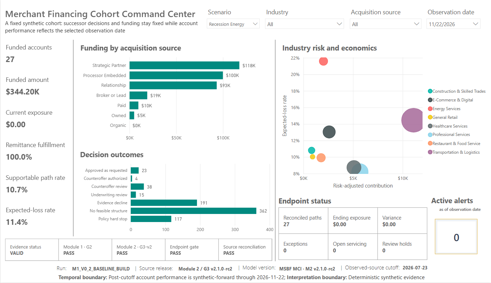
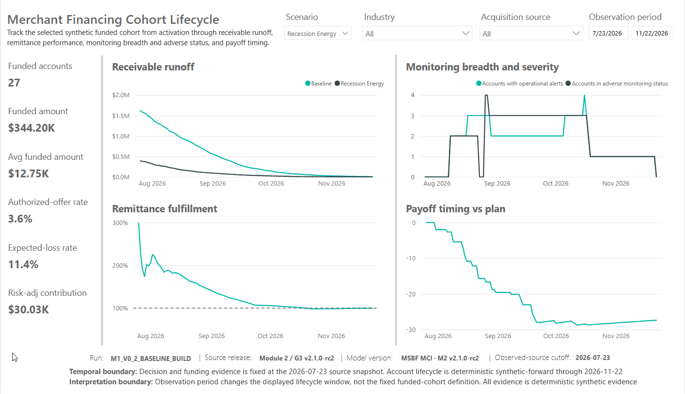
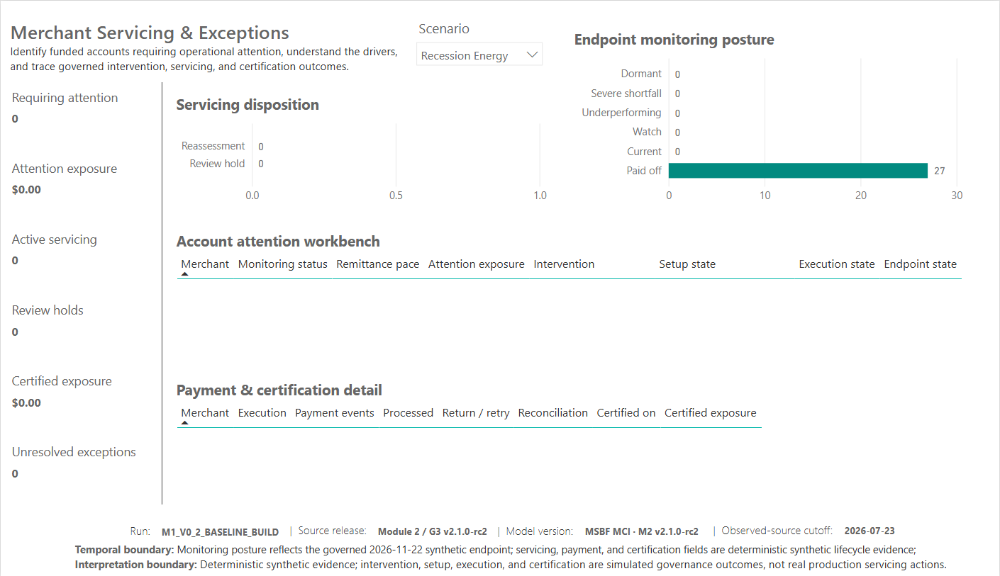

# MSBF Merchant Credit Intelligence
## Power BI Validation Report

**Document ID:** MSBF-MCI-PBI-VAL-R1  
**System under test:** `MSBF_Merchant_Credit_Intelligence_M2_v2.1.0-rc2.pbix`  
**Product release candidate:** Module 2 v2.1.0-rc2  
**Validation date:** 2026-09-04  
**Validation status:** **PASS - FINAL PUBLICATION CANDIDATE; CONTROLLED PUBLICATION ACTION PENDING**  
**Formal control population:** 52 controls - 51 PASS, 0 DEFERRED, 1 PENDING

---

## 1. Executive validation conclusion

The current **MSBF Merchant Credit Intelligence** Power BI release candidate is validated as a coherent, source-authorized, deterministic synthetic analytical product across its current P01-P04 scope.

The validation established that:

- the client-facing PBIX is physically readable and hash-identified;
- the report contains the intended four visible pages and one hidden diagnostic;
- every current page binding resolves to an R1 successor fact or a current shared dimension/metadata object;
- no predecessor fact remains referenced anywhere in P01-P04 or P02-DIAG physical visual JSON, including query bindings, `filterConfig`, or active filter predicates;
- accepted R26 source populations and G3-v2 certification are preserved;
- P03 narrative behavior passes across all 1,500 application-scenario paths;
- P03 monitoring and funded-lifecycle behavior reconciles across 130 funded paths and 15,600 monitoring rows;
- P04 preserves exact 130-key equality through intervention, setup, execution, certification, and endpoint performance;
- scenario isolation, interactions, tooltips, alt text, and tab order operate as designed;
- the report's temporal, synthetic, and nonproduction interpretation boundaries are visible and consistent.

The final portfolio-wide persistence/nonregression gate has been closed as **PASS** based on owner-confirmed post-reopen final evidence. One release control remains open by design: GitHub publication and public supersession have not been executed and require a separate controlled release action.

Accordingly, the report is **accepted as the final rc2 publication candidate for audit and controlled publication handoff**, but this validation report does not declare the artifact publicly released or production-ready.

## 2. Validation objectives

The validation was designed to determine whether the current PBIX:

1. matches the accepted product and release identity;
2. consumes the accepted R26 successor source architecture;
3. excludes predecessor fact references across complete physical visual JSON, including `filterConfig`;
4. preserves exact source populations, keys, and scenario boundaries;
5. implements the approved P01-P04 business story;
6. presents accurate and interpretable KPIs, charts, tables, narratives, and tooltips;
7. maintains correct filter and selection behavior;
8. retains accessibility and navigation controls;
9. contains no unresolved page-level semantic defect;
10. is suitable for GitHub publication support with persistence/nonregression closed and the separately authorized publication action pending.

## 3. Scope

### Included

- Physical PBIX package
- Embedded report definition
- Four visible pages and one hidden diagnostic
- Current report bindings and interactions
- Current R1 source populations
- P01 and P02 page conformance
- P03 narrative, monitoring, lifecycle, and servicing integration
- P04 endpoint monitoring, servicing, payment, and certification integration
- Tooltips, alt text, and tab order
- Owner evidence organization
- Requirements and validation traceability
- Release-boundary review

### Excluded

- P05 and P06 page acceptance
- Power BI Service deployment
- Tenant, workspace, gateway, or scheduled refresh validation
- Production performance/load testing
- Real customer data, underwriting, payment, or servicing execution
- GitHub release execution

## 4. Validation authority and evidence hierarchy

Validation used the following precedence:

1. accepted R26 M2.5-M2.12 / G3-v2 technical authority;
2. current client-facing PBIX and physically installed DAX;
3. extracted report definitions, pages, visuals, bindings, and interactions;
4. owner-captured final page, QA, tooltip, accessibility, and interaction evidence;
5. canonical implementation register and source-population records;
6. derived validation analysis and publication documentation.

No external facts were used to change or supplement the source-defined results.

## 5. System under test

| Attribute | Validated value |
| --- | --- |
| File | `MSBF_Merchant_Credit_Intelligence_M2_v2.1.0-rc2.pbix` |
| Bytes | `27,635,305` |
| SHA-256 | `ca46e8551860836a0cf4ff9239c42fcf8df02f1705596b9f8ca1bd047b5294e4` |
| DataModel bytes | `27,485,797` |
| DataModel SHA-256 | `24396d02c0fbcb782cc9918e842886711146b8ff9455c8822d2aeaf009b96061` |
| PBIX entries | `128` |
| Visible pages | `4` |
| Hidden pages | `1` |
| Visual containers | `96` |
| Query bindings | `221` |
| Observed-source cutoff | `2026-07-23` |
| Synthetic lifecycle endpoint | `2026-11-22` |

## 6. Validation methodology

The validation combined:

- direct ZIP/CRC and path inspection of the PBIX;
- extraction and hashing of embedded report definitions;
- page, visual, binding, field-reference, interaction, and DAX-query inventories;
- comparison to the previously controlled R4 canonical register;
- review of owner-confirmed measure and calculated-column changes;
- automated DAX QA for P03 and P04;
- full-page visual evidence under both scenarios;
- representative account-level regressions;
- tooltip, alt-text, tab-order, and interaction evidence;
- explicit review of synthetic, temporal, and release boundaries.

Controls were classified as:

- **PASS** - requirement satisfied by direct test, QA, or approved evidence;
- **DEFERRED** - required but intentionally scheduled for the final portfolio gate;
- **PENDING** - requires a separately authorized release action.

## 7. Physical package validation

| Control ID | Control | Observed | Expected | Status | Evidence |
| --- | --- | --- | --- | --- | --- |
| VAL-PHY-001 | PBIX ZIP CRC | PASS | PASS | PASS | Direct PBIX testzip |
| VAL-PHY-002 | Unsafe/duplicate/case-colliding paths | 0 / 0 / 0 | 0 / 0 / 0 | PASS | Direct PBIX path inspection |
| VAL-PHY-003 | Client-facing visible pages | 4 | 4 | PASS | Embedded pages.json |
| VAL-PHY-004 | Hidden diagnostic pages | 1 | 1 | PASS | Embedded P02-DIAG page.json |
| VAL-PHY-005 | Client-facing PBIX identity, size, and SHA-256 | MSBF_Merchant_Credit_Intelligence_M2_v2.1.0-rc2.pbix; 27,635,305 bytes; ca46e855...94e4 | Exact current client-facing release candidate | PASS | Direct project(2).zip and corrected PBIX hash inspection |

### Assessment

The client-facing PBIX passed CRC validation. No unsafe paths, duplicate paths, or case-fold collisions were identified. The embedded report definition contains the expected page structure, and the file identity matches the owner-approved market-facing name.

## 8. Governance and release-identity validation

| Control ID | Control | Observed | Expected | Status | Evidence |
| --- | --- | --- | --- | --- | --- |
| VAL-GOV-001 | R26 G3-v2 controls | 70 PASS / 0 FAIL | 70 PASS / 0 FAIL | PASS | R26 checkpoint and authority evidence |
| VAL-GOV-002 | R26 certification ID | G3V2_R26_C053DC064AB32A4D21864F94 | Exact accepted ID | PASS | R26 authority evidence |

| Control ID | Control | Observed | Expected | Status | Evidence |
| --- | --- | --- | --- | --- | --- |
| VAL-REL-003 | Visible product/model identity | MSBF Merchant Credit Intelligence / MSBF MCI - M2 v2.1.0-rc2 | Owner-approved market-facing identity | PASS | PBIX filename and P01-P04 final footers |

The build retains the accepted 70/70 G3-v2 control result and exact certification ID. The visible product identity has been changed from internal R26/C2 engineering nomenclature to the market-facing MSBF MCI identity without changing technical lineage.

## 9. Source-population validation

| Control ID | Control | Observed | Expected | Status | Evidence |
| --- | --- | --- | --- | --- | --- |
| VAL-SRC-001 | Application-scenario paths | 1,500 | 1,500 | PASS | R1DimApplicationScenario |
| VAL-SRC-002 | Daily monitoring rows / paths / days | 15,600 / 130 / 120 | 15,600 / 130 / 120 | PASS | P03 operational QA result 1 |
| VAL-SRC-003 | M2.6 intervention distribution | 126 / 3 / 1 | 126 / 3 / 1 | PASS | P03 operational QA result 4 |

Key populations were reconciled as follows:

| Object or stage | Validated population | Result |
| --- | --- | --- |
| Application-scenario dimension | 1,500 paths | PASS |
| Funded lifecycle | 130 unique paths | PASS |
| Daily monitoring | 15,600 rows / 130 paths / 120 days each | PASS |
| M2.6 intervention | 130 rows; 126 closed / 3 outreach / 1 temporary review | PASS |
| M2.7 operational setup | 130 rows; 126 no setup / 3 governance review / 1 temporary setup ready | PASS |
| M2.8 servicing execution | 130 rows; 126 no execution / 3 review hold / 1 active temporary processing | PASS |
| M2.9 certification | 130 rows; 126 closed / 3 review hold / 1 reassessment after retry | PASS |
| M2.10 performance | 130 rows; 126 closed stable / 3 controlled review / 1 active reconciled | PASS |
| G3-v2 certification | 70 PASS / 0 FAIL | PASS |

## 10. Semantic-model and binding validation

| Control ID | Control | Observed | Expected | Status | Evidence |
| --- | --- | --- | --- | --- | --- |
| VAL-SEM-001 | Successor-or-shared physical visual-reference coverage and predecessor-fact exclusion, including `filterConfig` | 96 visuals; 293 physical field-reference occurrences; 26 `filterConfig` rows; 3 active predicates; 0 predecessor-fact references / 0 predecessor-fact filter rows | 0 predecessor fact references across all physical visual JSON | PASS | CURRENT_PHYSICAL_VISUAL_REFERENCES_R7; CURRENT_PHYSICAL_FILTER_REFERENCES_R7; PHYSICAL_VISUAL_REFERENCE_SCAN_SUMMARY_R7 |

| Control ID | Control | Observed | Expected | Status | Evidence |
| --- | --- | --- | --- | --- | --- |
| VAL-SEM-002 | Model inventory qualification | R4 exact base 55 tables / 1,804 columns / 316 measures / 55 relationships; R5 estimated 1,807 columns / 349 measures | Exact base plus explicitly qualified readable/owner additions | PASS | R4 canonical register plus R5 query overlays and owner changes |

The current binding inventory establishes:

| Page | Bindings | R1 successor | Shared dimension/metadata | Predecessor facts | Result |
| --- | --- | --- | --- | --- | --- |
| P01 - Cohort Command Center | 49 | 39 | 10 | 0 | PASS_PAGE_FROZEN |
| P02 - Cohort Lifecycle | 49 | 39 | 10 | 0 | PASS_PAGE_FROZEN |
| P02-DIAG - Attention States | 33 | 26 | 7 | 0 | HIDDEN_DIAGNOSTIC_RETAINED |
| P03 - Application Journey | 55 | 42 | 13 | 0 | PASS_PAGE_FROZEN |
| P04 - Servicing & Exceptions | 35 | 29 | 6 | 0 | PASS_PAGE_FROZEN |

### Assessment

The critical version-mixing defect family is closed for the current report scope. Following the R16 focused correction, P01-P04 and P02-DIAG contain **zero predecessor-fact references across all physical visual JSON**, including `filterConfig`. Shared non-R1 dimensions remain permissible where they are the current canonical category or metadata dictionary for R1 facts.

The model inventory remains qualified: the R4 exact base contained 55 tables, 1,804 columns, 316 measures, and 55 relationships. R5 readable overlays and owner changes support an estimated current total of 1,807 columns and 349 measures. Exact final DMV counts were not separately recaptured; the qualified inventory remains a nonblocking documentation observation because the owner has closed the final persistence/nonregression gate on the persisted PBIX.

## 11. P01 validation

| Control ID | Control | Observed | Expected | Status | Evidence |
| --- | --- | --- | --- | --- | --- |
| VAL-P01-001 | P01 public page composition and final release identity | Command center present with KPI, sourcing, decision, industry, endpoint, alert, and evidence sections | Approved P01 page design | PASS | Focused P01 Baseline/Recession captures and binding inventory |

| Control ID | Control | Observed | Expected | Status | Evidence |
| --- | --- | --- | --- | --- | --- |
| VAL-P01-002 | Final-observation funded paths and endpoint state | Baseline 103 funded / $1.39M / $7.82K exposure; Recession Energy 27 funded / $344.20K / $0 exposure | Current accepted cohort results | PASS | Focused P01 Baseline and Recession Energy captures |

### Validated behavior

P01 provides the intended executive command center with:

- four segmentation/as-of controls;
- six core KPIs;
- funding by acquisition source;
- seven-outcome decision distribution;
- industry risk and economics;
- endpoint reconciliation and operational attention;
- visible evidence gates.

At the final observation date:

| Measure | Baseline | Recession Energy |
| --- | ---: | ---: |
| Funded accounts | 103 | 27 |
| Funded amount | $1.39M | $344.20K |
| Current exposure | $7.82K | $0.00 |
| Remittance fulfillment | 99.5% | 100.0% |
| Supportable path rate | 40.0% | 10.7% |
| Comparative expected-loss rate | 9.4% | 11.4% |

## 12. P02 validation

| Control ID | Control | Observed | Expected | Status | Evidence |
| --- | --- | --- | --- | --- | --- |
| VAL-P02-001 | Lifecycle page composition | Receivable runoff, remittance fulfillment, monitoring breadth/severity, and payoff timing present | Approved P02 page design | PASS | Focused P02 Baseline/Recession captures and binding inventory |

| Control ID | Control | Observed | Expected | Status | Evidence |
| --- | --- | --- | --- | --- | --- |
| VAL-P02-002 | Observation-period and segmentation behavior | Scenario, industry, acquisition-source, and observation-period interactions evidenced | Approved interaction behavior | PASS | Owner P02 interaction and observation-period captures |

| Control ID | Control | Observed | Expected | Status | Evidence |
| --- | --- | --- | --- | --- | --- |
| VAL-P02-003 | Operational-alert diagnostic tooltips | Raw alert conditions, operational alert families, and per-alerted-account context evidenced | Approved tooltip design | PASS | Owner P02 tooltip capture |

### Validated behavior

P02 displays:

- receivable runoff;
- remittance fulfillment;
- monitoring breadth and severity;
- payoff timing versus plan;
- scenario, industry, acquisition-source, and observation-period interactions.

The current R26 monitoring design correctly distinguishes operational-alert breadth from adverse monitoring status. Tooltips provide source-owned raw-condition and alert-family detail. The hidden P02-DIAG page remains available for internal analysis and hidden from view mode.

## 13. P03 narrative and application-journey validation

| Control ID | Control | Observed | Expected | Status | Evidence |
| --- | --- | --- | --- | --- | --- |
| VAL-P03-001 | 738 scenario pair | 2 rows, both PASS | 2 rows, both PASS | PASS | P03 narrative QA result 1 |
| VAL-P03-002 | Narrative failures | 0 | 0 | PASS | P03 narrative QA result 2 |
| VAL-P03-003 | Full narrative inventory | 1,500 rows; PASS only | 1,500 unique paths; PASS only | PASS | P03 narrative QA result 3 |

| Control ID | Control | Observed | Expected | Status | Evidence |
| --- | --- | --- | --- | --- | --- |
| VAL-P03-004 | Successor reconciliation failures | 0 | 0 | PASS | P03 performance/monitoring QA result 2 |

| Control ID | Control | Observed | Expected | Status | Evidence |
| --- | --- | --- | --- | --- | --- |
| VAL-P03-005 | 738 scenario pair | Baseline 120 monitoring rows; Recession Energy 0 rows | Exact isolation | PASS | P03 performance/monitoring QA result 3 |

| Control ID | Control | Observed | Expected | Status | Evidence |
| --- | --- | --- | --- | --- | --- |
| VAL-P03-006 | Final P03 application-to-account page composition | Request, decision, proposed structure, three narratives, performance, monitoring, and servicing present | Approved P03 final design | PASS | Focused P03 branch captures and final page evidence |

| Control ID | Control | Observed | Expected | Status | Evidence |
| --- | --- | --- | --- | --- | --- |
| VAL-P03-007 | Final P03 alt text, tab order, account-performance and monitoring tooltips | Implemented and evidenced | Approved accessibility/tooltip design | PASS | P03 alt-text, tab-order, and tooltip captures |

### Narrative QA

The final corrected narrative sequence produced:

- **Result 1:** exactly two rows for merchant 738 Baseline and Recession Energy; both PASS;
- **Result 2:** zero failures;
- **Result 3:** 1,500 rows, 1,500 unique ApplicationScenarioKeys, PASS only.

The final visible architecture retains three separate narratives:

1. Merchant operating evidence
2. Risk & economics assessment
3. Decision

Technical source rationales remain available in the model but are not forced into visible or redundant tooltips.

### Monitoring and lifecycle QA

The operational QA established:

- 15,600 monitoring rows;
- 130 application-scenario paths;
- exactly 120 monitoring days per path;
- zero successor reconciliation failures;
- merchant 738 Baseline with 120 monitoring rows and funded lifecycle;
- merchant 738 Recession Energy with zero monitoring rows and no lifecycle;
- M2.6 intervention distribution of 126 / 3 / 1.

### Representative visual evidence

The full focused P03 evidence set covers all seven governed outcomes and material review, evidence, no-feasible, stress-floor, and hard-stop branches.

## 14. P04 servicing and certification validation

| Control ID | Control | Observed | Expected | Status | Evidence |
| --- | --- | --- | --- | --- | --- |
| VAL-P04-001 | M2.6-M2.10 rows and unique keys | 130 / 130 each stage | 130 / 130 each stage | PASS | P04 QA result 1 |

| Control ID | Control | Observed | Expected | Status | Evidence |
| --- | --- | --- | --- | --- | --- |
| VAL-P04-002 | M2.7 distribution | 126 / 3 / 1 | 126 / 3 / 1 | PASS | P04 QA result 2 |

| Control ID | Control | Observed | Expected | Status | Evidence |
| --- | --- | --- | --- | --- | --- |
| VAL-P04-003 | M2.8 distribution | 126 / 3 / 1 | 126 / 3 / 1 | PASS | P04 QA result 3 |

| Control ID | Control | Observed | Expected | Status | Evidence |
| --- | --- | --- | --- | --- | --- |
| VAL-P04-004 | M2.9 distribution | 126 / 1 / 3 | 126 closed / 1 retry / 3 review | PASS | P04 QA result 4 |

| Control ID | Control | Observed | Expected | Status | Evidence |
| --- | --- | --- | --- | --- | --- |
| VAL-P04-005 | M2.10 distribution | 126 closed / 1 active / 3 review | Exact | PASS | P04 QA result 5 |

| Control ID | Control | Observed | Expected | Status | Evidence |
| --- | --- | --- | --- | --- | --- |
| VAL-P04-006 | Baseline KPIs | 4; $7,823.28; 1; 3; $6,061.03; 0 | Exact | PASS | P04 QA result 6 |
| VAL-P04-007 | Recession Energy KPIs | All operational exception measures 0 | All 0 | PASS | P04 QA result 6 |

| Control ID | Control | Observed | Expected | Status | Evidence |
| --- | --- | --- | --- | --- | --- |
| VAL-P04-008 | 098/112/312/749/264 chain | Expected states observed | Exact representative cases | PASS | P04 QA result 7 |

| Control ID | Control | Observed | Expected | Status | Evidence |
| --- | --- | --- | --- | --- | --- |
| VAL-P04-009 | Final P04 alt text, tab order, endpoint and servicing tooltips | Implemented; servicing burden removed from public tooltip | Approved P04 final design | PASS | P04 alt-text, tab-order, and final tooltip captures |

### Baseline endpoint

| Measure | Validated value |
| --- | ---: |
| Requiring attention | 4 |
| Attention exposure | $7,823.28 |
| Active servicing | 1 |
| Review holds | 3 |
| Certified exposure | $6,061.03 |
| Unresolved exceptions | 0 |
| Endpoint status | 99 Paid off / 4 Severe shortfall |
| Servicing disposition | 1 Reassessment / 3 Review hold |

### Recession Energy endpoint

- 27 Paid off;
- zero attention paths;
- zero attention exposure;
- zero active servicing;
- zero review holds;
- zero certified ending exposure;
- zero unresolved exceptions.

### Representative-path regression

| Merchant | Validated chain |
| --- | --- |
| 098 Baseline | Severe shortfall -> targeted outreach -> governance review -> execution review hold -> controlled review |
| 112 Baseline | Severe shortfall -> targeted outreach -> governance review -> execution review hold -> controlled review |
| 312 Baseline | Severe shortfall -> targeted outreach -> governance review -> execution review hold -> controlled review |
| 749 Baseline | Severe shortfall -> temporary remittance review -> setup ready -> active servicing -> active reconciled |
| 264 Baseline | Paid off -> no further action -> no setup -> no execution -> closed stable |

Merchant 749 additionally validates seven payment events, $1,762.25 processed, one return, one retry, reconciliation after retry, and $2,937.12 certified exposure.

## 15. Accessibility validation

| Control ID | Control | Observed | Expected | Status | Evidence |
| --- | --- | --- | --- | --- | --- |
| VAL-ACC-001 | P01-P04 title/KPI/chart/table alt text | Implemented and evidenced | Implemented | PASS | Owner alt-text captures |
| VAL-ACC-002 | Logical tab order P01-P04 | Implemented and evidenced | Implemented | PASS | Owner tab-order captures |

The owner evidence demonstrates substantive alt text and logical tab order across P01-P04. Dynamic KPI alt text is used where it materially improves comprehension. Slicers and visible footer text intentionally use native labels rather than redundant custom alt text.

The final P04 servicing tooltip was reviewed after removal of the unexplained servicing-burden metric. It now provides concise axis context, full queue wording, account count, and certified exposure.

## 16. Interaction validation

| Control ID | Control | Observed | Expected | Status | Evidence |
| --- | --- | --- | --- | --- | --- |
| VAL-INT-001 | Scenario isolation and visual interactions | Observed as designed | As designed | PASS | Owner interaction and scenario captures |
| VAL-INT-002 | P04 workbench-to-detail selection behavior | Merchant 098 and 749 selections isolate the lower detail table while page posture remains stable | Approved workbench-detail interaction | PASS | P04 filtered owner captures |

Validated interactions include:

- scenario isolation;
- P01/P02 industry and acquisition-source segmentation;
- observation-date/period behavior;
- P03 merchant/scenario case resolution;
- P04 workbench selection filtering only the lower detail;
- valid empty-state behavior under Recession Energy.

## 17. Temporal and interpretation-boundary validation

| Control ID | Control | Observed | Expected | Status | Evidence |
| --- | --- | --- | --- | --- | --- |
| VAL-TMP-001 | Observed-source cutoff | 2026-07-23 | 2026-07-23 | PASS | Visible footer and source controls |
| VAL-TMP-002 | Synthetic-forward lifecycle endpoint | 2026-11-22 | 2026-11-22 | PASS | P01-P04 footers and lifecycle evidence |

The report visibly communicates:

- observed decision-time source evidence through 2026-07-23;
- deterministic synthetic-forward lifecycle evidence through 2026-11-22;
- alternative governed scenarios rather than forecasts or sequential states;
- no real production servicing, payment, or adverse-action execution.

## 18. Evidence and publication-package validation

| Control ID | Control | Observed | Expected | Status | Evidence |
| --- | --- | --- | --- | --- | --- |
| VAL-EVD-001 | Owner evidence inventory and duplicate-hash scan | 142 files / 15,519,282 bytes / 0 duplicate-hash groups | Complete, nonduplicated owner evidence inventory | PASS | OWNER_EVIDENCE_MANIFEST and direct hash analysis |
| VAL-EVD-002 | Focused presentation-capture inventory | 94 presentation-focused captures across P01-P04 | Publication-candidate visual evidence separated from internal QA evidence | PASS | Owner evidence folder organization and manifest |

The owner-evidence package contains 142 files totaling 15,519,282 bytes and no duplicate-hash groups. The focused presentation area contains 94 curated Power BI captures, while raw QA/accessibility/interaction evidence remains separately identifiable as internal support.

### Publication-support payload

| Control ID | Control | Observed | Expected | Status | Evidence |
| --- | --- | --- | --- | --- | --- |
| VAL-PUB-001 | Publication-support payload completeness | PBIX, canonical MD/XLSX/JSON, BRD MD/DOCX/PDF, validation MD/DOCX/PDF, registers, curated captures, manifests, and checksums present | Complete approved publication-support payload | PASS | Publication-support package inspection and payload manifest |
| VAL-PUB-002 | Package path safety, archive integrity, clean extraction, and manifest reconciliation | CRC PASS; clean extraction PASS; zero unsafe, duplicate, case-fold-colliding, symlink, or encrypted paths; manifest/SHA256 reconciliation PASS | All checks PASS; all disallowed-path counts zero | PASS | MANIFEST.csv; SHA256SUMS.txt; ZIP_VALIDATION_REPORT.md/json |

The corrected R3 package is the final publication candidate for this rc2 scope subject to expedited focused re-audit of IA-D-R16-PBI-001. Owner-confirmed persistence/output-equivalence is PASS for the bounded correction. Package integrity validation does not itself execute GitHub publication.

## 19. Findings and observations

### Finding F-01 - R16 focused correction closed by physical re-scan

**Status:** CLOSED / PASS  
**Evidence:** Owner confirmation dated 2026-09-04 that the latest final P01-P04 captures were taken after save, complete Desktop close, and reopen; current PBIX/package designated final.  
**Disposition:** No further report edits are authorized absent a verified defect or a new controlled release cycle.

### Finding F-02 - GitHub publication not executed

**Status:** PENDING  
**Impact:** The current package supports publication but does not activate public supersession or claim that the release is live.  
**Disposition:** Execute through the separately authorized release action.

### Observation O-01 - Exact final model inventory

The current measure and column totals are reconstructed from the last exact R4 inventory plus readable overlays and owner-confirmed additions. This is adequate for publication-support documentation when clearly qualified. Exact DMV inventory was not separately recaptured. The qualified R4-plus-overlay inventory remains documented as a nonblocking observation; the physical PBIX and binding inventories remain controlling for publication.

### Observation O-02 - P05/P06 excluded

P05 and P06 remain internal candidate pages and are intentionally absent from the client-facing rc2 PBIX. No current public claim should imply that M2.11 strategy analysis is already presented through a completed P05/P06 experience.

## 20. Release recommendation

**Recommendation:** **ACCEPT AS CORRECTED FINAL PUBLICATION CANDIDATE SUBJECT TO EXPEDITED FOCUSED INDEPENDENT RE-AUDIT; IF ACCEPTED, PROCEED DIRECTLY TO CONTROLLED GITHUB PUBLICATION.**

The P01-P04 report build remains complete and page-frozen. IA-D-R16-PBI-001 was limited to stale P04 visual-filter metadata. The corrected PBIX removes the two predecessor predicates, retains the successor attention predicate, preserves the exact DataModel hash, and passes a complete physical visual-reference scan including `filterConfig`.

The remaining controlled release sequence is:

1. independent audit acceptance of this final publication-candidate package;
2. the separately authorized GitHub publication/public-supersession action;
3. post-publication download verification of every hosted asset against the package hash/size register and Windows-native clean extraction.

## Appendix A - Validation summary

| Status | Count | Meaning |
| --- | --- | --- |
| PASS | 51 | Validated by direct test, automated QA, physical inspection, or approved owner evidence |
| DEFERRED | 0 | No remaining deferred validation controls |
| PENDING | 1 | Separate controlled publication action |
| TOTAL | 52 | Corrected publication-support control population |

## Appendix B - Full control register

| Control ID | Control | Observed | Expected | Status | Evidence |
| --- | --- | --- | --- | --- | --- |
| VAL-ACC-001 | P01-P04 title/KPI/chart/table alt text | Implemented and evidenced | Implemented | PASS | Owner alt-text captures |
| VAL-ACC-002 | Logical tab order P01-P04 | Implemented and evidenced | Implemented | PASS | Owner tab-order captures |
| VAL-EVD-001 | Owner evidence inventory and duplicate-hash scan | 142 files / 15,519,282 bytes / 0 duplicate-hash groups | Complete, nonduplicated owner evidence inventory | PASS | OWNER_EVIDENCE_MANIFEST and direct hash analysis |
| VAL-EVD-002 | Focused presentation-capture inventory | 94 presentation-focused captures across P01-P04 | Publication-candidate visual evidence separated from internal QA evidence | PASS | Owner evidence folder organization and manifest |
| VAL-GOV-001 | R26 G3-v2 controls | 70 PASS / 0 FAIL | 70 PASS / 0 FAIL | PASS | R26 checkpoint and authority evidence |
| VAL-GOV-002 | R26 certification ID | G3V2_R26_C053DC064AB32A4D21864F94 | Exact accepted ID | PASS | R26 authority evidence |
| VAL-INT-001 | Scenario isolation and visual interactions | Observed as designed | As designed | PASS | Owner interaction and scenario captures |
| VAL-INT-002 | P04 workbench-to-detail selection behavior | Merchant 098 and 749 selections isolate the lower detail table while page posture remains stable | Approved workbench-detail interaction | PASS | P04 filtered owner captures |
| VAL-P01-001 | P01 public page composition and final release identity | Command center present with KPI, sourcing, decision, industry, endpoint, alert, and evidence sections | Approved P01 page design | PASS | Focused P01 Baseline/Recession captures and binding inventory |
| VAL-P01-002 | Final-observation funded paths and endpoint state | Baseline 103 funded / $1.39M / $7.82K exposure; Recession Energy 27 funded / $344.20K / $0 exposure | Current accepted cohort results | PASS | Focused P01 Baseline and Recession Energy captures |
| VAL-P02-001 | Lifecycle page composition | Receivable runoff, remittance fulfillment, monitoring breadth/severity, and payoff timing present | Approved P02 page design | PASS | Focused P02 Baseline/Recession captures and binding inventory |
| VAL-P02-002 | Observation-period and segmentation behavior | Scenario, industry, acquisition-source, and observation-period interactions evidenced | Approved interaction behavior | PASS | Owner P02 interaction and observation-period captures |
| VAL-P02-003 | Operational-alert diagnostic tooltips | Raw alert conditions, operational alert families, and per-alerted-account context evidenced | Approved tooltip design | PASS | Owner P02 tooltip capture |
| VAL-P03-001 | 738 scenario pair | 2 rows, both PASS | 2 rows, both PASS | PASS | P03 narrative QA result 1 |
| VAL-P03-002 | Narrative failures | 0 | 0 | PASS | P03 narrative QA result 2 |
| VAL-P03-003 | Full narrative inventory | 1,500 rows; PASS only | 1,500 unique paths; PASS only | PASS | P03 narrative QA result 3 |
| VAL-P03-004 | Successor reconciliation failures | 0 | 0 | PASS | P03 performance/monitoring QA result 2 |
| VAL-P03-005 | 738 scenario pair | Baseline 120 monitoring rows; Recession Energy 0 rows | Exact isolation | PASS | P03 performance/monitoring QA result 3 |
| VAL-P03-006 | Final P03 application-to-account page composition | Request, decision, proposed structure, three narratives, performance, monitoring, and servicing present | Approved P03 final design | PASS | Focused P03 branch captures and final page evidence |
| VAL-P03-007 | Final P03 alt text, tab order, account-performance and monitoring tooltips | Implemented and evidenced | Approved accessibility/tooltip design | PASS | P03 alt-text, tab-order, and tooltip captures |
| VAL-P04-001 | M2.6-M2.10 rows and unique keys | 130 / 130 each stage | 130 / 130 each stage | PASS | P04 QA result 1 |
| VAL-P04-002 | M2.7 distribution | 126 / 3 / 1 | 126 / 3 / 1 | PASS | P04 QA result 2 |
| VAL-P04-003 | M2.8 distribution | 126 / 3 / 1 | 126 / 3 / 1 | PASS | P04 QA result 3 |
| VAL-P04-004 | M2.9 distribution | 126 / 1 / 3 | 126 closed / 1 retry / 3 review | PASS | P04 QA result 4 |
| VAL-P04-005 | M2.10 distribution | 126 closed / 1 active / 3 review | Exact | PASS | P04 QA result 5 |
| VAL-P04-006 | Baseline KPIs | 4; $7,823.28; 1; 3; $6,061.03; 0 | Exact | PASS | P04 QA result 6 |
| VAL-P04-007 | Recession Energy KPIs | All operational exception measures 0 | All 0 | PASS | P04 QA result 6 |
| VAL-P04-008 | 098/112/312/749/264 chain | Expected states observed | Exact representative cases | PASS | P04 QA result 7 |
| VAL-P04-009 | Final P04 alt text, tab order, endpoint and servicing tooltips | Implemented; servicing burden removed from public tooltip | Approved P04 final design | PASS | P04 alt-text, tab-order, and final tooltip captures |
| VAL-PHY-001 | PBIX ZIP CRC | PASS | PASS | PASS | Direct PBIX testzip |
| VAL-PHY-002 | Unsafe/duplicate/case-colliding paths | 0 / 0 / 0 | 0 / 0 / 0 | PASS | Direct PBIX path inspection |
| VAL-PHY-003 | Client-facing visible pages | 4 | 4 | PASS | Embedded pages.json |
| VAL-PHY-004 | Hidden diagnostic pages | 1 | 1 | PASS | Embedded P02-DIAG page.json |
| VAL-PHY-005 | Client-facing PBIX identity, size, and SHA-256 | MSBF_Merchant_Credit_Intelligence_M2_v2.1.0-rc2.pbix; 27,635,305 bytes; ca46e855...94e4 | Exact current client-facing release candidate | PASS | Direct project(2).zip and corrected PBIX hash inspection |
| VAL-PUB-001 | Publication-support payload completeness | PBIX, canonical MD/XLSX/JSON, BRD MD/DOCX/PDF, validation MD/DOCX/PDF, registers, curated captures, manifests, and checksums present | Complete approved publication-support payload | PASS | Publication-support package inspection and payload manifest |
| VAL-PUB-002 | Package path safety, archive integrity, clean extraction, and manifest reconciliation | CRC PASS; clean extraction PASS; zero unsafe, duplicate, case-fold-colliding, symlink, or encrypted paths; manifest/SHA256 reconciliation PASS | All checks PASS; all disallowed-path counts zero | PASS | MANIFEST.csv; SHA256SUMS.txt; ZIP_VALIDATION_REPORT.md/json |
| VAL-REL-001 | Persistence/nonregression closure including bounded post-audit P04 correction | Pre-audit full save/close/reopen PASS; corrected PBIX saved with unchanged DataModel and unchanged non-filter visual payload; owner observed no visual/result change and approved reuse of existing captures without re-capture | Current corrected PBIX persisted and no output regression from localized filter removal | PASS | Persistence closure receipt R2; focused correction member diff; owner no-recapture signoff; physical scan |
| VAL-REL-002 | GitHub publication / public supersession | NOT EXECUTED | Separate authorized release action | PENDING | This package supports but does not execute publication |
| VAL-REL-003 | Visible product/model identity | MSBF Merchant Credit Intelligence / MSBF MCI - M2 v2.1.0-rc2 | Owner-approved market-facing identity | PASS | PBIX filename and P01-P04 final footers |
| VAL-RPT-001 | Page / visible / hidden / visual / binding inventory | 5 pages / 4 visible / 1 hidden / 96 visuals / 221 bindings | Exact current PBIX inventory | PASS | Embedded PBIX report definition extraction |
| VAL-SEM-001 | Successor-or-shared physical visual-reference coverage and predecessor-fact exclusion, including `filterConfig` | 96 visuals; 293 physical field-reference occurrences; 26 `filterConfig` rows; 3 active predicates; 0 predecessor-fact references / 0 predecessor-fact filter rows | 0 predecessor fact references across all physical visual JSON | PASS | CURRENT_PHYSICAL_VISUAL_REFERENCES_R7; CURRENT_PHYSICAL_FILTER_REFERENCES_R7; PHYSICAL_VISUAL_REFERENCE_SCAN_SUMMARY_R7 |
| VAL-SEM-002 | Model inventory qualification | R4 exact base 55 tables / 1,804 columns / 316 measures / 55 relationships; R5 estimated 1,807 columns / 349 measures | Exact base plus explicitly qualified readable/owner additions | PASS | R4 canonical register plus R5 query overlays and owner changes |
| VAL-SRC-001 | Application-scenario paths | 1,500 | 1,500 | PASS | R1DimApplicationScenario |
| VAL-SRC-002 | Daily monitoring rows / paths / days | 15,600 / 130 / 120 | 15,600 / 130 / 120 | PASS | P03 operational QA result 1 |
| VAL-SRC-003 | M2.6 intervention distribution | 126 / 3 / 1 | 126 / 3 / 1 | PASS | P03 operational QA result 4 |
| VAL-TMP-001 | Observed-source cutoff | 2026-07-23 | 2026-07-23 | PASS | Visible footer and source controls |
| VAL-TMP-002 | Synthetic-forward lifecycle endpoint | 2026-11-22 | 2026-11-22 | PASS | P01-P04 footers and lifecycle evidence |

| VAL-COR-001 | R16 audit finding bounded to one P04 visual | IA-D-R16-PBI-001 HOLD identified exactly two stale predecessor filters; broad remediation not required | Localized correction only | PASS | Owner-provided R16 audit decision and focused correction authorization summary |
| VAL-COR-002 | Authorized stale filters removed from Payment & certification detail | Two predecessor predicates absent; R26 P04 Requires Attention Flag = 1 retained | Two predecessor filters removed; successor attention filter retained | PASS | Direct corrected visual filterConfig inspection |
| VAL-COR-003 | Complete physical visual JSON scan including filterConfig references | 96 visuals / 293 refs / 26 filterConfig rows / 3 active predicates / 0 predecessor fact refs / 0 predecessor fact filter rows | Predecessor fact references across all physical visual JSON = 0 | PASS | CURRENT_PHYSICAL_VISUAL_REFERENCES_R7; CURRENT_PHYSICAL_FILTER_REFERENCES_R7; PHYSICAL_VISUAL_REFERENCE_SCAN_SUMMARY_R7 |
| VAL-COR-004 | Correction boundedness and semantic nonregression | DataModel unchanged; target and endpoint-monitoring visuals unchanged outside filterConfig; only 4 PBIX members changed | No semantic-model or visual query/layout change beyond authorized filter metadata correction | PASS | FOCUSED_CORRECTION_PBIX_MEMBER_DIFF_R7; direct normalized JSON comparison |
| VAL-COR-005 | Owner visual-output equivalence and no-recapture signoff | Owner observed no visual/result change and expressly approved reuse of existing P04 captures without re-capture | No re-capture required when bounded correction does not change displayed results | PASS | Owner attestation dated 2026-09-04; existing final P04 captures retained |

## Appendix C - Companion evidence and registers

- `CANONICAL_SOURCE_OF_TRUTH.md`
- `POWER_BI_BUSINESS_REQUIREMENTS.md`
- `registers/MSBF_MCI_POWER_BI_CANONICAL_SOURCE_OF_TRUTH_R7_20260904.xlsx`
- `registers/MSBF_MCI_POWER_BI_BUSINESS_REQUIREMENTS_REGISTER_R3_20260904.csv`
- `registers/MSBF_MCI_POWER_BI_REQUIREMENTS_TRACEABILITY_MATRIX_R3_20260904.csv`
- `registers/MSBF_MCI_POWER_BI_VALIDATION_CONTROL_REGISTER_R7_20260904.csv`
- `registers/CURRENT_REPORT_PAGES.csv`
- `registers/CURRENT_REPORT_VISUALS.csv`
- `registers/CURRENT_REPORT_BINDINGS.csv`
- `registers/CURRENT_PHYSICAL_VISUAL_REFERENCES_R7.csv`
- `registers/CURRENT_PHYSICAL_FILTER_REFERENCES_R7.csv`
- `registers/PHYSICAL_VISUAL_REFERENCE_SCAN_SUMMARY_R7.csv`
- `registers/FOCUSED_CORRECTION_PBIX_MEMBER_DIFF_R7.csv`
- `registers/OWNER_EVIDENCE_MANIFEST.csv`
