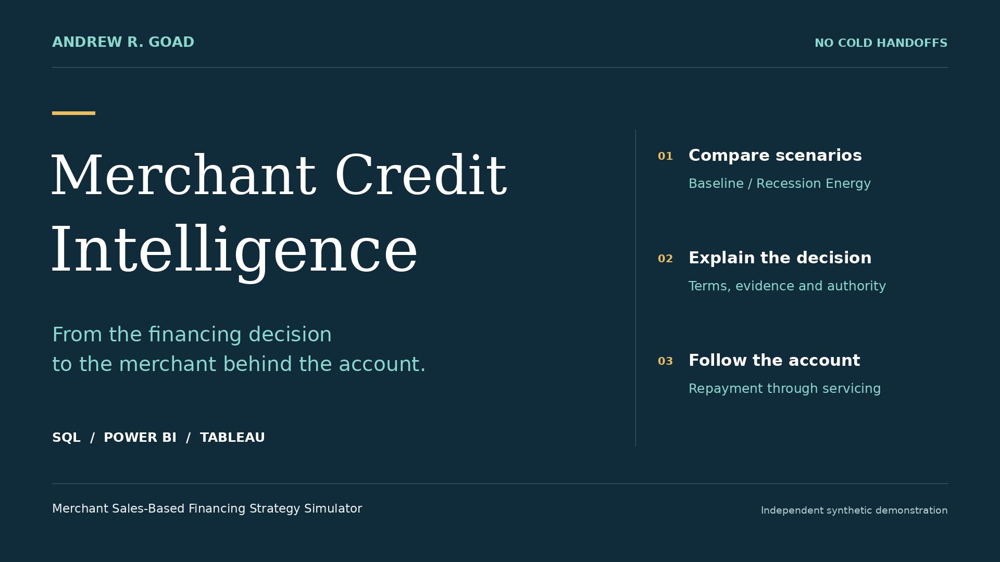

# Merchant Credit Intelligence · Narrated presentation

### From the financing decision to the merchant behind the account.

**Andrew R. Goad · 3 minutes 48 seconds · SQL, Power BI and Tableau**

Every financing request starts with a business trying to move forward. This presentation follows the evidence from a portfolio question to an individual merchant's financing terms, account history and servicing outcome.

**[Watch or download the presentation](https://raw.githubusercontent.com/andrew-goad/merchant-sales-based-financing-strategy-simulator/main/docs/presentation/Merchant_Credit_Intelligence.mp4)** · [Read the transcript](TRANSCRIPT.md) · [Download captions](https://raw.githubusercontent.com/andrew-goad/merchant-sales-based-financing-strategy-simulator/main/docs/presentation/Merchant_Credit_Intelligence.srt)

If GitHub offers a download instead of playback, save the MP4 and open it in your video player. For optional captions, save the SRT beside the MP4 with the same base filename and enable subtitles in a compatible player. The video keeps dashboard labels and tooltips unobstructed.

## Follow the business question

Power BI and Tableau present the **same SQL decision logic**. Power BI connects portfolio patterns to merchant decisions and the account that follows. Tableau adds a **side-by-side comparison of Baseline and Recession Energy stress**, making differences in outcomes, proposed terms and supporting evidence easier to investigate.

The demonstration retains detailed tooltips and the **Strategic Partner channel in both scenarios**. Merchant 098 illustrates how a smaller authorized counteroffer changes the simulated account path. Merchant 258 shows why finding proposed terms still does not confer permission to fund. The servicing view then connects review holds, permitted activity, payment return, retry and reconciliation.

## Chapters

| Start | What to watch for |
| --- | --- |
| 00:00 | Opening · Merchant Credit Intelligence |
| 00:03 | Portfolio and Strategic Partner · connect concentration to the scenario |
| 00:45 | Tableau · compare matched decisions and investigate their reasons |
| 01:46 | Merchant 098 · follow both alternative funded-account paths |
| 02:13 | Merchant 258 · distinguish proposed terms from funding permission |
| 02:31 | Same review category · understand the difference in proposed amounts |
| 02:56 | Lifecycle and monitoring · follow repayment, payoff and analytical judgment |
| 03:18 | Servicing · inspect return, retry and reconciliation |
| 03:30 | Closing · explore the work and connect |

## Explore the work

The closing card provides four branded QR destinations. These clickable links also work for viewers watching on a phone.

| Destination | What you can explore |
| --- | --- |
| [Tableau Public](https://public.tableau.com/app/profile/andrew.goad/viz/MCI_Risk_Decision_Scenario_Review/RiskDecisionScenarioReview) | Interactive, matched-scenario decision comparison. |
| [MSBF project](../../README.md) | Source logic, requirements, explanations and evidence; [Power BI package](../power_bi/m2_v2_1/README.md) and [viewing guide](../guide/CURRENT_USE.md#view-power-bi). |
| [Human-in-the-Loop Analytical Leadership](https://github.com/andrew-goad#human-in-the-loop-analytical-leadership) | Judgment Through Delivery: the case study and original review evidence. |
| [Andrew R. Goad on LinkedIn](https://www.linkedin.com/in/andrewrgoad) | Connect and continue the conversation. |

**Clear evidence. Thoughtful decisions.** Understanding what decisions mean for the merchant's business and the bank's portfolio.

## Scope and credits

Independent, deterministic synthetic demonstration; non-production and no real funds. Baseline and Recession Energy are alternative scenarios, not sequential account histories or forecasts. Review, authorization and funding are distinct. Lifecycle activity after the 23 July 2026 source cutoff is synthetic-forward through 22 November 2026.

This presentation is an additive portfolio companion. It does not change simulator versions, accepted source/report/workbook bytes, release authority or historical audit findings. [Asset credits](ASSET_CREDITS.md).

[Portfolio home](../../README.md) · [Documentation portal](../README.md) · [Analytical reading guide](../guide/ANALYTICS.md) · [Tableau companion](../tableau/README.md)
