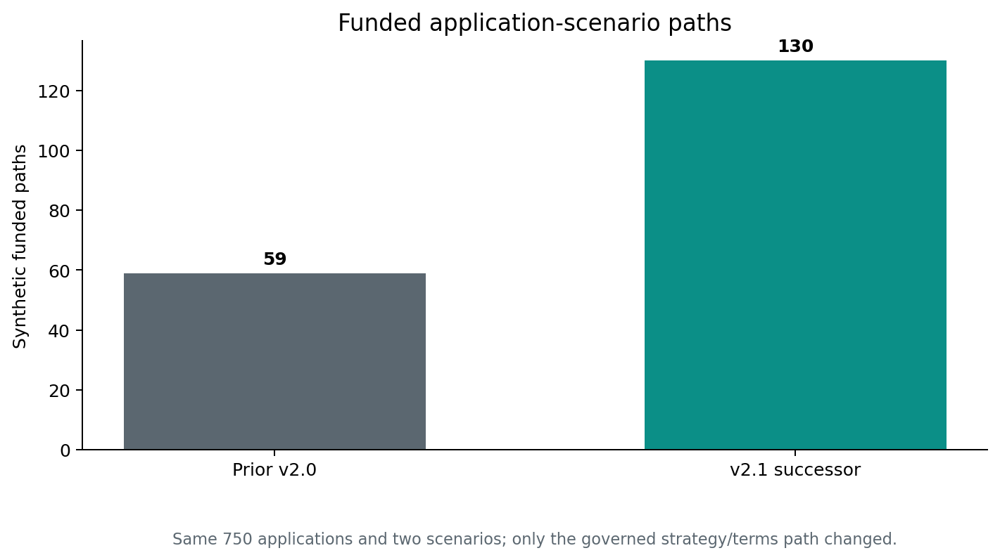
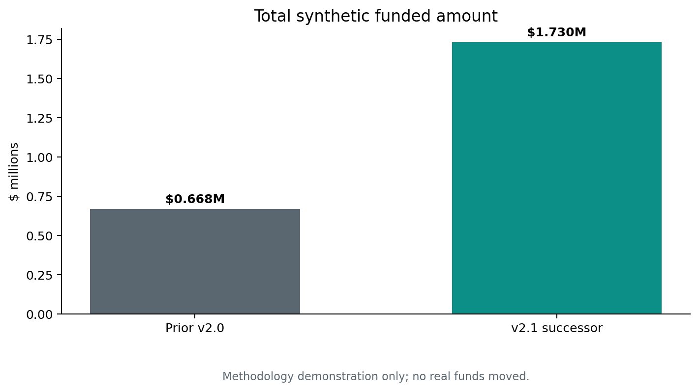
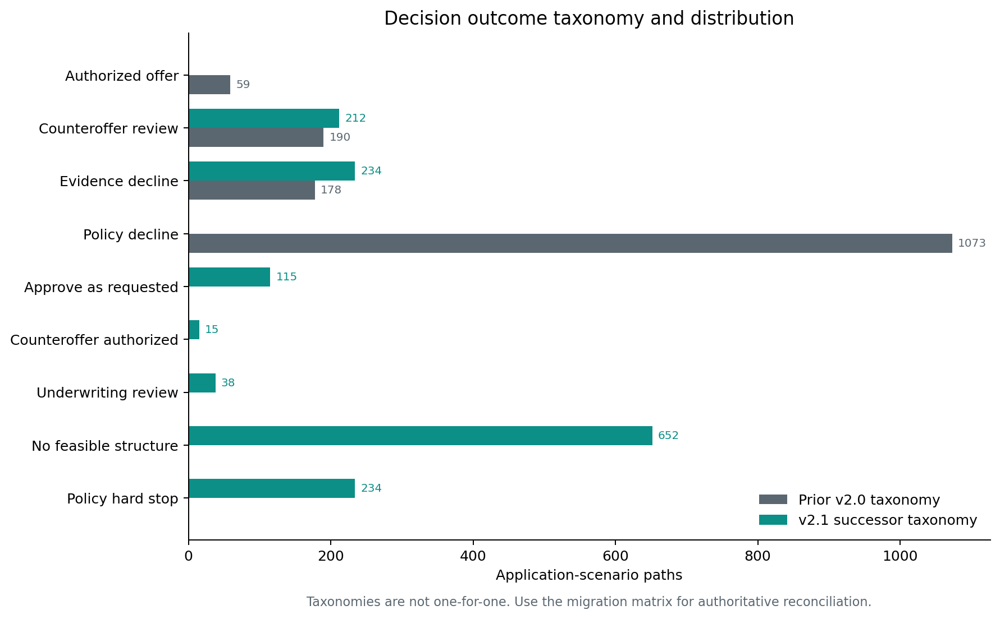
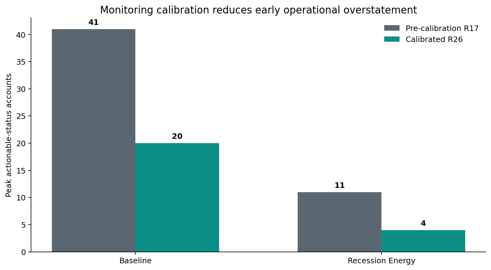
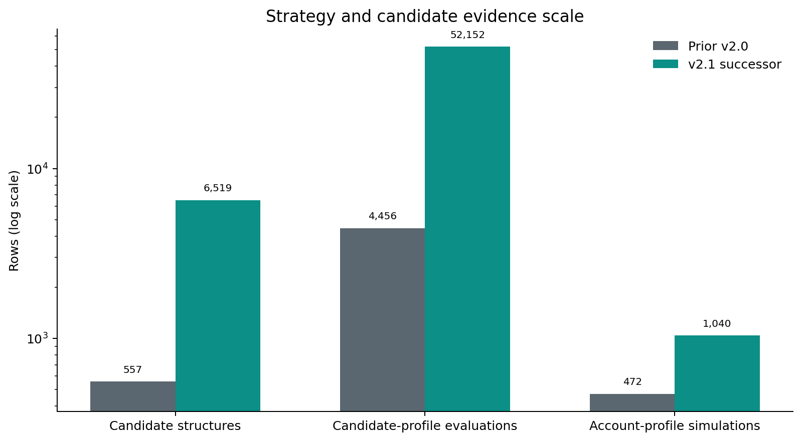

# MSBF Module 1/2 v2.1 Technical Successor
## Executive Change Brief: What changed from the public v2.0.0 release, why it changed, and what the evidence proves

**Report date:** 2026-09-04  
**Report version:** R1  
**Technical successor authority:** `IA-D-R15-M12-001` - `PASS_WITH_OBSERVATIONS`  
**Integration authority:** `IA-INT-R15-R26-001` - version-separated integration only  
**Publication:** Not authorized

> **Status boundary**  
> This report uses **v2.1** as the working stable-release family for the accepted R26 technical successor. The exact final public tag, Git commit, and release title are **not yet frozen**. Public Module 2 / G3 v2.0.0 remains controlling until a version-separated R26 repository/Power BI candidate passes bounded integration audit and an explicit release action activates supersession.

## Executive conclusion

The successor is not a cosmetic repackaging of the prior publication. It corrects the **business decision path**, expands the **candidate-search evidence**, rebuilds the **activated portfolio**, makes downstream operations **population-portable**, fixes one **deterministic cent-rounding defect**, recalibrates early monitoring to avoid overstating ordinary ramp-up risk, and issues a new **G3-v2 certification identity**.

The same 750 synthetic applications and two governed scenarios remain in scope. What changes is how the system distinguishes evidence limits, hard policy stops, structural feasibility, review authority, authorized offers, and post-funding monitoring.

The most important numerical changes are:

| Measure | Prior public v2.0.0 | v2.1 technical successor | Change |
| --- | --- | --- | --- |
| Applications / scenarios | 750 / 2 | 750 / 2 | No population expansion |
| Final decision classes | 4 | 7 | Authority and proof taxonomy made explicit |
| Candidate structures | 557 | 6,519 | +5,962 |
| Funded paths | 59 | 130 | +71 (120.3%) |
| Synthetic funded amount | $667,600 | $1,729,500 | +$1,061,900 (159.1%) |
| Daily monitoring rows | 7,080 | 15,600 | 130 paths x 120 days |
| Candidate-profile evaluations | 4,456 | 52,152 | +47,696 |
| Account-profile simulations | 472 | 1,040 | 130 paths x 8 profiles |
| G3-v2 controls | Not applicable | 70 / 70 PASS | New successor certification |

## What changed in plain language

### 1. The system now searches before declaring failure

The predecessor could classify many structure-remediable cases too early. The successor evaluates governed alternatives before concluding that no feasible structure exists. It retains a 40% minimum counteroffer amount, a 60% maximum exposure reduction, only 30/60/90-day horizons, an economic hurdle, authority-first dual-frontier selection, and no automatic repayment-cost increase.

This is why the candidate evidence expands from 557 rows to 6,519 rows and why 143 predecessor policy declines are recovered to a supportable structure or governed review path.

### 2. Decision authority is no longer compressed into four broad labels

The predecessor reported four broad outcomes. The successor reports seven: approved as requested, authorized counteroffer, counteroffer review, underwriting review, evidence decline, no feasible structure, and policy hard stop.

That distinction matters because a missing-evidence decline, a hard policy stop, a failed structure search, and a reviewable alternative are not the same business result.

### 3. More supportable paths produce a larger synthetic activated portfolio

Authorized funded paths increase from 59 to 130, and synthetic funded amount increases from $667,600 to $1,729,500. These are deterministic simulation results, not realized customer acceptance or real funding.

The stress scenario remains conservative: matched Recession Energy outcomes and funded amounts do not improve relative to their Baseline counterparts.

### 4. Operations were rebuilt, not merely rescaled

M2.5-M2.10 were recompiled from the corrected 130-path portfolio. Population-bound assumptions were removed, source hashes were rebound, stable application-scenario keys were preserved, and the full chain passed 115 of 115 controls.

A one-cent retry-rounding defect was corrected at its source. Exact-zero certification was retained rather than weakened by adding a tolerance.

### 5. Monitoring is now less prone to false early urgency

The calibrated policy begins pace monitoring from first expected remittance, uses selected total repayment divided by selected horizon for expected pace, begins pace WATCH eligibility on day 21, begins pace-adverse eligibility on day 30, and requires three consecutive days. Early no-remittance, zero-sales, liquidity, and horizon-overrun triggers remain.

For Baseline, the peak actionable-status population falls from 41 to 20 paths; for Recession Energy it falls from 11 to 4. Final endpoint outcomes remain unchanged from the already accepted R17 rebuild.

### 6. Strategy-analysis volume expands, but its public interpretation is deliberately constrained

M2.11 evaluates 6,519 candidates under eight governed profiles, producing 52,152 candidate-profile rows, 12,000 application-profile rows, and 1,040 account-profile rows.

However, in the accepted R26 population the profiles do not change the high-level decision outcome across any of the 1,500 application-scenario paths. They do change the selected candidate on 249 paths and the selected amount on 247 paths. Therefore the current P05/P06 showcase is held: the profiles are valid offer/terms optimization and bounded account-treatment evidence, but not yet a mature decision-strategy challenger.

## Why the numbers are reliable

The report does not rely on narrative estimates. The major findings are independently recomputed from physical predecessor and successor files:

1. The 1,500-row predecessor-successor decision file is crosstabbed into a complete migration matrix whose row and column totals reconcile.
2. Funded counts and amounts are summed directly from 130 physical M2.4 advance rows.
3. Monitoring totals and endpoint values are recomputed from 15,600 physical daily rows.
4. R17 and R26 daily monitoring facts are compared field by field at the exact application-scenario-day key.
5. M2.6-M2.10 R17 and R26 exports are compared cell by cell and remain exact.
6. R26 policy, source, simulation, control, Power BI, report, and certification identities match the focused Independent Audit decision.
7. Failed-run provenance is retained: R26 R2 remains FAIL, while the accepted retained-final resume is separately identified.
8. No accepted v2.0.0 stage directory was modified in the pre-R26 repository candidate.

## What did not change

- Module 1 / G2 accepted logic, evidence, contracts, and population.
- The 750-application, two-scenario comparison base.
- Deterministic synthetic and non-production boundaries.
- No-real-funds, no-external-notice, no-production-action controls.
- Stress non-improvement requirements.
- Exact-zero payment reconciliation.
- The eight-profile M2.11 method; only its source population and semantic identity changed.
- Public v2.0.0 authority, which remains controlling until explicit supersession.

## Decision requested from reviewers

Treat this package as the comprehensive technical change specification and evidence reconciliation for the future v2.1 integration candidate. It is ready to inform the version-separated repository build and subsequent bounded integration audit. It does not itself authorize publication or supersession.
